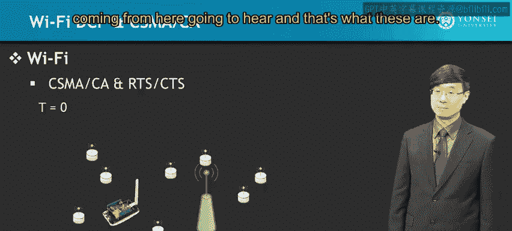

# 101：29_4.2 Wi-Fi DCF CSMA-CA（第2部分）📡

## 概述

在本节课中，我们将继续学习Wi-Fi中DCF（分布式协调功能）的核心机制——CSMA/CA（载波侦听多路访问/冲突避免）。我们将重点探讨帧间间隔、竞争窗口和时隙时间等概念，这些机制共同协作，以确保多个设备能够有序、高效地共享无线信道。

## 帧间间隔与优先级

上一节我们介绍了CSMA/CA的基本流程，本节中我们来看看帧间间隔如何决定通信的优先级。

帧间间隔用于设定通信的优先级。可以这样理解：如果两个人在快速对话，他们发送和回复的节奏非常快，那么其他人就很难在不打断他们的情况下插入对话，因为话语很容易重叠。然而，如果他们的对话节奏很慢，每说一句话后都有较长的等待和回复间隔，那么由于间隔时间较宽，其他人就更容易插入并发送自己的信息，甚至可以“劫持”对话。

在Wi-Fi中，帧间间隔就是数据包之间的一段很短的时间间隔。这个间隔时间的长短决定了优先级。

*   **短帧间间隔**：`SIFS` 是最短的帧间间隔。使用SIFS的通信序列（如RTS、CTS、数据、ACK的交换）发送和回复速度极快。一旦一个通信会话以SIFS间隔进行，其他设备就无法干扰，必须等待该会话结束。
*   **DCF帧间间隔**：`DIFS` 比SIFS长。在一个使用SIFS的快速通信会话结束后，会有一段较长的DIFS间隔，之后才会开始新的通信会话竞争。

因此，如图所示，通信过程会遵循 `DIFS` -> `SIFS` 这样的间隔模式。

## 竞争窗口（退避窗口）

除了帧间间隔，还有一个关键机制是竞争窗口，也称为退避窗口。

竞争窗口之所以存在，是因为当检测到有多个设备试图通信时，需要决定谁先发送。以下是其工作流程：

1.  首先设定一个初始的竞争窗口持续时间。
2.  每个想要发送数据的设备会在这个窗口期内随机选择一个数字。
3.  设备会等待与其所选数字对应的时间长度。
4.  等待结束后，设备检查信道是否空闲。如果空闲，则开始使用信道；如果繁忙，则重新进入退避流程。

由于每个设备随机选择数字，它们通常会选择不同的值。这样，幸运地选到较小数字的设备会比选到较大数字的设备更早尝试通信，从而避免了冲突。这段“等待所选随机数对应时间”而不发送的过程，就是我们所说的**退避窗口**。

当然，存在一种可能性：不同设备随机选择了相同或相近的数字，从而导致数据包碰撞。为了避免这种情况：

*   如果检测到信道繁忙或发生碰撞，下一次竞争窗口的尺寸会**加倍**。
*   所有设备在这个加倍的窗口内重新选择随机数。由于窗口变大，再次选择相同数字导致碰撞的概率会大大降低。
*   如果再次失败，窗口尺寸会继续加倍，这个过程最多重复**10次**。
*   当窗口尺寸达到最大值（加倍10次后），将保持该最大尺寸，并在此窗口内重新选择随机数，最多再尝试**6次**。
*   如果经过这总共16次（10次加倍尝试 + 6次最大窗口尝试）尝试后仍然失败，设备将放弃本次通信，并从头开始流程。

这就是Wi-Fi（以及你的智能手机）每天都在使用的CSMA/CA操作机制。

## 时隙时间与参数关系

继续深入，我们还需要了解**时隙时间**。

时隙时间是一个基本的时间单位，是最小的时间量度。它就像一个时间单元，用于构建其他时间间隔：

*   多个时隙时间可以组成一个竞争窗口。
*   DIFS和SIFS等帧间间隔也是时隙时间的倍数。

具体来看：
*   `SIFS`（短帧间间隔）用于需要立即响应的动作，例如在RTS、CTS、数据帧交换的会话中，回复必须在SIFS内发出。
*   `DIFS`（DCF帧间间隔）是基于竞争服务的最小空闲时间。

查看图中参数，时隙时间非常短，单位是微秒。根据不同的IEEE 802.11 Wi-Fi模式（如a/b/g/n），这些数值可能略有不同。SIFS和DIFS也以微秒为单位。

它们的关系如下：
*   **SIFS** 通过在其传输机会内保持最短的帧间间隔，来维持最高的信道使用优先级。因为它最短，所以能保证通信序列不被其他设备打断。
*   **DIFS** 比SIFS长，其长度等于 **SIFS + 2个时隙时间**。

所以，从时长上看：**时隙时间 < SIFS < DIFS**。DIFS比SIFS多的部分，正是那额外的2个时隙时间。

## 总结

本节课我们一起学习了Wi-Fi DCF中CSMA/CA机制的另外几个核心部分：
1.  **帧间间隔**：`SIFS` 和 `DIFS` 通过不同的时间长度来设定通信优先级，确保高优先级的会话（如ACK）不被中断。
2.  **竞争窗口（退避窗口）**：设备通过在此窗口内随机选择等待时间来避免冲突。如果发生冲突，窗口尺寸会指数级增长（加倍），以降低再次碰撞的概率。
3.  **时隙时间**：作为基本时间单位，用于构建竞争窗口和各类帧间间隔。

这些精妙的时序机制共同作用，使得多个Wi-Fi设备能够在没有中心控制器的情况下，公平、有效地共享无线信道，这也是我们日常无线网络能够顺畅运行的基础。