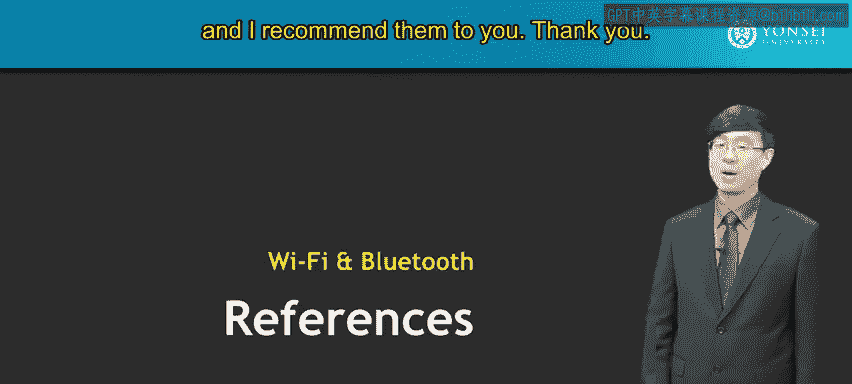

# 延世大学《新兴技术从智能手机到物联网再到大数据》课程 P102：4.2 Wi-Fi DCF CSMA-CA（第3部分）📡

在本节课中，我们将学习Wi-Fi分布式协调功能（DCF）中，使用RTS/CTS机制来避免隐藏节点问题的具体操作流程。我们将通过时序图，详细解析一次完整的数据交换过程。

上一节我们介绍了RTS/CTS的基本概念，本节中我们来看看这个机制在实际通信中是如何一步步运行的。

## 操作流程详解

现在，让我们通过下面的示意图来观察这个机制的实际运作。

在通信会话开始时，分布式帧间间隔（DIFS）计时器被启动。这意味着，在前一个会话结束后，设备需要等待一个基本的DIFS时间段。

随后，发起通信的设备会发送一个“请求发送”（RTS）信号。自然地，处在该设备附近的其他设备会侦听到这个RTS信号。

以下是RTS信号触发的一系列动作：

*   **设置网络分配向量（NAV）**：侦听到RTS信号的设备会设置自己的NAV计时器。NAV是一个虚拟的载波侦听机制，它告诉设备在NAV计时结束前不要发送任何数据，从而避免与即将发生的通信产生碰撞。
*   **保护通信窗口**：这样做的目的是保护即将在这台设备与目标设备之间交换的数据包。

RTS信号的传输时间会被计入总耗时。紧接着，在一个短帧间间隔（SIFS）之后，通信的另一端——即目标接收设备——会立即回复一个“允许发送”（CTS）信号。

这个CTS信号是对收到的RTS请求的回复。同样地，处在这个目标设备周围（图中蓝色虚线范围内）的设备也会侦听到CTS信号。

以下是CTS信号带来的影响：

*   **扩展保护范围**：这些设备也会设置自己的NAV计时器，从而抑制自身的数据发送，避免与正在进行RTS/CTS握手的两台设备发生碰撞。

CTS信号的传输时间也被加入总耗时。再经过一个SIFS短间隔后，数据包才会被正式发送。

此时，数据包是受到保护的，因为周围设备由于设置了NAV而处于静默状态。数据包发送完毕后，会再经过一个非常短的SIFS间隔。

然后，接收方会发送一个确认（ACK）包，回传给发送数据包的站点，以确认数据包已无误接收。ACK包的传输时间也会被计入。

在ACK包交换完成后，整个数据交换过程结束。之后，再经过一个DIFS时间段，下一个通信会话便可以开始。

## 时序图分析

为了更好地从时间维度理解，我们来看一个时序流程图。图中时间轴向下延伸，我们选取了三个有代表性的节点：
*   **节点A**：代表靠近接收端的邻居节点。
*   **节点B**：代表远离通信双方的另一个邻居节点。
*   **节点C**：代表靠近即将发送RTS的发送端的邻居节点。

让我们看看这个操作在时间上是如何工作的：

1.  **等待与发起**：在前一个会话结束后，发送端等待一个DIFS时间，然后发送RTS信号。这个信号会到达它想要通信的目标节点。
2.  **首次NAV设置**：基于这个时刻，发送端周围的设备（如节点C）会设置一个NAV持续时间，在此期间它们不会发送任何信息。
3.  **回复与二次保护**：经过一个SIFS持续时间后，目标节点回复CTS信号。这将触发它周围的设备（如节点A）也设置NAV，以确保不会发生碰撞，从而保护整个通信会话。这也是为什么节点A会在这个NAV期间抑制发送。
4.  **安全传输数据**：此时信道已确保安全，不会发生碰撞，因此可以继续发送数据包。数据包在一个SIFS周期后发出。
5.  **确认与结束**：数据包被接收后，再经过一个SIFS周期，接收方会发回确认（ACK）包。
6.  **释放信道**：此后，会话完成。发送方安全地发送了数据包，并且通过返回的ACK确认包知道数据已被安全接收。然后，经过一个DIFS周期，其他设备就可以使用这个信道了。

## 总结

本节课中我们一起学习了Wi-Fi中RTS/CTS机制的具体工作流程。通过DIFS等待、RTS/CTS握手交换、NAV设置、数据安全传输以及ACK确认这一系列步骤，有效解决了隐藏节点问题，保障了在竞争信道环境下的可靠通信。整个流程的核心在于利用控制帧（RTS/CTS）为后续的数据传输预先预约并保护信道资源。

这些是我使用的参考资料，也推荐给你。谢谢。