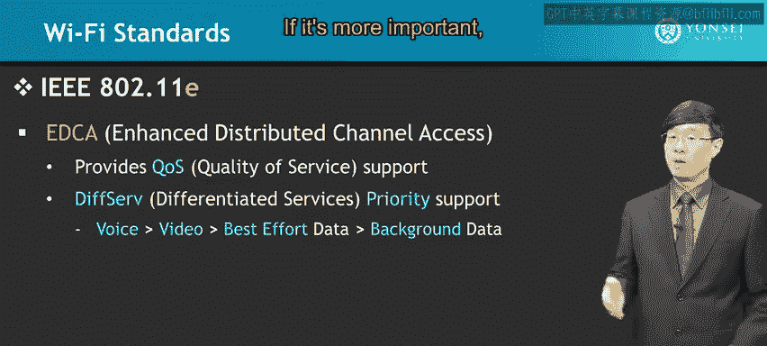
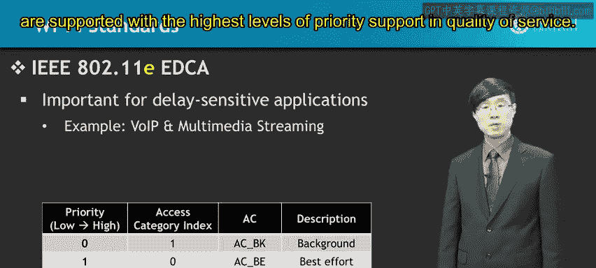
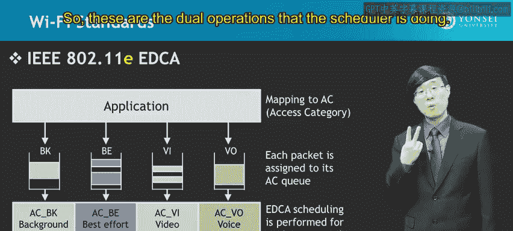
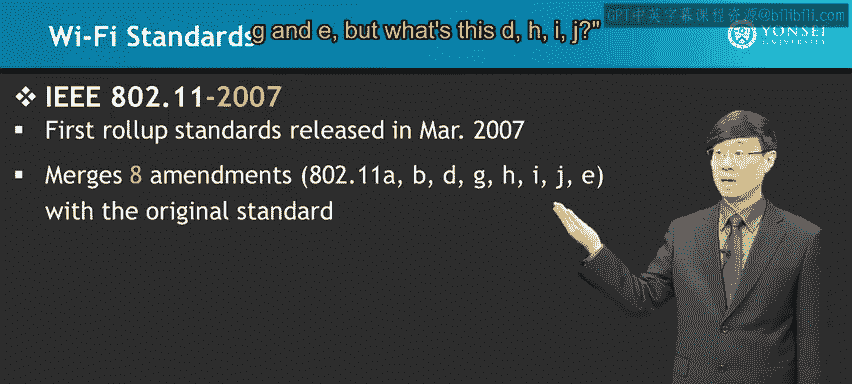

# 课程31：Wi-Fi标准（第1部分）📡

在本节课中，我们将学习Wi-Fi技术的基础标准，即基于IEEE 802.11系列的标准。我们将了解不同Wi-Fi标准的发展历程、核心技术特点、支持的数据速率以及它们如何满足各种应用需求。课程内容涵盖从最初的802.11标准到后续的关键修订版，如802.11a、b、e、g等，并解释它们如何共同构成了现代Wi-Fi网络的基石。

---

## Wi-Fi标准概述

Wi-Fi标准是基于IEEE 802.11系列的技术规范。这些标准规定了构建一个无线系统需要满足的协议和要求，包括数据包结构、介质访问控制、信道、调制方式以及数据速率等。

数据速率方面，我们已经知道：
*   802.11a最高可达 **54 Mbps**
*   802.11b最高可达 **11 Mbps**
*   802.11g最高可达 **54 Mbps**
*   802.11n最高可达 **150 Mbps**
*   802.11ad最高可达 **7 Gbps**

---

## 原始标准：802.11-1997

上一节我们概述了Wi-Fi标准，现在让我们从最初的版本开始深入了解。802.11-1997标准于1997年6月发布，是IEEE 802.11 Wi-Fi标准的原始版本。

该标准支持 **1 Mbps** 或 **2 Mbps** 的数据速率。它使用CSMA/CA（载波侦听多路访问/冲突避免）协议，并在2.4 GHz ISM（工业、科学和医疗）频段或红外频段上工作。

以下是其物理层调制方案：
*   在2.4 GHz频段使用**跳频扩频**
*   在2.4 GHz频段使用**直接序列扩频**
*   在红外频率范围使用**红外通信**

---

## 802.11a标准

接下来，我们看看802.11a标准。它于1999年9月发布，是对原始标准的一项修订。

该标准支持前向纠错编码，并定义了OFDM通信的要求。OFDM（正交频分复用）是当时新兴的宽带、高数据速率通信技术，至今仍保持着重要性和普及度。

OFDM的使用将数据速率提升至 **54 Mbps**。这种增强的数据速率使得支持多种多样的多媒体应用成为可能，因此极具吸引力。该标准在 **5 GHz ISM频段** 工作，这一点很重要，因为后续我们将讨论能同时支持5 GHz和2.4 GHz频段的协议。

---

## 802.11b标准

现在，我们来看802.11b标准。它同样于1999年9月发布，在调制技术方面是对原始标准的直接扩展。

它使用了HR-DSSS（高速直接序列扩频）和CCK（互补码键控）调制技术。与之前1或2 Mbps的数据速率相比，802.11b的数据速率最高可达 **11 Mbps**。它像原始的802.11-1997标准一样，在 **2.4 GHz频段** 工作。

---

## 802.11e标准与服务质量

在了解了基础的数据速率标准后，我们转向一个关键的功能性标准：802.11e。这个协议支持EDCA（增强型分布式信道接入），你可以将其视为对原始DCF协议的增强，旨在支持需要服务质量的应用。

区分服务是一种技术支持优先级处理。对于更重要的应用，必须有一种方法来支持更高级别的可靠性，以确保服务质量。

典型的服务优先级设置如下：
*   语音
*   视频
*   尽力而为的数据
*   后台数据

802.11e协议中引入的EDCA技术，后来被纳入了802.11-2007标准汇总版，并用于包含802.11n、11p、11ac等标准中。因此，虽然你可能不常直接看到“802.11e”这个名称，但它正是让你频繁使用的这些协议能够提供优秀服务质量支持的原因。

让我们看看它是如何工作的。观察EDCA，优先级类型有哪些？最高优先级是语音，对应访问类别 **AC_VO**。其次是视频，对应访问类别 **AC_VI**。第三是尽力而为的数据支持，对应访问类别 **AC_BE**。最低优先级是后台数据流量，对应访问类别 **AC_BK**。

优先级数字是3、2、1、0，但访问类别索引号是3、2、0、1。总体而言，优先级顺序是语音最高，其次是视频，然后是尽力而为，最后是后台。记住这一点很重要，尽管查看AC索引时可能会因为1和0与实际优先级顺序相反而感到些许困惑。

这对于延迟敏感的应用（如IP语音、多媒体）至关重要。当我们说多媒体时，它包括语音和视频，这就是为什么它如此重要，因为这两个类别在服务质量支持中享有最高的优先级。

---

### EDCA系统结构

EDCA定义了四个具有访问类别的优先级。系统结构如下：当应用程序发送数据时，会识别它是语音、视频、尽力而为还是后台数据，并据此进入不同的队列。进入哪个队列决定了你获得的服务优先级。

在拥有这些访问类别之前，在使用802.11e之前，我们用什么？在以前的情况下，只有一个队列，所有数据都进入那个队列，采用先到先服务的原则。这里我们进行了区分，使得如果你在更高优先级的队列中，下方的调度器会优先发送你的数据。

调度器会查看每个队列中的内容，如果你在更高优先级的队列中，就会被优先发送。这就是EDCA调度器的作用，它决定使用哪个队列。如果在同一访问类别内部需要解决冲突或优先级控制，这些单元也会进行内部冲突解决。

因此，调度器有双重目的：一是区分不同的队列以服务不同的访问类别；二是在同一类别内解决内部冲突。这就是调度器执行的双重操作。

---

## 802.11g标准

接下来是802.11g标准。它于2003年6月发布，是对802.11b的修订。

它在 **2.4 GHz ISM频段** 工作，与802.11b类似，并且支持硬件兼容性，这一点很好。它使用了OFDM调制技术。制定11g技术的目的之一，就是因为我们在11a中使用OFDM取得了巨大成功，达到了54 Mbps。所有开发者都在想，这很酷，让我们把5 GHz频段（即11a）的技术也搬到2.4 GHz频段，在这个频段也实现54 Mbps的数据速率。

他们确实做到了。但为了实现这一点，他们必须非常明智地选择信道，因为在802.11g中，通过信道选择以智能的方式进行干扰预防。这是什么意思？有14个信道，它们像这样重叠。在这些信道中，哪些是不重叠的？让我们使用它们，因为共同使用该协议频率的用户之间的干扰会更小。

结果证明是信道 **1、6和11**，就是这些信道。你可以看到它们并不重叠。需要说明的是，这里绘制的是主瓣（频谱中能量最集中的主要低频带）。当然，这些频谱主瓣还有较低的旁瓣，它们向两侧延伸得很广。

这就是为什么我说这些是基于主瓣不重叠的“非重叠信道”。当然，经过滤波和掩蔽抑制的旁瓣确实会相互重叠，相互干扰。但再次强调，当我说非重叠信道时，我指的是它们的主瓣。

---

## 802.11-2007汇总标准

最后，我们来看IEEE 802.11-2007，这是第一个于2007年3月发布的汇总标准。

“汇总”是什么意思？汇总意味着我们将原始标准的八个修订版合并在一起。也就是说，我们将802.11a、b、d、g、h、i、j、e这些标准合并成了一个标准，即802.11-2007协议。

你可能在想，我听说过a、b、g和e，但d、h、i、j是什么？让我们解释一下：
*   **802.11d**（2001年发布）：在数据包中添加了国家信息。
*   **802.11h**（2003年发布）：提供了DFS（动态频率选择）和TPC（发射功率控制）技术。这指的是扫描整个频段选择无人使用的信道进行传输，以及根据情况使用合适的功率水平，而非固定功率。
*   **802.11i**：包含了安全性增强。
*   **802.11j**：为日本4.9 GHz频段提供支持。
*   **802.11e**：我们已经解释过，用于支持服务质量的访问类别优先级。

所有这些都被合并到了这个标准中，这很酷，也是为什么这个标准如此重要。

---

## 总结

本节课中，我们一起学习了Wi-Fi技术的基础——IEEE 802.11系列标准的第一部分。我们从最初的802.11-1997标准开始，了解了其基本速率和调制方式。随后，我们探讨了提升数据速率的802.11a（使用OFDM，5 GHz频段）和802.11b（2.4 GHz频段）标准。接着，我们深入学习了关键的802.11e标准，它通过EDCA和访问类别（AC_VO， AC_VI， AC_BE， AC_BK）为语音、视频等应用提供了服务质量保障。然后，我们看到了结合两者优点的802.11g标准（在2.4 GHz频段使用OFDM达到54 Mbps）及其智能信道选择（1，6，11信道）。最后，我们了解了802.11-2007作为第一个汇总标准，如何将a、b、d、g、h、i、j、e等多个重要修订版整合为一体，奠定了现代Wi-Fi协议的基础。