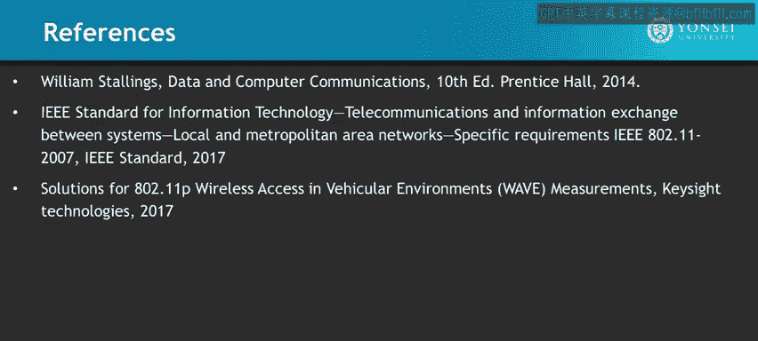

# 104：32_4.3 Wi-Fi标准（第2部分）📡

在本节课中，我们将继续学习一系列重要的Wi-Fi标准。我们将了解这些标准如何通过引入新技术（如MIMO和OFDM）来提升数据传输速率、扩展应用场景，并特别关注为物联网和车联网设计的协议。

上一节我们介绍了早期的Wi-Fi标准，本节中我们来看看后续发展出的更先进、更快速的标准。

---

### 802.11N标准

802.11N标准于2009年10月发布。它通过使用MIMO技术（多输入多输出技术）来提升网络吞吐量。该技术使用多根天线进行发送和接收，从而实现了更高的数据速率和扩展的数据服务。此标准在2.4 GHz和5 GHz频段均可运行，是支持双频操作的最合适标准之一，最高数据速率可达**150 Mbps**。

### 802.11P标准

802.11P协议于2010年7月发布，旨在支持WAVE（车载环境无线接入）。因此，它主要应用于各种智能汽车、智能交通系统和自动驾驶车辆。该标准在5.9 GHz信道运行，采用OFDM（正交频分复用）技术和源自802.11E的EDCA（增强分布式信道访问）机制来提供基于优先级的服务质量。其最大数据速率为**54 Mbps**，并支持V2X（车联万物）通信。

以下是V2X通信中“X”所代表的几种可能：

*   **V2V**：车辆到车辆通信，车辆通过车载智能设备（如车载单元）进行通信。
*   **V2I**：车辆到基础设施通信，基础设施可以是基站或接入点（即路边单元RSU）。
*   **V2P**：车辆到行人通信，行人通过智能手机、智能手表等设备与车辆连接。

### 802.11AC标准

802.11AC标准于2013年12月发布，是在802.11N基础上的修订版，专注于更高的吞吐量和数据速率。其新特性包括支持更宽的5 GHz信道带宽（从11N的40 MHz提升至80或160 MHz），并采用了多用户MIMO技术和高密度调制技术。因此，其数据速率可以非常高，在使用160 MHz带宽时最高可达**866.7 Mbps**。

### 802.11AD标准

802.11AD标准于2012年发布，基于WiGig规范，并于2013年3月被Wi-Fi联盟吸纳。它使用60 GHz的ISM频段，结合传统Wi-Fi网络，可支持高达**7 Gbps**的数据速率。为了实现如此高的速率，必须使用60 GHz的高频段，因为高频段能提供更宽的带宽。其速率是802.11N的10倍，支持需要宽带服务的无线互联家庭应用。

### 802.11AH标准

802.11AH协议专为支持物联网技术而设计，于2016年12月发布。它在900 MHz频段运行，带宽较窄，通常为1至16 MHz，也可使用低于1 GHz的替代频谱来分流流量。作为物联网技术，低功耗自然是其必备特性。

以下是其低功耗模式的一些关键特性：

*   **中继功能**：用于扩展服务范围。
*   **唤醒与休眠周期协议**：在不需要访问信道时节省能量。

802.11AH协议能使用单个接入点为数千个物联网设备提供连接。其目标应用是在1平方公里区域内支持多达100万台设备。它支持M2M（机器对机器）通信以及智能电表、智能家居等物联网市场设备，数据速率最高可达**347 Mbps**，足以同时支持多种不同类型的物联网应用。

---

本节课中我们一起学习了从802.11N到802.11AH的一系列关键Wi-Fi标准。我们看到了它们如何通过MIMO、更宽带宽和专用频段来大幅提升速度，也了解了为特定场景（如车联网的802.11P和物联网的802.11AH）设计的协议如何优化功耗和连接规模。这些标准共同构成了现代无线通信多样化和高性能的基础。