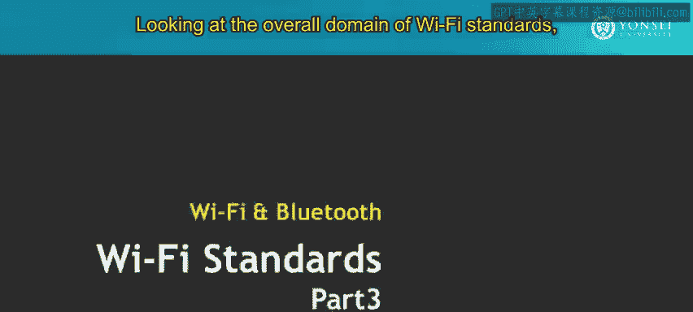
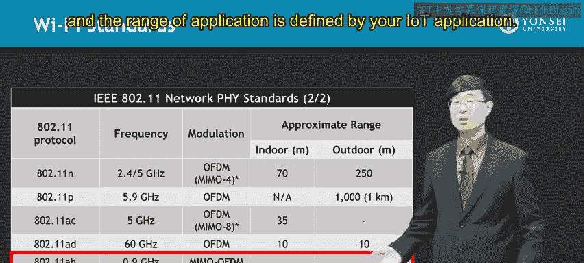
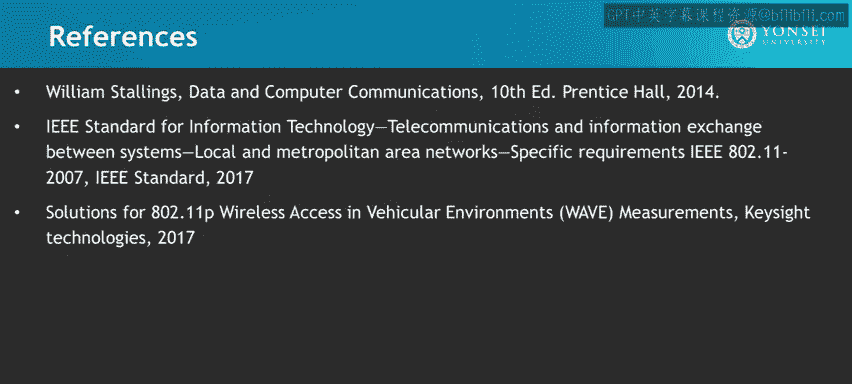

# 延世大学《新兴技术从智能手机到物联网再到大数据》 - P105：33_4.3 Wi-Fi标准（第3部分）📡




在本节课中，我们将继续深入学习Wi-Fi标准，重点回顾不同协议的发展历程、关键参数（如频率、带宽和数据速率），并探讨双频段技术、Wi-Fi Direct和网络共享等高级功能。我们将通过清晰的表格和对比，帮助你理解这些标准如何演变以满足不同的应用需求。

---

## Wi-Fi标准演进概览

上一节我们介绍了Wi-Fi的基本概念，本节中我们来看看其具体的技术标准是如何随着时间演进的。以下是主要Wi-Fi协议的关键参数汇总，包括发布日期、工作频率、带宽和最大数据速率。

| 协议标准 | 发布日期 | 频率 | 最大数据速率 |
| :--- | :--- | :--- | :--- |
| 802.11 | 1997 | 2.4 GHz | 1-2 Mbps |
| 802.11a | 1999 | 5 GHz / 3.7 GHz | 54 Mbps |
| 802.11b | 1999 | 2.4 GHz | 11 Mbps |
| 802.11g | 2003 | 2.4 GHz | 54 Mbps |
| 802.11-2007 | 2007 | 2.4 GHz & 5 GHz | 54 Mbps |
| 802.11n | 2009 | 2.4 GHz & 5 GHz | 72.2 - 150 Mbps |
| 802.11p | 2010 | 5.9 GHz | 54 Mbps |
| 802.11ac | 2013 | 5 GHz | 高达数百Mbps |
| 802.11ad | 2012 | 60 GHz | 高达 7 Gbps |
| 802.11ah | 2016 | 低于 1 GHz | 较低速率，针对IoT优化 |

**关键点解析：**
*   **802.11a/b/g**：奠定了Wi-Fi在2.4GHz和5GHz频段的基础，数据速率提升至54Mbps。
*   **802.11n**：是一个重要里程碑，引入了MIMO技术，支持**双频段（2.4GHz和5GHz）**，数据速率首次突破百兆大关。
*   **802.11p**：专为智能交通系统设计，**牺牲了数据速率以换取更远的通信距离**（车辆间可达数百米，车与基础设施间可达公里级），用于车辆防撞和自动驾驶。
*   **802.11ac/ad**：追求极高的数据速率（可达Gbps级别），其中802.11ad使用60GHz频段，但信号穿透力极差，范围很短。
*   **802.11ah**：为物联网设备设计，**以低功耗和广连接为核心**，牺牲数据速率以支持海量设备接入。

---

## 通信范围对比

了解不同标准的通信范围对于规划网络覆盖、避免信号盲区至关重要。以下是各协议在室内和室外环境下的典型通信距离。

| 协议标准 | 室内范围（约） | 室外范围（约） | 备注 |
| :--- | :--- | :--- | :--- |
| 802.11 | 20 米 | 100 米 | 原始标准 |
| 802.11a | 35 米 | 视频率而定 | 5GHz频段 |
| 802.11b | 35 米 | 140 米 | 2.4GHz频段 |
| 802.11g | 35 米 | 140 米 | 同11b范围，但速率更高 |
| 802.11n | 70 米 | 250 米 | MIMO技术，双频段优势 |
| 802.11p | 不适用 | 300米 - 1公里以上 | 专为车外通信设计 |
| 802.11ac | 35 米 | - | 主要使用5GHz |
| 802.11ad | 极短（约房间内） | - | 60GHz，易被障碍物阻挡 |
| 802.11ah | 视具体应用而定 | 视具体应用而定 | 针对IoT，范围可变 |

**关键点解析：**
*   **802.11n** 凭借MIMO技术，显著提升了有效通信范围。
*   **802.11p** 的室外长距离特性是其应用于车联网的关键。
*   **802.11ad** 虽然速率极高，但60GHz信号几乎无法穿透墙壁，**通信范围非常有限**，类似于无线个域网技术。

---

## 双频段技术详解

在了解了各个独立的标准后，我们来看看一个重要的实践特性：双频段。普通Wi-Fi设备通常只支持单一频段（2.4GHz或5GHz），而双频段设备则能同时支持两者。

**支持双频段的关键协议是 802.11n**（以及之后的802.11ac等）。它像一个共同的桥梁：

*   **2.4 GHz 频段协议**：802.11b, 802.11g, **802.11n**
*   **5 GHz 频段协议**：802.11a, **802.11n**, 802.11ac



一个支持802.11n的双频接入点可以同时为工作在2.4GHz的老设备（如旧手机、IoT设备）和工作在5GHz的新设备（如新款笔记本、平板）提供服务，并通过扩展服务集连接到互联网。这使得网络部署更加灵活高效，能更好地支持多种设备，这也是为什么支持双频段的路由器通常更受欢迎且价格稍高的原因。

---

## Wi-Fi Direct 与 网络共享

除了通过接入点连接，Wi-Fi还支持设备间直接通信和共享网络连接。

**1. Wi-Fi Direct**
Wi-Fi Direct 允许设备在没有传统无线接入点的情况下，直接与其他设备建立点对点连接。你可以将其视为对早期“Ad-hoc”模式的增强和标准化。
以下是Wi-Fi Direct的主要连接类型：
*   **一对一**：两台设备直接连接，如手机直接连接打印机进行打印。
*   **群组**：多台设备同时连接形成一个群组，共享文件或进行游戏。

**2. 网络共享**
网络共享是一种关键的技术，你可能已经在智能手机上使用过它，即 **“开启个人热点”**。
这项技术允许你将设备（通常是手机）的移动网络连接（如4G/5G）或已有的Wi-Fi连接，通过Wi-Fi信号共享给其他设备使用。这样，没有蜂窝数据功能的设备（如平板、笔记本电脑）就可以通过你的手机连接到互联网。

```
典型流程：智能手机（开启热点） -> 作为虚拟路由器 -> 其他Wi-Fi设备连接 -> 访问互联网
```

---




本节课中我们一起学习了Wi-Fi标准的演进历程，从早期低速协议到现代高速、双频及专用协议。我们对比了不同标准的速率和范围，理解了**802.11n**在双频支持上的关键作用，**802.11p**为车联网做出的距离优化，以及**802.11ah**面向物联网的低功耗设计。最后，我们还探讨了**Wi-Fi Direct**和**网络共享**这两种实用的直接连接与网络扩展功能。掌握这些知识，有助于你根据实际应用场景选择和部署合适的Wi-Fi技术。