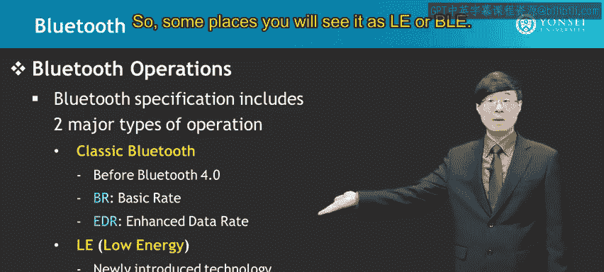
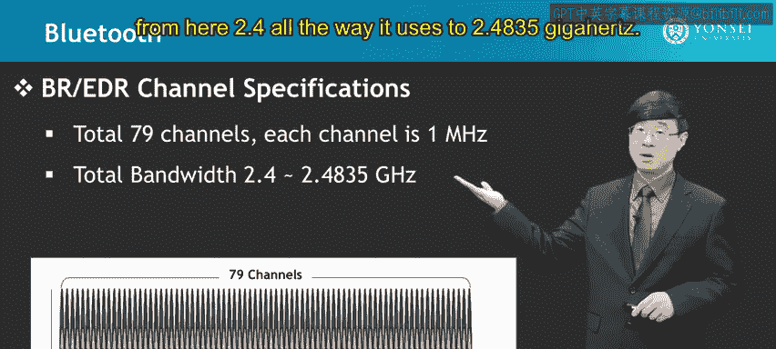
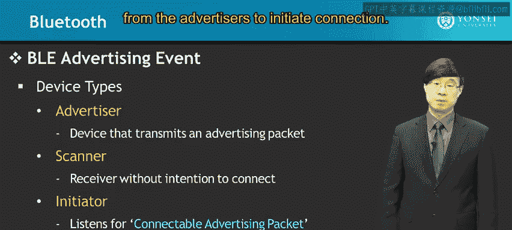
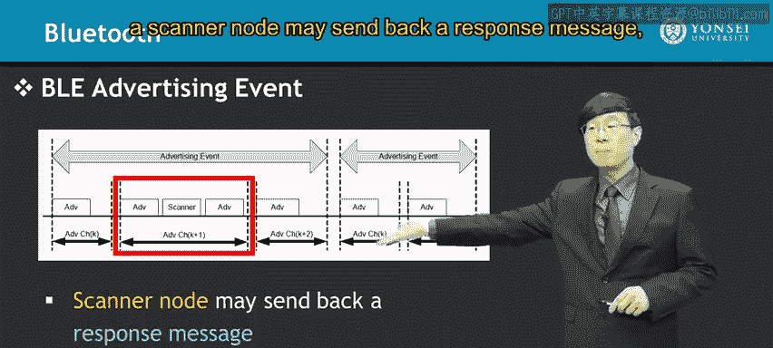
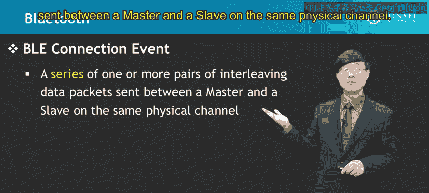
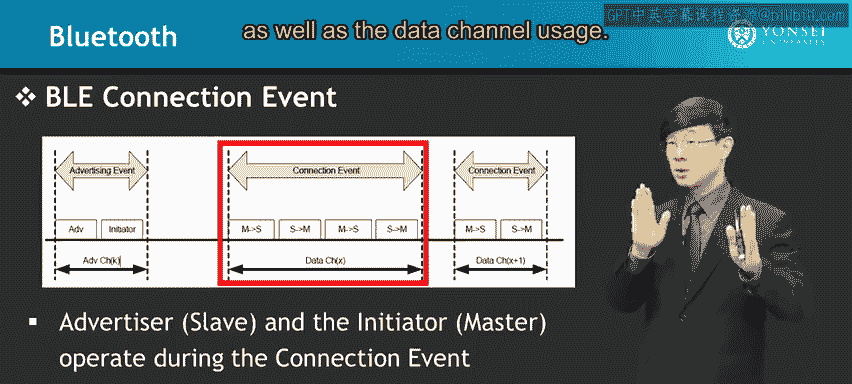

# 课程 34：4.4 蓝牙技术详解 📶

在本节课中，我们将学习蓝牙技术。蓝牙是一种重要的无线个人区域网络协议，广泛应用于连接手机、耳机、医疗设备等多种设备。我们将从蓝牙的基本概念、发展历史、网络结构、技术特点以及低功耗蓝牙的工作原理等方面进行详细介绍。

---

## 蓝牙概述

蓝牙是一种无线个人区域网络协议，由蓝牙技术联盟设计和标准化。它主要用于替代有线连接，连接不同类型的设备。典型的应用场景包括将手机连接到耳机或无线音箱。此外，心率监测仪或医疗设备也使用蓝牙技术。

蓝牙的标准化工作由蓝牙技术联盟负责。该联盟成立于1998年，蓝牙的第一个规范版本1.0于1999年发布。最新的版本是2016年发布的蓝牙5.0。早期的标准，如蓝牙1.1和1.2，被批准为IEEE 802.15.1标准，即基于802.15系列的无线个人区域网络标准，其中.1代表蓝牙技术。然而，它不再作为IEEE标准维护，所有标准现在仅来自蓝牙技术联盟。

---

## 蓝牙技术特点

蓝牙工作在2.4 GHz免许可的ISM频段。它采用自适应跳频技术，更具体地说，是**跳频扩频技术**。这有助于避免与使用Wi-Fi或ZigBee等其他非跳频通信网络设备产生干扰，并提高了在ISM频段内的共存性。

蓝牙网络的形成基于一种称为**微微网**的结构，它采用星型网络拓扑。该网络有一个主节点作为网络的中心，以及多个从节点。

微微网的组成部分包括主节点和从节点。每个微微网只有一个主节点，它负责提供数据包交换、参考时钟和跳频扩频模式。主节点是微微网的形成中心，所有通信，即使是相邻从节点之间的通信，也必须通过主节点进行。从节点只能与主节点通信，并同步到主节点的时钟和跳频扩频模式。

---

## 微微网与散射网结构

让我们深入了解一下网络结构。下图展示了多个微微网尝试形成的场景。

图中，黄色椭圆形区域，以及绿色、红色和浅紫色的区域，都表示正在尝试形成的微微网。

*   以节点A为中心的微微网，我们称之为微微网A，因为A是该星型网络的主节点。
*   类似地，我们有以节点C为主的微微网C。
*   以及以节点F为主的微微网F。
*   节点G的范围内没有其他节点，因此它尚未形成一个微微网；必须形成一个星型连接才能被称为微微网。

进一步观察细节：
*   在黄色的微微网A中，A是主节点，节点B、C和D以星型方式连接到它，因此B、C、D是从节点。
*   节点C在微微网A中是从节点，但它同时是微微网C的主节点，连接着节点E。当一个节点在一个微微网中担任从节点，在另一个微微网中担任主节点时，它可以作为两个微微网之间的通信连接点。
*   作为主节点，节点F向节点D和微微网F中的其他从节点广播信息。图中显示了广播信号被发送出去。
*   节点D既是微微网F的从节点，也是上方微微网A的从节点。因此，一个节点可以在两个或更多不同的微微网中担任多个从节点角色。
*   节点G在此结构中范围内没有其他节点，因此它持续扫描以查看未来是否有其他设备进入其范围，从而形成一个微微网。

---

## 蓝牙操作类型

蓝牙主要包括两种主要的操作类型：经典蓝牙和低功耗蓝牙技术。

*   **经典蓝牙**：指蓝牙4.0标准之前的版本（即最高到3.x版本）。它包括基本速率和增强数据速率。
    *   **基本速率**：表示为 **BR**。
    *   **增强数据速率**：表示为 **EDR**。自然，EDR具有更高的数据速率。
*   **低功耗蓝牙**：这是在蓝牙4.0标准中新引入的，您也会看到其代号为 **BLE**。有些地方将其标记为LE或BLE。

---

## 经典蓝牙技术细节

上一节我们区分了蓝牙的类型，本节中我们来看看经典蓝牙的具体技术参数。

观察BR和EDR模式的整体信道规格，可以看到总共有79个信道，每个信道宽度为1 MHz。总带宽范围在ISM频段的2.4 GHz频率范围内，具体从2.4 GHz到2.4835 GHz。

在其结构内部，它使用时分双工方案以及跳频通信模式。

以下是其调制方式和数据速率规格：
*   **调制方式**：它使用**GFSK**，其中FSK是频移键控，G代表高斯脉冲整形。因此，使用的是结合了高斯脉冲整形的频移键控跳频扩频技术。在EDR中，使用**DPSK**技术，具体是π/4或8DPSK，作为调制模式。
*   **数据速率**：BR可提供**1 Mbps**的数据速率，而EDR可达**2-3 Mbps**，这也是它被称为EDR的原因。
*   **连接数量**：一个主节点最多可以与七个从节点互连。因此，当您观察一个星型结构的微微网时，会看到最多八个节点相互连接并通信。

---

## 低功耗蓝牙技术细节

BLE蓝牙低功耗操作的频谱格式如下：它使用2.402至2.480 GHz范围，总共有40个信道。

其中有三个信道（图中橙色标记），编号为37、38和39，它们用于**主要广播**。其余的37个信道（图中蓝色部分）用于**数据传输**，并且在蓝牙5中也用于**次要广播**。

BLE操作基于TDMA和FDMA多址方案。调制使用GFSK。在蓝牙5.0之前，其数据速率可达1 Mbps；蓝牙5.0之后，提升到2 Mbps。蓝牙5在物理层编码上的典型差异是支持前向纠错编码，这导致数据速率降低，但更安全、更可靠，对信道错误和各种其他干扰信号更具弹性。

数据传输被放置在称为“事件”的时间段内。在BLE蓝牙低功耗中，有两种类型的事件：一种是**广播事件**，另一种是**连接事件**。广播是一种无需连接的广播机制。连接事件则在主从设备之间建立连接以发送数据。

---

## BLE广播与连接机制

广播信道的目的包括在设备之间建立连接，以及在未连接的设备之间通信信息。

设备类型包括：
*   **广播器**：发送广播数据包的设备。
*   **扫描器**：无意连接、仅扫描信道的接收设备。
*   **发起器**：监听来自广播器的可连接广播数据包以发起连接的设备。

观察操作的时间序列，其中有广播事件，以及后续的事件，在时间间隔内可以看到广播消息。

广播事件发生在广播信道（信道37、38和39）上。它们可以进行广播或执行单向通信。在上图红色框内的事件中，扫描器节点可能会发回一个响应消息，该扫描器消息位于两个广播消息之间。

---

## BLE连接事件详解

BLE连接事件是在同一物理信道上，主设备和从设备之间发送的一系列一个或多个交错数据包对。发起器监听来自广播器的可连接广播数据包。

一旦从广播器接收到该数据包，它就会请求发起连接。请注意，发起器是发送连接发起请求的一方，这使其成为主设备。而发出可连接广播数据包的广播器，则以某种被动方式查看是否有人连接，因此广播器设备成为从设备。

观察上图，您可以看到一个广播和整体连接机制，其中发起器在广播事件期间在广播信道上检测到来自广播器的可连接消息。广播器（从设备）和发起器（主设备）在连接事件期间操作。连接事件发生在数据信道内。

尽管我们按顺序观察，但操作发生在不同的信道上。您需要结合前面的频谱图来理解：所有蓝色信道以及其间橙色的信道被分别用于此处进行的操作。必须仔细区分广播信道的使用和数据信道的使用。

---

## 总结与参考资料

本节课中，我们一起学习了蓝牙技术。我们从蓝牙的基本定义和发展历史开始，了解了其工作在ISM频段并采用跳频扩频的技术特点。我们深入探讨了蓝牙的网络结构——微微网和散射网，以及主从节点的角色。接着，我们区分了经典蓝牙和低功耗蓝牙，并分别介绍了它们的关键技术参数，如调制方式、数据速率和信道使用。最后，我们详细解析了BLE中的广播与连接事件机制。

这些是我使用的参考资料，推荐给您。

