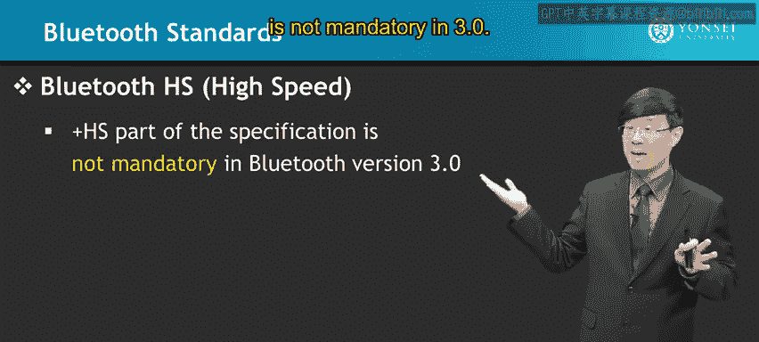

# 延世大学《新兴技术从智能手机到物联网再到大数据》课程 - P107：35_4.5 蓝牙标准（第1部分）📶

在本节课中，我们将学习蓝牙技术的发展历程，重点关注其核心标准的演进。我们将区分经典蓝牙与低功耗蓝牙标准，并详细解析增强数据速率和高速蓝牙等关键技术。

蓝牙标准的演进过程如图所示，主要协议根据其发展时间线，用不同颜色的圆圈标注。

首先，我们需要区分位于左侧的经典蓝牙标准，即基本速率系统。以演进序列中的4.0标准为分界点，中间部分则是蓝牙低功耗标准。蓝牙低功耗标准持续发展，并连接至5.0及未来的标准。

以下是蓝牙标准的主要演进阶段：

*   **1.0**：首个被采纳的规范，于1999年发布。
*   **1.1 与 1.2**：修复了主要漏洞并使其稳定。其中，基于2002年的1.1版本发布时，IEEE 802.15.1标准也随之发布，该标准包含了蓝牙特别兴趣小组的1.1标准。
*   **2.0**：增加了**EDR**。
*   **2.1**：增加了简单配对和**NFC**支持。NFC是一项非常重要的技术，被添加到蓝牙规范中，因此2.1版本虽然图示圆圈较小，但非常重要。
*   **3.0**：为支持高速传输增强了功耗控制，并即将在后续页面介绍**HS**支持。
*   **4.0**：这是一次重大革新，于2010年将**BLE**技术纳入规范。
*   **4.1**：实现了与第四代移动通信**LTE**的共存。
*   **4.2**：提供了更高的吞吐量和增强的安全性。
*   **5.0**：于2016年发布，速度翻倍，意味着数据速率变得更高。

接下来，我们将更详细地了解EDR标准及其部分规范。

## 增强数据速率 📈

上一节我们概述了蓝牙标准的整体演进，本节中我们来看看**EDR**的具体含义。

**EDR**代表**增强数据速率**。它在蓝牙2.0版本中被引入，旨在实现更快的数据传输。它支持高达**3 Mbps**的数据速率。EDR还提供了低功耗特性，这对于许多无线、电池供电的蓝牙设备来说非常必要。它通过使用**减少的占空比**来降低功耗。这意味着在占空比开启期间完成所有数据通信，之后设备进入休息模式以最大限度地节省能量。

## 蓝牙高速技术 🚀

了解了EDR后，我们再来看看蓝牙高速技术。

蓝牙高速技术于2009年发布，并被包含在标有“+HS”的3.0版本中。这里的“+HS”意味着它并非3.0标准的强制组成部分。

那么，这具体是什么意思呢？标为 **`3.0 + HS`** 的版本可提供高达**24 Mbps**的数据传输速度。然而，它并非纯粹使用蓝牙技术。蓝牙链路被用于协商和建立连接，类似于一个控制信道，而高速数据流量则通过共存的**Wi-Fi**链路，使用**802.11**技术来承载。

正如你所知，Wi-Fi 802.11技术传输距离更远，且数据速率远高于蓝牙，因为它是无线局域网协议，而蓝牙是无线个域网协议。蓝牙是一种**WPAN**技术，而Wi-Fi是一种**WLAN**协议，它们的设计目的和用途不同。

因此，当你看到 **`3.0 + HS`** 时，你就知道它需要使用共存的Wi-Fi支持。

回想一下，大约在2009年，正是智能手机蓬勃发展的时期。第一代智能手机大约在2007年出现，到2009年时，基于Android和Apple的智能手机已非常普及。此外，平板电脑和iPad也已出现。这些智能设备上同时具备Wi-Fi、蓝牙和移动通信功能。这意味着你可以在同一设备上交互使用Wi-Fi和蓝牙，这些技术由一个控制单元统一管理。既然如此，何不让蓝牙借助Wi-Fi系统来提升性能呢？这正是2009年这一概念得以实现的原因。

以下是关于蓝牙高速技术“+HS”的要点：

*   它是规范的一部分，但在3.0标准中**并非强制要求**。
*   使用时需要标注为 **`+ HS`**，以区别于标准的3.0。
*   它再次利用Wi-Fi进行高速数据通信。

本节课中，我们一起学习了蓝牙标准的演进脉络。我们区分了经典蓝牙与低功耗蓝牙，并深入探讨了增强数据速率和蓝牙高速技术的工作原理。关键点在于，EDR提升了经典蓝牙的数据速率，而高速蓝牙则通过借助共存的Wi-Fi链路来实现更高的传输速度。理解这些标准的发展，有助于我们更好地认识现代无线通信设备的连接能力。