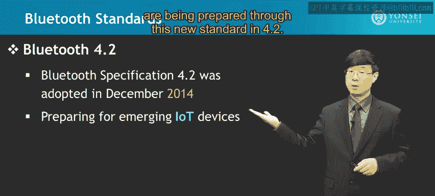

# 108：36_4.5 蓝牙标准（第2部分）📡

在本节课中，我们将继续学习蓝牙标准的发展，重点介绍从蓝牙4.0开始引入的关键技术，特别是蓝牙低功耗（BLE）及其带来的变革。我们还将了解蓝牙信标（Beacon）的工作原理，以及后续4.1和4.2版本如何为物联网时代做好准备。

上一节我们介绍了蓝牙标准的早期版本，本节中我们来看看蓝牙4.0及以后版本带来的重大革新。

## 蓝牙4.0：智能蓝牙的诞生 🚀

蓝牙4.0标准于2010年发布，其整体标准被称为“蓝牙智能”。这是一个包含重大技术飞跃的版本。

它包含了之前版本的模式，即基本速率（BR）和增强数据速率（EDR），以确保向后兼容性。这意味着一个搭载蓝牙4.0芯片的设备，能够与所有旧版蓝牙标准（如3.0、2.0）的设备进行通信。兼容性是通过在新技术中集成旧模式的技术来实现的。

当然，蓝牙4.0最重要的新成员是**蓝牙低功耗**。顾名思义，它定义了一系列配置文件，使设备能够以极低的能耗运行，从而服务于大量动态应用。

它在保持相似通信范围的同时，显著降低了功耗和成本。这听起来像是双赢：你获得了与无线个域网相同的通信范围，但电池消耗却少得多，而且成本更低。

制造商可以为产品实现定制化的规格。此外，一个设备可以支持多个BLE配置文件，这使其功能更加强大。

以下是设备可以支持的一些配置文件示例：
*   **蓝牙健康配置文件**
*   **运动与健身配置文件**
*   **互联网协议支持配置文件**
*   **环境传感配置文件**

## 蓝牙信标技术 📍

蓝牙信标是一种发射技术，它发送一个可以被蓝牙接收器读取的唯一ID号，该ID号可用于智能手机上的各种应用。

你可以这样理解：当你进入一个体育场，场内有各种自动售货机、入口、洗手间等信息，还有寻找座位和获取周边优惠券的可能。你可以在特定位置部署蓝牙信标设备，当有人进入其信号覆盖范围时，他们的设备就会接收到信标信号，从而看到周边的服务和支持设施信息。这正是蓝牙信标的作用。

蓝牙信标通常部署为非常小巧的设备，由电池供电，并通过BLE技术广播信号。由于使用BLE技术，它们处于极低能耗的模式，同时所有蓝牙4.0及更高版本的设备都能检测到这些信号。

智能手机上的应用程序可以识别蓝牙信标的位置，并在手机上激活基于特定位置的信息。例如，当我进入某个范围，接收到一个标识特殊服务或优惠券的信标信号，我的手机上就会弹出相应的优惠券，指引我找到附近的摊位。

以下是蓝牙信标的一些主要应用场景：
*   **基于位置的广告**
*   **优惠券分发**
*   **家庭自动化**
*   **交通系统**
*   **体育场馆与商店**

## 蓝牙4.1与4.2：面向未来的演进 🔮

上一部分我们看到了蓝牙4.0和信标技术的强大功能，现在我们来了解后续版本如何进一步优化和扩展这些能力。

蓝牙4.1规范于2013年发布，它主要包含了对蓝牙的增量软件更新，无需硬件升级。

其改进包括：改善了与LTE（第四代移动通信）技术的共存能力，因为当时LTE正变得越来越普及；包含了批量数据交换速率支持；以及设备多角色同时支持。

蓝牙4.2于2014年发布，它主要处理了新兴物联网设备的配对问题，为物联网技术的需求和各种产品的出现做好了准备。

蓝牙4.2引入的关键特性包括：
*   **低功耗安全连接**
*   **链路层隐私增强**
*   **扩展扫描器过滤策略**
*   **互联网协议支持配置文件（IPSP）的第6版，用于支持连接家庭应用**

---

本节课中我们一起学习了蓝牙4.0标准带来的“蓝牙智能”和低功耗革命，了解了蓝牙信标技术如何实现基于位置的服务，并探讨了蓝牙4.1和4.2版本如何通过软件改进为物联网时代的设备互联做好准备。这些演进使得蓝牙技术从简单的文件传输工具，发展成为支撑智能设备、可穿戴设备和物联网生态系统的关键无线通信标准。