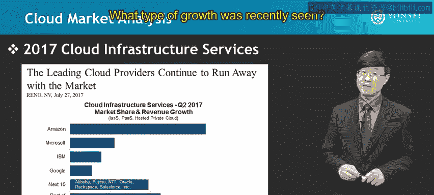
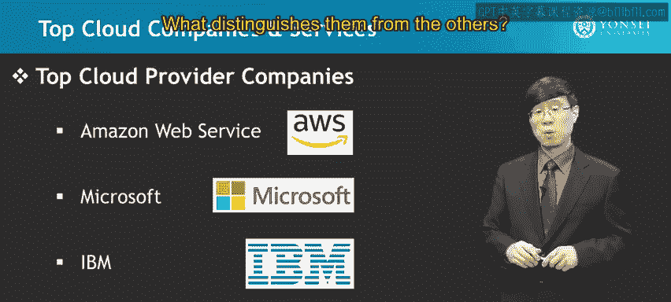

# 延世大学《新兴技术从智能手机到物联网再到大数据》课程 - P110：38_5.1 云市场分析 5.2 顶级云公司和服务 📊☁️

在本节课中，我们将要学习云计算的市场格局以及主要的服务提供商。我们将从分析云市场的三个主要服务类别开始，然后了解哪些公司在市场中占据主导地位，以及它们各自的特点。

---

## 5.1 云市场分析 📈

本节我们将对云计算市场进行分析。我们将从三个维度来审视市场：软件即服务、平台即服务和基础设施即服务。

以下是2014年的市场数据，它展示了云计算的三个主要类别：

*   **SaaS (Software as a Service)**：软件即服务。
*   **PaaS (Platform as a Service)**：平台即服务。
*   **IaaS (Infrastructure as a Service)**：基础设施即服务。

软件、平台和基础设施即服务是云计算能够提供的三大类支持。它们的定义和具体功能将在本讲稍后的幻灯片中详细解释。首先，让我们进行市场分析。

观察图表，我们可以从三个层面进行分析：

1.  **SaaS（软件）**：在图表顶部，纵轴的单位是 **$Bn**，代表十亿美元。可以看到，基于软件的云技术正在快速增长。
2.  **PaaS（平台）**：在图表中部，纵轴的单位是 **$Mn**，代表百万美元。其市场规模相对较小，但同样在增长。
3.  **IaaS（基础设施）**：在图表底部，纵轴的单位也是 **$Bn**，代表十亿美元。其市场规模巨大且增长迅速。

从这些数据可以明显看出，无论软件、平台还是基础设施，各类云服务的需求和消费都非常旺盛，并且正在以极高的速度增长。因此，学习云计算这一模块非常重要。

上一节我们分析了市场的基本构成，本节中我们来看看基于2016年数据集的增长率对比。

此图比较了三大类服务的复合年增长率百分比。以下是关键发现：

*   **SaaS（软件即服务）** 在整体CAGR百分比方面是最具主导地位的类别。这也解释了本部分标题“企业利用SaaS的十大理由”的含义，即采用基于SaaS的产品来支持云计算技术，对企业业务增长至关重要。
*   **IaaS（基础设施即服务）** 的规模小于SaaS，但仍然非常显著。从2013年到2018年的预测数据来看，它也在持续增长。
*   **PaaS（平台即服务）** 的规模最小，但同样在显著增长。通过对比三者，可以看到它达到的整体份额。

接下来，我们将目光转向具体的公司。亚马逊在云计算竞赛中处于领先地位。

基于2017年的数据，亚马逊网络服务的市场份额达到了 **40%**。而其他主要竞争者——微软、谷歌和IBM——加起来占 **23%**。这显示了亚马逊在该领域的卓越表现。

此外，排除这四大巨头，排名第5到第14的公司加起来，以及其他所有公司加起来，其市场份额如图所示。这进一步表明，亚马逊、微软、谷歌和IBM这四大巨头主导着云市场。

为了更深入地了解2017年第二季度的服务细节，我们来看下一张图表。

此图将微软、IBM和谷歌的市场份额分开显示，并与亚马逊进行对比。可以清楚地看到亚马逊目前的主导地位。这也正是我们需要更详细研究亚马逊网络服务系统的原因。

图表上方列出了四大公司，接着是排名第5到第14的公司组合及其支持者，剩余的市场份额则显示在下方。

我们还观察到过去一年的增长情况。在过去四个季度（即一年）中，直到2017年第二季度：
*   亚马逊增长了 **1%**。在其已经很大的基数上，1%的增长是显著的。
*   微软、IBM、谷歌以及排名第5到第14的公司组合也显示了各自的增长。
*   从2017年第二季度开始，过去一年中发生的整体变化导致了图中所示的市场份额分布。

---

## 5.2 顶级云公司和服务 🏆

我们刚刚看到了四大顶级公司的表现，它们是：**亚马逊（AWS）**、**微软**、**IBM** 和 **谷歌**。

因此，值得更仔细地观察这四大巨头为何表现如此出色，它们的服务有何特点，以及是什么让它们与众不同。

---

### 总结

本节课中我们一起学习了云计算的市场分析。我们了解到云服务主要分为 **SaaS**、**PaaS** 和 **IaaS** 三大类，并且市场对它们的需求都在高速增长。同时，我们也认识到云市场由 **亚马逊（AWS）**、**微软**、**IBM** 和 **谷歌** 这四大公司主导，其中亚马逊处于明显的领先地位。理解这些市场格局和主要参与者，是深入学习具体云技术的基础。