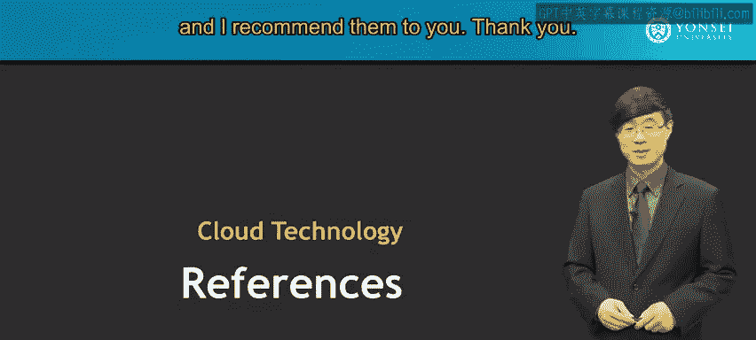
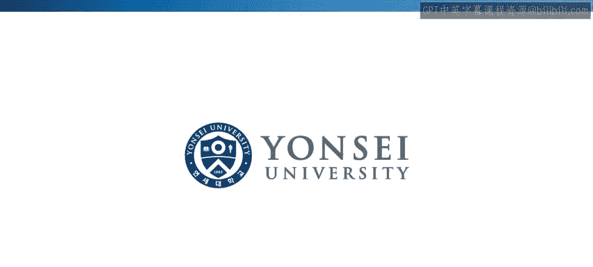

# 课程 40：5.4 IBM 与 5.5 Google 云服务详解 ☁️

在本节课中，我们将学习两家领先的云服务提供商：IBM 和 Google。我们将了解它们各自在云计算领域的排名、核心服务、技术特点以及关键产品。课程内容将涵盖从基础设施到应用服务的完整云技术栈。

---

## IBM 云服务概述

上一节我们介绍了云计算的基本模型，本节中我们来看看排名第三的云服务公司——IBM。IBM 云支持多种部署模式，并提供广泛的服务。

IBM 在云公司排名中位列第三。它支持**公有云**、**私有云**和**混合云**。关于这些云类型的详细定义，我们将在几分钟后具体说明。

它提供超过 130 项独特的服务，覆盖了**基础设施即服务 (IaaS)**、**平台即服务 (PaaS)** 和**软件即服务 (SaaS)**，即 IaaS、PaaS 和 SaaS 全部涵盖。

以下是 IBM 云的一些核心服务：

*   **IBM Cloud Object Storage**：支持数据存储、管理和受控访问。它允许应用程序直接连接到对象存储，并与 IBM 云服务集成。
*   **自助服务门户和 REST API**：提供支持。REST 代表表述性状态转移，API 是应用程序编程接口，它们使你能够访问特定的服务和功能。
*   **IBM Cloud Private**：这是一个用于构建或现代化云应用程序的变革性平台。它包含预打包的企业级解决方案，使其易于使用且功能强大。它提供了增强的安全性、速度和控制力。
*   **IBM Cloud Streaming Video Technology**：提供简化工作流管理和视频流的解决方案。其**B2B（企业对企业）** 视频服务支持对 IBM 云流媒体视频客户尤为重要，因为它可以支持基于 IBM 云技术以特定方式进行视频流传输的公司。这是一个更侧重于企业间支持、实现业务目标的平台。

---

## Google 云平台详解

了解了 IBM 的云生态后，我们转向排名第四的云公司——Google。Google 不仅是搜索引擎巨头，也在云计算领域有着重要布局。

Google 是排名第四的云公司。该公司成立于 1998 年，是全球最大的搜索引擎技术公司。

在云计算技术方面，2011 年是一个非常重要的转折点，这是 Google 启动 **Google Cloud Platform** 的时间。

以下是 Google 云平台的一系列关键产品与服务：

*   **Google Compute Engine (2011年)**：提供基于虚拟机的**基础设施即服务 (IaaS)**。这些虚拟机运行在 Google 的数据中心。它提供云工具和工作流支持，并支持基于事件、负载均衡的全球可扩展服务。
*   **Google App Engine (2008年)**：这是一个用于支持 Web 应用程序的**平台即服务 (PaaS)**。它根据资源需求和服务器负载提供自动扩展。
*   **Google Cloud Storage (2010年)**：这是一个在线文件存储服务。
*   **Google BigQuery (2012年)**：这是一个数据分析工具，使用类似 SQL 的查询在几秒钟内处理大数据集。正如其名，这是支持大数据分析的云计算技术。
*   **Google Compute Engine (2012年)**：这是一个基于虚拟机技术的**基础设施即服务 (IaaS)** 支持，以分布式方式在各种场景中使用。
*   **Google Cloud Endpoints (2013年)**：这是一个在 App Engine 内创建服务并轻松从 Android、iOS 和 JavaScript 客户端连接的工具，使各种移动设备能够轻松使用 Google 云端点。
*   **Google Cloud DNS**：这是一个由 Google 云技术支持的域名系统服务。
*   **Google Cloud Datastore**：提供 NoSQL 数据存储。
*   **Cloud SQL (2014年全面上市)**：提供基于 SQL 的存储和处理能力，完全托管 MySQL 数据库。

---

## 扩展了解：Apple iCloud

虽然不在前四名，但鉴于苹果产品的普及，其 iCloud 服务也值得了解。它于 2011 年公开发布，包含云存储和云计算技术。

其操作系统基础是 OS X 或 Microsoft Windows 7 及更高版本，或 iOS 5 及更高版本。iCloud 取代了之前的 MobileMe 服务。

以下是 iCloud 的一些主要功能：

*   **邮件、通讯录和日历**：基础的个人信息管理服务。
*   **查找我的朋友**：社交定位功能。
*   **备份与恢复**：为设备设置和数据提供备份功能，由 iOS 5 或更高版本支持。
*   **查找我的 iPhone**：使用户能够跟踪 iOS 设备或 Mac 的位置。这曾是 MobileMe 的功能。
*   **回到我的 Mac**：支持远程登录到其他安装了此功能的电脑。
*   **iWork for iCloud**：苹果的 iWork 套件（包括 Pages、Numbers 和 Keynote）的网页版界面。
*   **照片流与 iCloud 照片图库**：用于存储照片。照片图库以原始分辨率存储所有照片及其元数据（包括位置信息）。
*   **iCloud 存储空间**：于 2011 年首次推出，为每个账户提供免费存储空间。
*   **iCloud 云盘**：可以保存照片、视频、文档和应用程序。
*   **iCloud 钥匙串**：用于网站和 Wi-Fi 密码的安全数据库，以及用于快速访问和自动填充的信用卡、借记卡安全管理。
*   **iTunes Match**：扫描和匹配音乐库曲目的功能，可服务于从 CD 或其他来源复制的曲目。

---

## 课程总结

本节课中，我们一起学习了 IBM 和 Google 这两家主要云服务提供商的核心产品与服务。我们了解到 IBM 提供全面的 IaaS、PaaS、SaaS 服务，并专注于企业级混合云与流媒体解决方案；而 Google 云平台则以其强大的数据分析工具（如 BigQuery）、自动扩展的应用引擎和广泛的基础设施服务著称。此外，我们还简要了解了 Apple iCloud 的主要功能。这些知识为我们理解当今多元化的云计算生态系统奠定了基础。