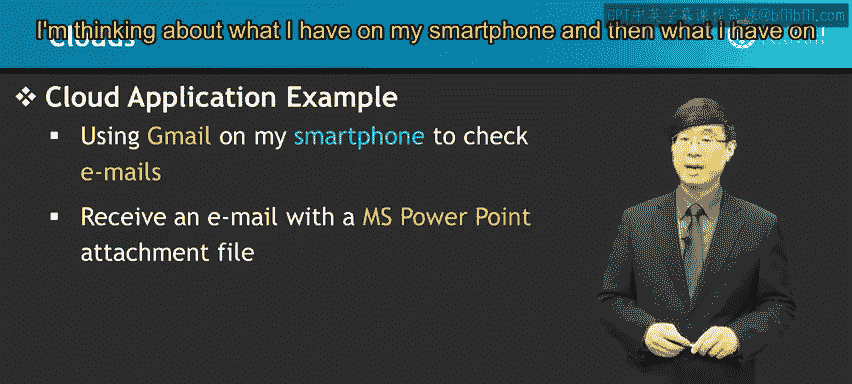
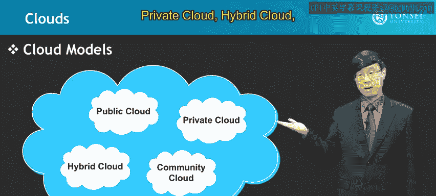
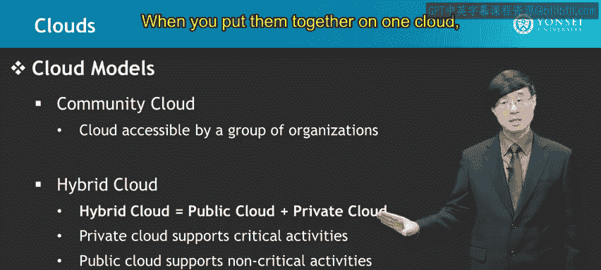
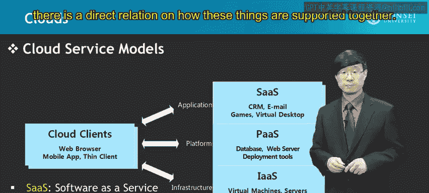
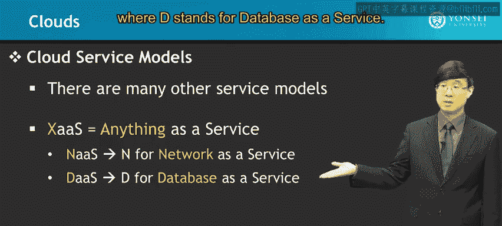
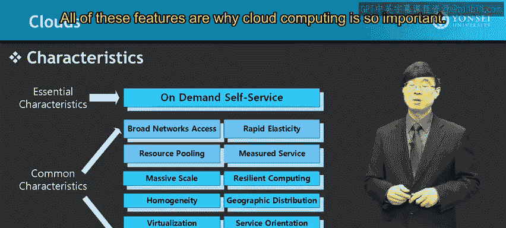
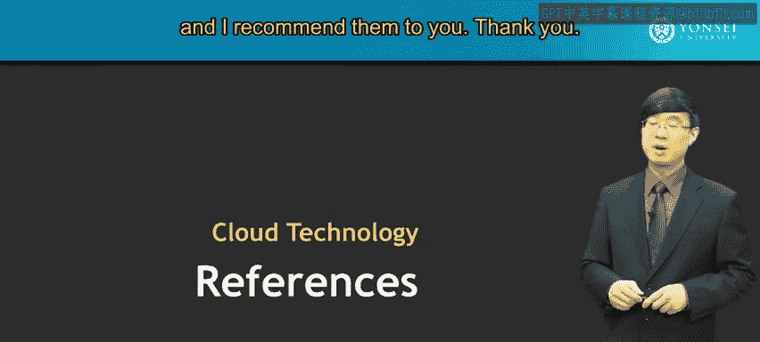
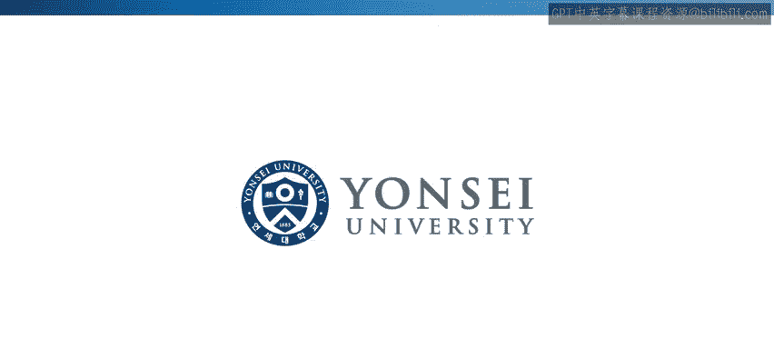

# 113：5.6 云计算 ☁️

在本节课中，我们将要学习云计算的核心概念、服务模型及其主要特征。云计算是支撑现代智能手机、物联网和大数据应用的关键技术。

---

云计算提供在线数据存储服务。它支持在线应用程序的配置与访问。此外，云计算还提供多种软件、计算平台和计算基础设施。

从以上描述中可以注意到，软件、平台和基础设施是云计算提供的三大核心内容。进一步分类其特征，在线数据存储可被视为基于平台或基础设施的存储机制。数据存储本身通过数据库（平台）或存储服务器（基础设施）实现。

上一节我们介绍了云计算的基本功能，本节中我们来看看一个具体的云应用示例。

**云应用示例**
此示例基于在智能手机上使用Gmail查看邮件，特别是查看邮件中包含的附件文件，该附件是一个Microsoft PowerPoint文件。

我思考了智能手机上有什么，以及个人电脑或笔记本电脑上需要什么才能打开一个Microsoft PowerPoint文件。

要在笔记本电脑或个人电脑上打开Microsoft PowerPoint文件，首先需要安装包含操作系统的Microsoft Windows。安装好Windows后，才能在其上安装Microsoft Office套件，之后才能打开PowerPoint、Excel、Word等文件。

然而，在智能手机上，并没有Microsoft Windows操作系统，也没有安装Microsoft Office。但是，当你收到带有此类附件的邮件时，仍然可以在智能手机上打开它。是什么使我能够做到这一点？这正是我们所说的云服务的本质。

我们不具备的平台技术、基础设施技术或任何软件，都可以按需从云端即时获取并使用。这基本上就是云计算使你的智能手机能够做到的事情。

Google Drive服务提供了Google Docs、Sheets和Slides，可用于打开文件。当你需要时，它可以立即交付。这就是我们所说的云计算。仅从这一点看，其应用潜力就非常强大。

不仅限于智能手机，当我们观察物联网时，这些物联网设备本身当然不包含其所需的所有软件、数据库、基础设施、计算和存储支持。许多设备体积小、结构简单、运算能力有限。因此，仅有物联网可能无法完成很多任务，但当物联网设备连接到云端时，你能做的事情自然就变得无限可能。这就是我们在这门课程中将云计算与物联网技术一起学习的原因。

---

云计算能为我们做什么？云计算可以通过公共或私有网络或互联网提供服务，而服务托管系统位于远程位置。

云计算可以支持各种应用，例如：
以下是云计算支持的部分应用类型：
*   电子邮件
*   网络会议
*   客户关系管理
*   游戏
*   数据库管理
*   以及其他各种应用

---

云计算模型主要包括以下几种：
以下是主要的云计算部署模型：
*   **公共云**：使公共系统和服务能够成功运行。它基于开放架构，因此可以收发电子邮件和浏览网站。由于其开放性和公共可访问性，安全性可能较低。
*   **私有云**：使服务能在组织内部成功运行。由于其私有性质，它更安全，也更难访问。
*   **社区云**：可供一组组织访问，这些组织共享一个云。
*   **混合云**：是公共云和私有云的结合。私有云支持关键活动，公共云支持非关键活动。

这意味着，如果是需要保护的机密信息，或涉及公司数据或公司本身的详细信息，则需要使用私有云，以便在更高程度上保护这些信息。而公共云可用于普通用户发送邮件、接收邮件、访问网站和执行其他操作。因此，私有云和公共云都是必需的，将它们结合在一个云上，就是我们所说的混合云。

---

上一节我们了解了云的部署模型，现在我们来深入探讨云的服务模型。

云服务模型如下图所示，我们有云客户端，以及**SaaS**、**PaaS**和**IaaS**。
*   **SaaS** 是软件即服务。
*   **PaaS** 是平台即服务。
*   **IaaS** 是基础设施即服务。

它们的功能如下：
以下是各服务模型提供的具体内容：
*   观察**SaaS**，它提供客户关系管理、电子邮件、游戏、虚拟桌面等技术，这些都基于SaaS（软件即服务）云计算技术。
*   然后是**PaaS**，它提供数据库、Web服务器、部署工具和开发工具等。这些是平台技术所支持的内容。
*   接着是**IaaS**，即基础设施即服务，它提供虚拟机、服务器、存储能力和网络支持。

较低层的服务模型支持较高层的管理、计算能力和安全性。这意味着，如果有人要使用IaaS，那么除了获得支持的IaaS基础设施外，他们还需要添加平台和软件，以便能够充分利用他们所接收的特定IaaS云技术。因此，当你观察这个结构的上下层时，可以清楚地看到这些服务是如何相互支持、关联的。

---

现在，让我们详细看看这三大主要分类。

**软件即服务**：向最终用户提供各种软件应用程序作为服务。可以这样理解：我使用过云计算技术吗？我什么时候会用到云计算技术？我会用到SaaS吗？事实证明，如果你有智能手机或平板电脑，那么你已经使用过它了。例如，你在智能手机上下载的应用程序就是SaaS技术。你已经使用了很长时间。

**平台即服务**：为应用程序提供程序可执行平台、开发工具。

**基础设施即服务**：为整个云提供基础计算和安全资源。它包括备份存储、计算能力和虚拟机。

云服务模型还包括其他类型的模型，可以归类为 **XaaS**，其中X可以是任何你想要的字母。例如，有人用N代表网络，形成**网络即服务**；有人用D代表数据库，形成**数据库即服务**；有人用B代表业务，形成**业务即服务**等等。

这些分类是基于人们如何希望使用XaaS分类来满足其需求，使其服务或整体方案独特且易于表达。然而，所有这些以及其他模型，根本上都可以归入三大类：SaaS（软件即服务）、PaaS（平台即服务）和IaaS（基础设施即服务）。所有这些也都属于SaaS、PaaS、IaaS的范畴，但人们确实会这样细分，你也可以这样做。

---

从云计算技术中你能获得哪些好处？
以下是云计算的主要优势：
*   **高效率和高可靠性**
*   **通过互联网提供灵活的应用程序即实用工具**
*   **在线操作和配置应用程序**
*   **在线开发和部署工具**
*   **无需预装软件**，因为你可以按需获取所需的一切
*   **成本效益高**
*   **按需自助服务**，资源可通过网络获取

当我们谈到成本效益时，你会发现，与购买软件包、获取DVD并在电脑上安装相比，使用云计算，首先你可以在需要时下载各种不同的应用程序，无需为可能不用的东西投资。当需要时，你去下载并使用它，因此当你下载某物时，你会知道“我肯定会使用它”，所以在资金投入上没有浪费。

其特性还包括，**基本特征是按需自助服务**，这正是我前面谈到的。我将进行自助服务，在我需要时获取它，所以是自助服务，按需获取。这是使云计算技术如此有吸引力的基本特征。

**共同特征**包括：
以下是云计算的共同特征：
*   **宽带网络接入**：我必须拥有良好的有线或无线网络，以便在我想要的时候立即下载所需内容。
*   **快速弹性**：这意味着存在各种智能手机、智能设备、智能平板。当我下载云服务时，它需要适配我的电脑或智能手机，匹配适量的内存、内部总线、显示方式等，以便能在我的设备上运行。为了实现这一点，它需要具备此特性。
*   **资源池化**：自然，你可以在需要时调用资源并一起使用它们。
*   **可度量的服务**。
*   **大规模**。
*   **弹性计算**。
*   **同质性**。
*   **地理分布**。
*   **虚拟化**。
*   **面向服务**。
*   **低成本软件**。
*   **高级安全性**。

所有这些特性正是云计算如此重要的原因。

---

本节课中我们一起学习了云计算的核心概念。我们探讨了云计算提供的三大核心服务（IaaS、PaaS、SaaS）及其关系，分析了不同的部署模型（公共云、私有云、混合云、社区云），并详细阐述了云计算的关键特征和优势，特别是其按需自助服务和成本效益。理解这些基础知识对于把握智能手机、物联网和大数据背后的技术支撑至关重要。