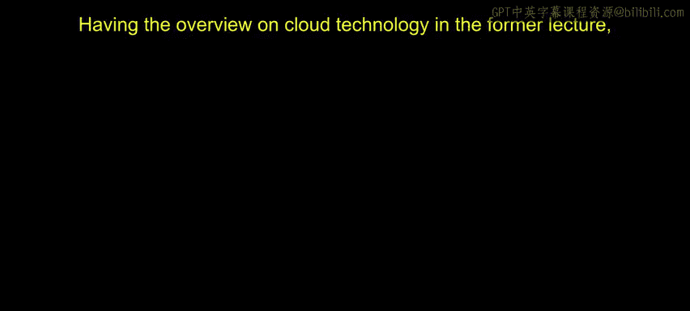
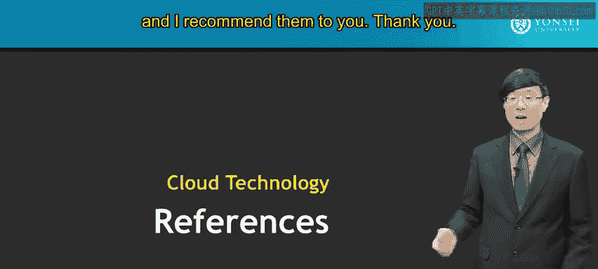
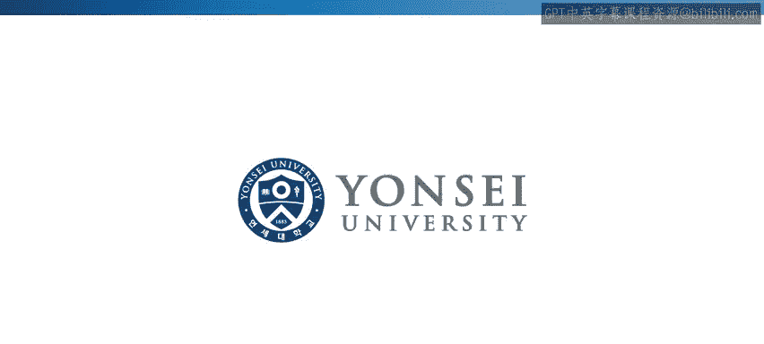

# 延世大学《新兴技术：从智能手机到物联网再到大数据》课程 - P114：42_5.7 IaaS、PaaS、SaaS 🚀

## 概述

在本节课中，我们将深入学习云计算的三种核心服务模型：基础设施即服务（IaaS）、平台即服务（PaaS）和软件即服务（SaaS）。我们将详细探讨每种模型的定义、构成、运作方式及其带来的优势。

上一讲我们对云技术有了概览，现在我们将深入探讨IaaS、PaaS和SaaS的细节。

## 服务模型概览

再次回顾整体的服务模型，我们有这三种类型。需要明确的是，上层的服务依赖于下层提供的功能支持。同时，当你获得下层的服务时，通常也需要上层的服务一同提供，以便更有效地使用下层的基础设施。

例如，当你获得IaaS支持时，通常也会以虚拟机包的形式获得PaaS和SaaS服务。同样，当你接收PaaS服务（例如一个数据库）时，数据库将通过PaaS服务提供，但你仍然需要SaaS技术来支持数据库的使用。这就是我们所说的：如果你接收了较低层的服务，通常需要上层的支持以打包形式交付给你。

然而，如果你接收的是SaaS，你拿到就能直接使用，因为你的智能手机或其他移动智能设备已经具备了运行软件所需的平台和基础设施，软件只需适配配置即可使用。

## 基础设施即服务 (IaaS) 💻

IaaS指的是通过互联网提供基础设施支持。它主要关乎云计算资源和存储资源。

### IaaS的构成

IaaS包含以下核心要素：
*   **计算能力**
*   **存储服务**
*   **软件包和捆绑服务**
*   **虚拟局域网技术**
*   **虚拟机功能**

### 虚拟机的核心作用

在云计算技术中，虚拟机是关键特性之一。IaaS通过对虚拟机的管理访问，实现了对计算资源的控制。服务器虚拟化功能至关重要。对计算资源的访问正是通过管理虚拟机来实现的。

以下是虚拟机管理命令的示例：
*   `Save data on Cloud server`
*   `Start web server`
*   `Install new application`

### IaaS的交付与运作

让我们看看IaaS是如何交付以及虚拟机如何运作的。软件所有者（即虚拟机的设计者）会将其放置在存储区域网络（SAN）的存储设备上。云服务器就位于这里。如图所示，虚拟机包含一个独特的包，其中集成了自己的操作系统和应用软件，并作为一个整体交付。

当用户（如用户一和用户二）请求时，他们会联系虚拟交换机（V-Switch）。V-Switch会从存储和SAN中提取信息，并将其交付给用户。这样，应用和操作系统作为一个包就被交付到了用户的设备上，例如你的智能手机。

### IaaS的优势

IaaS的主要特点是灵活高效地租用计算机和服务器硬件。

以下是可租用的资源示例：
*   虚拟机
*   存储空间
*   带宽
*   防火墙
*   IP地址
*   监控服务

其付费结构基于资源类型、使用时间和服务包来确定费用。

IaaS的优势还包括**可移植性**以及与**遗留应用程序的互操作性**。这一点非常重要，因为你的设备可能无法运行所有旧的软件或操作系统。然而，如果你在一个大型云平台上寻找，很可能找到旧的软件包和旧版本的操作系统，这意味着你可以打开旧的文件和文档。

它实现了基于互联网连接使用基础设施资源的可移植性。它提供了一种方法，以维持IaaS云之间遗留应用程序和工作负载的互操作性。

## 平台即服务 (PaaS) 🛠️

PaaS为应用开发提供开发和部署工具。

### PaaS的主要类型

典型的PaaS类型包括以下四种：
1.  **仅应用交付环境**：提供按需扩展和应用程序安全性。
2.  **独立开发环境**：为特定功能提供独立的平台。
3.  **附加开发设施**：允许用户定制并以各种方式使用现有的SaaS平台，以构建和扩展新的服务。
4.  **开放平台即服务**：提供运行应用程序的开源软件。

### PaaS的运行时环境

PaaS应用的运行时环境基于一种结构，其中云服务器通过集成开发环境（IDE）与用户交互。

在IDE中，有四个主要组件作为用户使用的平台接口：
*   **可扩展的基础设施**
*   **应用托管**
*   **备份与恢复**
*   **数据安全**

我们通过集成开发环境（IDE）与这些组件交互，从而使用云服务器的计算资源。

### PaaS的优势

PaaS的优势包括：
*   **更低的管理开销**：用户无需参与平台的任何管理工作。
*   **更低的总拥有成本**：用户无需购买任何硬件、内存或服务器，只需租用。他们只需购买一段时间的租约，使用完毕后即可终止。
*   **可扩展的解决方案**：包括基于应用程序资源需求的自动资源规模控制，意味着你只会下载你真正需要的部分。此外，在大型开发团队协作时，能够以同质化的方式整合不同的设计。当多个程序员共同开发解决方案时，无需担心不同计算机上软件版本不匹配的问题，因为它们都从云端访问。如果有一个软件开发工具包包含测试环境，可以测试你的程序、功能、包或库是否与主框架系统兼容，那么通过测试就意味着你的系统能与主框架协同工作，并且其他开发者也使用相同的测试环境。显然，对于大规模软件开发项目，可扩展的解决方案至关重要。
*   **更现代的系统软件**：这是PaaS的一个重要组成部分。

关于软件版本兼容性：如果你在电脑上打开一个程序，可能发生三种情况：1）该程序基于的软件版本比你电脑上的高；2）版本相同；3）版本比你电脑上的低。当然，如果版本相同且设计正确，它能完美运行。但如果来自更高版本，某些功能可能无法工作；反之，如果来自更低版本，则可能无法充分利用本应使用的新库函数来使程序更高效、更强大。避免这些问题的一个方法就是使用云计算技术。

## 软件即服务 (SaaS) 📱

SaaS以服务形式向用户提供软件应用程序，这些软件部署在云服务器上，可通过互联网访问。

### SaaS的特点

SaaS包含以下特点：
*   **按需可用**：需要时下载，这正是我们在智能手机上的操作方式。
*   **易于维护**：无需用户进行软件升级或维护，全部由云支持，这也是我们正在享受的。
*   **灵活扩展或缩减**：集中管理和数据。这意味着如果你需要调整，通常不需要你亲自进行所有调整。云管理员可以控制下载到你电脑上的内容，如果需要发送补丁或修复某个模块中的错误，他们可以直接操作。
*   **支持共享数据模型**：多个用户可以共享单一的数据模型和数据库。
*   **成本效益**：按使用付费，没有买错软件的风险。
*   **多租户编程解决方案**：确保多个程序员使用相同的软件版本，不存在版本不匹配问题。

这些特点在PaaS中也有体现，在SaaS中同样存在。

### SaaS应用结构

开放的SaaS应用结构如图所示，与云服务器交互。我们主要使用的单元包括：
*   SaaS目录网络服务
*   SaaS消息网络服务
*   SaaS协作网络服务
*   SaaS内容网络服务

这些服务通过一个**SaaS编排层**提供给我们。这个编排层位于中间，与客户端用户界面层交互。它负责协调对这些核心SaaS功能的访问，这些功能再与云服务器交互。因此，在控制单元的重要性方面，编排无疑非常关键。

## 总结

本节课我们一起学习了云计算的三种核心服务模型：IaaS、PaaS和SaaS。我们详细探讨了每种模型如何提供不同层次的服务，从底层的基础设施到开发平台，再到顶层的应用软件，以及它们各自的特点、运作方式和为开发者和用户带来的主要优势。理解这些模型有助于我们更好地利用云技术来构建和部署应用程序。

