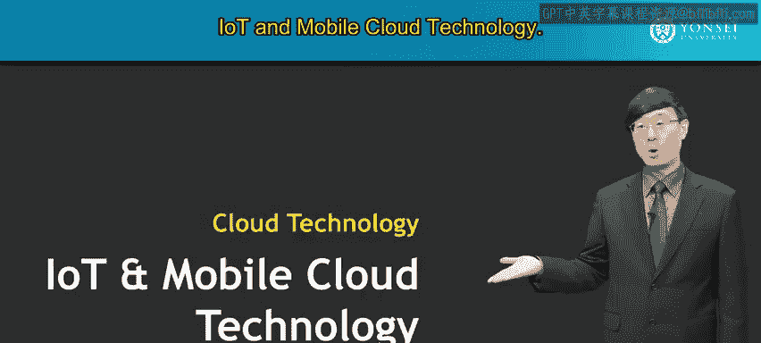
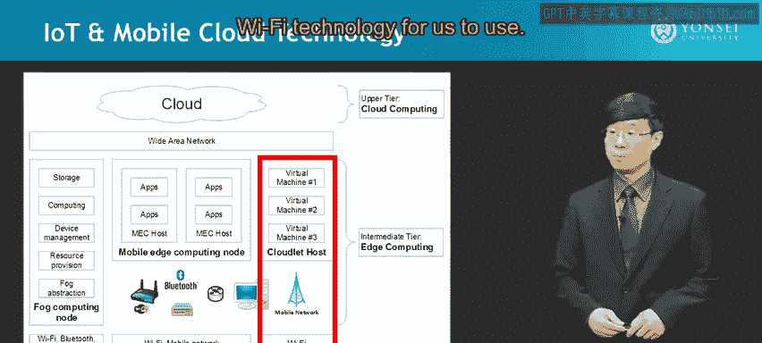
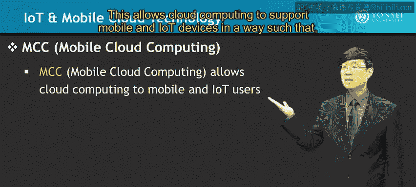
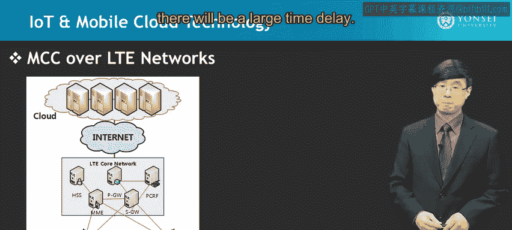
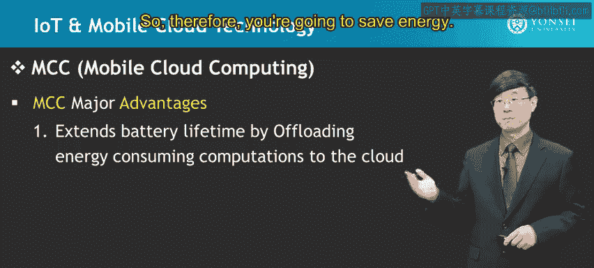

# 延世大学《新兴技术：从智能手机到物联网再到大数据》课程笔记 - P115：5.8 物联网移动云技术 & 5.9 移动云计算 (MCC) 📡☁️

## 概述

在本节课中，我们将要学习物联网与移动云技术的关系，并深入探讨移动云计算的概念、架构及其优缺点。我们将了解到，为了满足智能设备对快速、可靠服务的需求，仅仅依赖远程的云计算是不够的，因此催生了边缘计算等新技术。

---

## 物联网与移动云技术

当前存在的各种物联网和移动智能设备，都需要云计算的支持，以满足我们对这些设备功能的多样化需求。

因此，云计算的支持是必要的。然而，云计算支持通常位于互联网上某个远程服务器中。

如果我们希望获得快速、可靠的服务，那么我们就需要在云计算中引入一些额外的技术，这就是被归类为**边缘计算**的技术。换句话说，边缘计算旨在将云资源带到网络边缘，即用户所在的位置，以便我们能够有效地使用它们。

---

## 边缘计算的三种技术类别

为了基于边缘计算技术将云技术尽可能地带到我们身边，主要存在三类技术组。

以下是这三类技术的简要介绍：

*   **雾计算**：如图所示，我们可以通过Wi-Fi、蓝牙和ZigBee等通信方式（例如无线局域网和无线个域网技术）访问它。它支持存储计算、设备管理、资源供应和雾提取技术。
*   **移动边缘计算**：这个类别除了包含部分Wi-Fi技术外，还使用移动通信。它基于MEC（移动边缘计算），其中的MEC主机承载着交付给我们使用的应用程序。从名称中的“移动”一词自然可知，它使用移动通信网络。
*   **云朵**：在云朵主机上，我们可以看到存在的虚拟机，它们通常通过Wi-Fi技术被带到离我们更近的地方，供我们使用。

---

## 深入理解移动云计算

上一节我们介绍了边缘计算的三种形式，本节中我们来看看其中一种核心概念：移动云计算。

### 什么是移动云计算？

云计算的趋势是这样的：用户对高数据速率和服务质量的需求正在呈指数级增长。

此外，智能手机、物联网设备以及各种其他传感器和执行器的技术演进正变得高度先进。

许多智能设备和物联网设备都拥有非常强大的中央处理器、图形处理器和片上系统单元。

然而，CPU本身并不足以计算所有信息并提供准确、智能的结果。

另一个问题是，在很多情况下，即使设备足够强大能够进行计算，其结果也可能不够理想。因为当我们想要做出决策时，我们不希望仅基于一个本地设备进行决策，而是希望基于环境、观察周围环境和所有选项，并结合情境感知（即我知道正在发生什么以及什么对我有影响）来做出最优决策。

为了实现这一点，即使你能在一个节点上进行计算，你仍然无法获得全部范围的数据。这就是为什么我们说并非所有数据都可在单个节点上获得，这是不可能的。因此，即使你的计算能力足够强大，但由于你没有收集到所有数据，你的结果仍然不是最优的。

但是，如果我要收集周围的数据以获得准确的情境感知，那将是一个巨大的数据量，让智能设备或移动设备将所有数据都存入内存同样是不可能的。

此外，当我们谈论物联网设备和智能手机、智能手表等智能设备时，可使用的总能量非常有限。这就是为什么你不能要求它始终以最高速度运行以提供快速结果。另外，就物联网和智能手机而言，我们使用的设备体积很小。

因此，由于这些小型设备受限于电池，如果你要求你的设备始终快速计算，会耗尽电池，设备将变得无用。此外，如果你要求它计算所有收集到的周围信息，它将持续不断地进行处理和计算，同样会耗尽电池。

所以，无论如何，由于这些是电池受限的设备，并且有如此多的计算任务，总会存在局限性。这就是移动云计算变得非常有吸引力的原因。它允许云计算来支持移动和物联网设备。

### 移动云计算如何工作？

其工作方式是这样的：当我们观察在第四代和第五代移动系统以及物联网系统中被称为用户设备的智能设备时，你可以通过核心网络（可以是互联网或移动通信网络）使用远程集中式云，并向移动运营商寻求帮助，从而通过网络连接到云，请求云保存信息或计算结果，并将结果交付给我。

观察我们所讨论的，云在远端，然后是互联网，接着是移动通信结构的核心网络，再往下是我们称之为无线接入网络的部分，它有连接着的基站（我们称之为eNodeB），并连接到用户设备。

这是一个第四代移动通信网络，LTE或LTE-A网络看起来就是这样。当智能手机上的用户需要服务时，它将连接到基站，基站连接到核心网络，核心网络连接到互联网，互联网再连接到云，然后服务将被交付给使用智能手机的用户。

这就是移动云计算如何支持我们智能手机服务的过程。自然地，你可以看到存在距离。而且，操作需要经过移动通信核心网络以及互联网，然后一路到达云端，这将产生较大的时间延迟。

---

## 移动云计算的优缺点

因此，当我们审视原始的移动云计算基础设施时，它存在优点和缺点。

以下是其优缺点分析：

**优点：**

*   **节能**：显然，如果你不在你的智能设备上进行计算，你就不会使用它的计算资源。你只需要收集信息，将其发送到云端，并请求云端收集更多信息、进行计算，然后只将结果发送给你。因此，你将节省能源。
*   **强大的计算与存储能力**：此外，云端设备拥有非常快速的高计算能力和大内存。因此，当你使用它们时，它们会快速计算结果并发送给你。
*   **节省本地存储**：你可以不断地保存数据，这使得它非常有吸引力，因为智能手机和物联网设备的内存非常有限。

**缺点：**

*   **延迟问题**：主要的缺点在于，由于云端距离较远，数据传输需要经过多个网络节点，会导致显著的延迟，这对于需要实时响应的应用（如自动驾驶、增强现实）来说是一个挑战。

---

## 总结

本节课中，我们一起学习了物联网对移动云技术的依赖，并深入探讨了移动云计算的概念。我们了解到，为了克服远程云计算带来的延迟问题，边缘计算技术（如雾计算、移动边缘计算和云朵）应运而生，旨在将计算和存储资源推向网络边缘。移动云计算通过将繁重的计算任务卸载到云端，帮助解决了移动和物联网设备在计算能力、存储空间和电池续航方面的根本限制，但其固有的延迟问题也催生了更靠近用户的边缘计算解决方案。