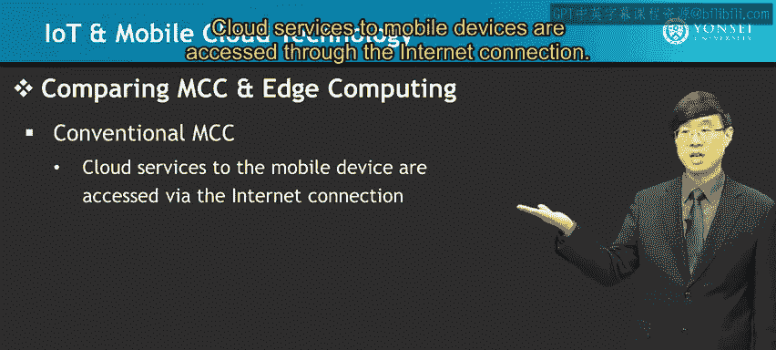
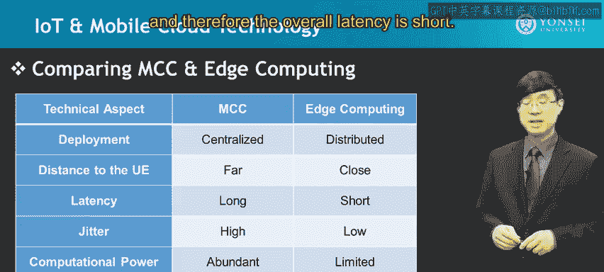

# 延世大学《新兴技术：从智能手机到物联网再到大数据》课程 - P116：44_5.10 边缘计算 🖥️

在本节课中，我们将学习边缘计算的概念，并将其与传统的移动云计算进行比较。我们将探讨边缘计算如何通过将计算资源靠近用户来解决延迟和网络资源消耗等问题。

---

上一节我们介绍了边缘计算的基本概念，本节中我们来看看传统的移动云计算。

在传统的移动云计算中，移动用户通过移动通信核心网络和互联网连接到云服务器。移动设备通过互联网连接访问云服务。

以下是传统移动云计算的一些特点：

*   **延迟长，服务质量性能成为问题。**
*   **网络资源使用率高**，因为每个请求都需要经过移动通信网络和互联网，然后必须接收返回信息。
*   **物联网和智能设备电池消耗高**，因为它们需要将数据发送到本地基站或连接到有线区域网络的设备，以便访问互联网。
*   **数据包到达时间抖动显著**。这是一个问题，因为数据包在发送时可能具有均匀的时间间隔，但当它们经过复杂的网络、逐跳传输到达服务器，再由云服务器计算并返回结果时，数据包和帧之间的间隔会变得混乱。这可能导致数据包密集堆积或相隔甚远。

这种时间抖动会增加延迟边界违规的总体概率，对于视频游戏、视频流等实时多媒体服务尤为重要。例如，在接收视频文件时，典型的数据速率基于每秒接收的帧数。如果一帧的数据包没有在特定的时间间隔内到达，该帧将无法重建，导致延迟边界违规，从而显著降低整体服务质量。

---

上一节我们讨论了传统移动云计算的挑战，本节中我们来看看边缘计算作为解决方案。

边缘计算将计算和存储资源移动到更靠近用户、更靠近网络边缘的位置，例如基站或接入点。

以下是边缘计算的特点：

*   **延迟非常短，服务质量支持高**，因为资源距离用户很近。
*   **网络资源使用率低**。
*   **物联网和智能设备电池消耗低**，因为设备只需与近距离的边缘计算设备进行短程通信以快速获取结果。

但另一方面，边缘计算也更复杂。需要能够预测用户将使用什么内容，并提前将其预取到边缘计算设备中。虽然这样做可以实现请求时的最大速度交付，但也带来了如何正确进行预测和预取的挑战。

---

上一节我们分别介绍了两种计算模式的特点，本节中我们来对它们进行系统比较。

以下是传统移动云计算与边缘计算在几个关键维度的对比：

*   **部署方式**：MCC是**集中式**的，而边缘计算是**分布式**的。
*   **与用户设备的距离**：MCC的云服务器**距离远**，边缘计算设备**距离近**。
*   **延迟**：MCC**长**，边缘计算**短**。
*   **数据包到达时间抖动**：MCC**高**，边缘计算**低**。
*   **计算能力**：MCC使用位于数据中心的高性能云服务器，**能力强**；边缘计算设备通常是小型、便携且常由电池供电的，**能力有限**。
*   **存储能力**：MCC在大型云服务器上，**存储容量大**；边缘计算设备**存储容量有限**。

因此，在研究边缘计算时，我们将重点关注以下三种主要形式：雾计算、移动边缘计算和云微数据中心。

---

本节课中我们一起学习了边缘计算。我们首先了解了传统移动云计算在延迟、资源消耗和服务质量方面面临的挑战。接着，我们探讨了边缘计算如何通过将计算和存储资源部署在靠近用户的网络边缘来解决这些问题。最后，我们系统比较了两种计算模式在部署、距离、延迟、抖动、计算和存储能力等方面的差异。理解边缘计算是把握物联网和实时应用发展趋势的关键。