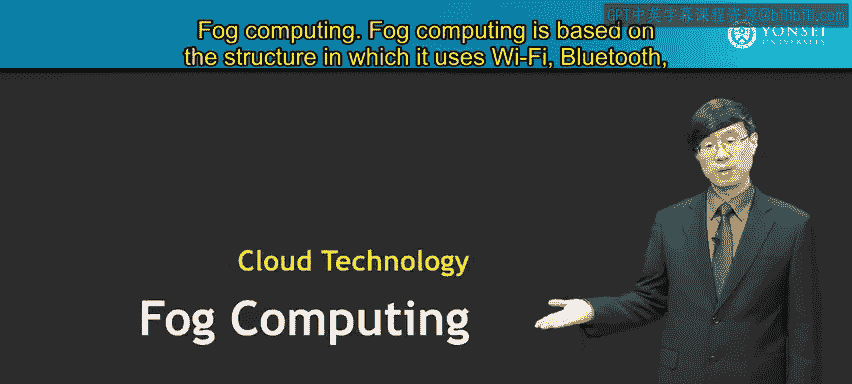
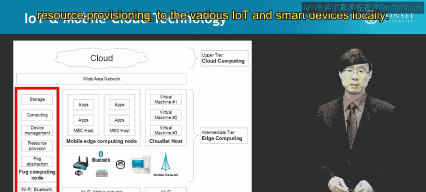
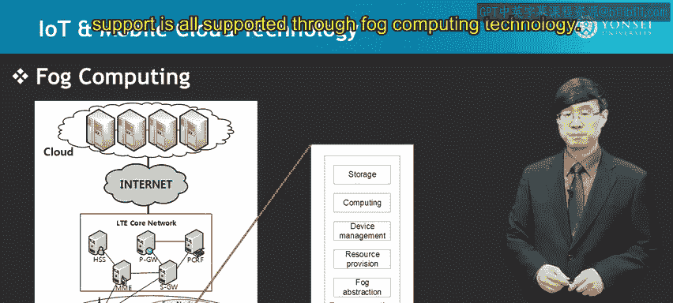
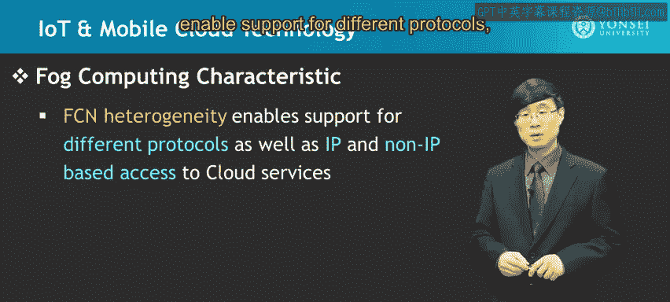

# 延世大学《新兴技术从智能手机到物联网再到大数据》课程 - P117：5.11 雾计算 🌫️

在本节课中，我们将要学习**雾计算**的核心概念。雾计算是一种分布式计算架构，它将数据、计算、存储和应用从集中的云数据中心，扩展到网络边缘的设备附近。我们将了解其工作原理、关键特性以及它在物联网架构中的重要作用。

---

上一节我们介绍了云计算在物联网中的中心化角色，本节中我们来看看它的一个重要补充——雾计算。

雾计算基于一种特定的结构，它利用Wi-Fi、蓝牙或Zigbee、6LoWPAN等各种无线个域网技术。其目的是为本地各种物联网和智能设备提供**存储**、**计算**、**设备管理**以及**雾抽象**和**资源供给**服务。

---

观察整体的网络结构，引入一个雾节点接入移动网络后，它就成为了本地设备新的连接中心。这意味着，如果本地设备需要彼此通信，它们无需访问整个骨干网络，而是可以在本地直接共享和访问彼此。

此外，如果这些设备需要连接到互联网或主云，它们可以请求雾节点建立连接，并通过该雾节点来使用网络连接。这就是我们所说的雾计算。

正如之前提到的，从存储到资源供给和计算支持等一系列功能，都通过雾计算技术得以实现。

---

## 定义与关键特性

雾计算有时也被称为雾网络或雾化。其定义核心在于，它利用一个或多个**协作的终端用户客户端**或**靠近用户的边缘设备**来提供服务。

以下是雾计算支持的主要服务：

*   **存储服务**：提供大量的本地存储，而非将所有数据存储在云端数据中心。
*   **通信支持**：设备通过雾设备进行通信，而非通过互联网骨干网路由。
*   **控制与管理**：通过雾设备提供控制、配置、测量和管理功能，替代由互联网网关进行控制的方式。

在之前学习的LTE网络结构中，有服务网关和PDN网关。雾网络结构可以与之交互、协同工作和通信，使我们也能通过雾节点被集中控制和管理。

---

## 雾计算的特点

雾计算具有以下几个显著特点：

*   **去中心化**：虽然之前的图示中只画了一个雾计算设备，但实际上可以根据特定需求部署许多个。
*   **协作式基础设施**：整体基础设施基于多个**雾计算节点**协同工作。
*   **位置灵活**：FCN可以部署在终端设备和云之间的任何位置。
*   **异构性**：雾节点在本质上具有异构性。这意味着它们不必采用单一的形式、协议或网络类型，可以在结构、模式和协议上多样化，并包含各种功能元素。并非所有雾设备都需要相同，也并非都需要提供相同的服务（例如，一些提供存储，另一些提供交互通信）。
*   **典型设备**：典型的雾计算设备可以包括路由器、交换机、接入点、物联网网关、机顶盒等。反过来，这些设备内部也可以集成雾模块，使其在部署时就能自动支持雾网络。
*   **协议支持**：FN的异构性使其能够支持不同的协议，以及基于IP和非IP的云服务访问。

---

上一部分我们了解了雾计算的架构特点，接下来我们看看其核心的抽象层。

## 统一的雾抽象层

统一的雾抽象层包含一系列功能，用于为各种类型的终端设备提供**资源分配**、**监控**、**安全**、**设备管理**、**存储**和**计算服务**。这一层是雾计算能够灵活服务多样化设备的关键。

---

本节课中我们一起学习了**雾计算**。我们了解到，雾计算通过将计算和存储能力下沉到网络边缘，有效弥补了云计算的延迟和带宽限制。其**去中心化**、**异构性**和**协作式**的特点，使其特别适合物联网场景，能够实现本地设备的快速通信、高效管理和灵活的资源供给。统一的雾抽象层则确保了服务的多样性和可管理性。