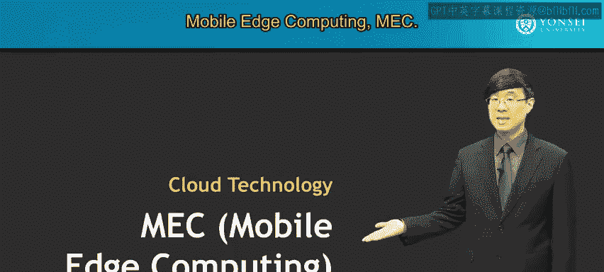
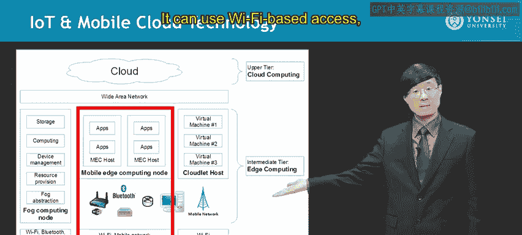
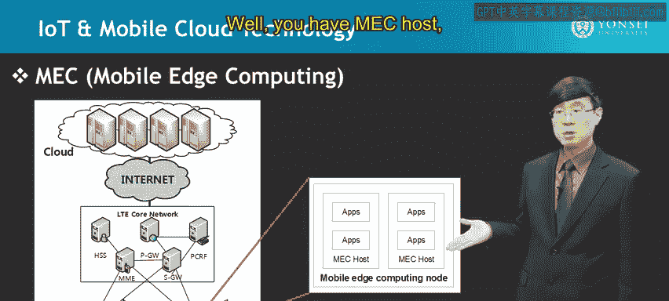
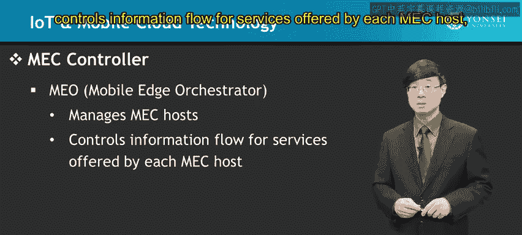

# 118：46_5.12 MEC移动边缘计算 📡

在本节课中，我们将要学习移动边缘计算。移动边缘计算是边缘计算在移动通信网络中的具体应用。

MEC的结构位于中间位置，其基础是移动通信网络。它也可以使用基于Wi-Fi的接入点。

在MEC架构中，存在内部运行着应用程序的MEC主机设备。一个典型场景是在移动通信环境中，将一台MEC服务器添加到移动通信网络中。这台服务器有其特定的部署位置，它将与基站协作，并与移动通信基础设施的无线接入网和核心网协同工作。

MEC是移动边缘计算的缩写，指利用移动通信网络进行的边缘计算。典型的网络通常是3G及更高版本，虽然某些情况下包括3G，但最典型的是像LTE和LTE-A这样的4G网络，以及即将到来的5G标准。5G标准预计将在2019年和2020年发布，这些标准期望在其基础设施上部署和使用各种MEC技术。

MEC主机上运行着应用程序支持。

MEC的定义是：在移动蜂窝网络的边缘实现云计算和IT服务。当我们提到MEC时，我们考虑的是移动通信网络，例如LTE。在基站或核心路由器之外，部署着MEC设备，即小型云设备。这些设备将与互联网另一端的主云进行交互，获取所需内容，并直接交付给智能手机、智能平板、智能手表和其他物联网设备。MEC从根本上基于移动蜂窝网络。

使用MEC的原因如下：

*   **为移动用户设备提供更快的云服务。**
*   **减少网络拥塞。** 如果一个MEC设备能观察多个用户并预测他们的需求，它就可以预先获取正确的资源并快速交付。当本地其他设备也需要相同资源时，MEC已经拥有副本，可以直接重新分发。在传统的移动云计算模式下，每个设备都需要直接与互联网另一端的服务器通信并下载信息，用户数量将与互联网和移动核心网络的流量成正比，这不是我们期望的。MEC的可扩展性特征因此极具吸引力。
*   **提供更可靠的应用程序支持。** 如果我从MEC下载内容，由于距离很近，当数据包出现错误时，我可以直接请求重传，恢复非常容易。如果没有MEC，我需要连接互联网另一端的主服务器，每个数据包错误都需要等待通过互联网重新传输，这效率不高。

MEC的特性还包括：MEC使蜂窝网络运营商能够向授权的第三方开放其无线接入网络，这样应用程序开发商和内容提供商可以更积极地共享移动通信网络的资源，这就像开辟了一个新的服务领域。基于MEC技术，这非常有吸引力，尤其是在结合云计算技术时。

MEC服务器提供实时信息。信息类型包括网络负载和容量、连接到服务器的终端设备信息、位置信息。这对于基于位置的服务尤为重要。随着技术发展，位置服务变得越来越重要，例如智能汽车、无人机以及各种基于我们位置的应用。这些LBS类型的服务可以通过MEC的云计算技术得到有效支持。

此外，MEC基于移动通信网络。当使用MEC时，除了移动通信网络本身提供的精确时钟时间外，还可以支持辅助GPS信息等基于位置的信息。因此，即使在卫星GPS信号不足、难以确定位置的阴影区域，我也可以借助移动通信基础设施获得AGPS支持，从而找到位置并获得所需的高级服务。

其他特性包括：MEC节点通常与无线网络控制器或宏基站共址部署。这意味着数据通信模式和其他信令技术与云计算技术紧密结合，这是MEC的优势之一。在4G LTE-A网络中，基站是eNodeB；在5G移动网络中，基站是gNB。了解这些术语有助于确定MEC云的部署位置。

服务器可以运行多个MEC主机，这是一个优点。云中的一台服务器可以支持多个MEC主机，这些主机可以根据其支持的具体服务或特定用户进行划分。MEC主机可以通过虚拟化接口执行计算和存储任务，这正是该技术力量的来源。虚拟接口、虚拟连接、虚拟机等都以动态方式使用，并被带到足够近的位置，从而实现快速可靠的服务，这正是边缘技术的作用。当我们在移动网络中使用时，这就是MEC为我们所做的。

其中关键的控制器单元是移动边缘编排器。它管理MEC主机，控制每个MEC主机所提供服务的信息流。

同时，它还控制资源和网络拓扑，并管理移动边缘应用程序。

本节课中，我们一起学习了移动边缘计算的核心概念、架构、优势及其在移动网络中的关键作用。MEC通过在网络边缘部署计算资源，显著提升了移动服务的速度、可靠性并降低了核心网络压力，是支撑未来5G和物联网应用的重要技术。