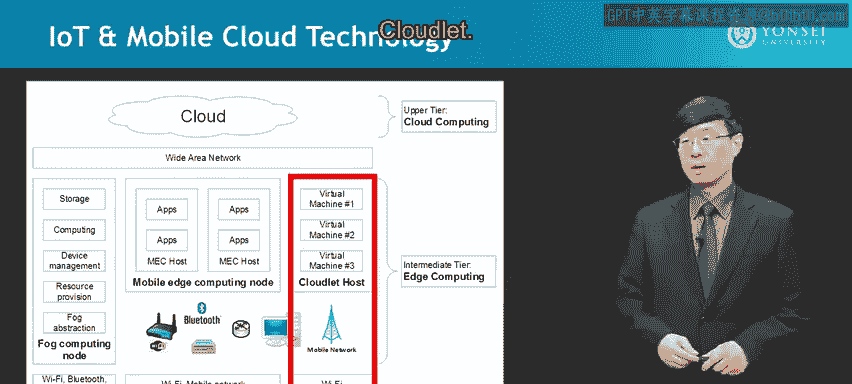
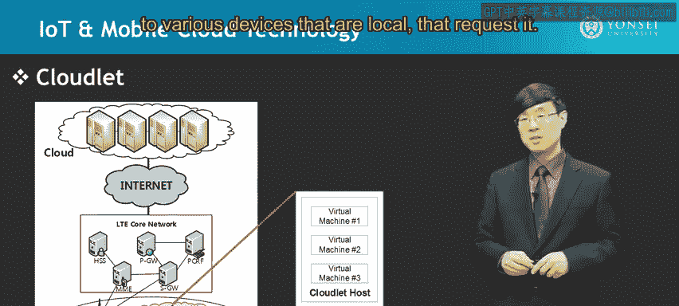
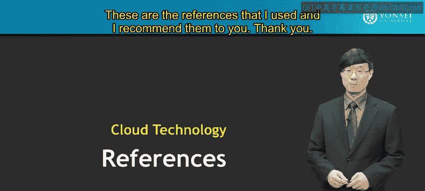

# 延世大学《新兴技术从智能手机到物联网再到大数据》课程 - P119：47_5.13 云朵（Cloudlet） 🏢

在本节课中，我们将要学习一个重要的边缘计算概念——**云朵（Cloudlet）**。我们将了解它的定义、架构、工作原理，并将其与雾计算、移动边缘计算等其他边缘计算范式进行比较。

---

## 概述

云朵是一种位于网络边缘、靠近移动设备的小型云计算数据中心。它的核心目标是为移动设备提供低延迟、高可靠的计算资源，以支持资源密集型和交互式的移动应用。简单来说，它就像一个“盒子里的数据中心”，将云的能力带到离用户更近的地方。

---

## 什么是云朵？ 🤔

云朵的定义基于**移动增强型小规模云数据中心技术**。它们位于互联网的边缘，靠近移动设备。在某些情况下，一些移动设备甚至可以被编程为云朵。

云朵支持资源密集型和交互式的移动应用，并以低延迟为移动设备提供强大的计算资源。云朵位于用户设备（UE）和云端设备之间的某个中间位置。

**核心概念**：云朵是一个“盒子里的数据中心”概念。它将云拉近到用户设备，因此它就像一个**微型云设备**，虽然不具备完整云的所有功能和容量。

---

## 云朵的架构与工作原理 ⚙️

上一节我们介绍了云朵的基本概念，本节中我们来看看它的具体架构和工作方式。

云朵通常通过**Wi-Fi连接**进行访问。其内部运行着**虚拟机**，这是云计算技术的核心特征。

以下是一个示例，展示了云朵的工作方式：我们有一个云服务器（即本地服务器）和一个调制解调设备。它们可能是相互连接的独立设备，也可能集成在一个单元中。它们共同作为本地云支持系统接入网络。当然，它们不具备主云的全部容量和存储内存，因此我们称其为“云朵”。在内部，它们可以支持为本地请求服务的各种设备的虚拟机。

云朵使用虚拟机通过Wi-Fi网络为用户设备实时提供资源。因此，它实现了直接的“一跳”云访问，这正是延迟变得非常小且可靠性大大提高的原因。

云朵的架构基于三层模型：

以下是云朵的三层架构：

1.  **云朵层**：这是一组协同定位的节点，由**云朵代理**管理。
2.  **节点层**：这是在操作系统之上运行的多个执行环境，由**节点代理**管理。
3.  **组件层**：这包括一组与上层接口的服务，具体体现在其执行环境中。

---

## 与其他边缘计算范式的比较 🔄

我们已经了解了云朵的独立架构，现在将其与**雾计算**和**移动边缘计算**进行比较，以便更清晰地理解它们之间的区别。

以下是雾计算、移动边缘计算和云朵计算在多个维度上的对比：

*   **设备/节点**：
    *   **雾计算**：路由器、交换机、接入点、网关。
    *   **移动边缘计算**：运行在基站（如eNodeB或未来的gNodeB）中的服务器。
    *   **云朵计算**：“盒子里的数据中心”概念。
*   **节点位置**：
    *   **雾计算**：在终端设备和云之间变化。
    *   **移动边缘计算**：位于无线网络控制器和基站。
    *   **云朵计算**：本地或户外安装。
*   **软件架构**：
    *   **雾计算**：基于雾抽象层。
    *   **移动边缘计算**：由移动通信网络中的移动协调器控制。
    *   **云朵计算**：由云朵代理控制，节点代理辅助。
*   **上下文感知能力**：
    *   **雾计算**：中等。
    *   **移动边缘计算**：高（能获取更多知识、预测和获取相关内容）。
    *   **云朵计算**：相对较低（因为要分发的必要虚拟机已预先准备和交付）。
*   **邻近性**：
    *   **雾计算**：一跳或多跳。
    *   **移动边缘计算**：一跳（智能手机到基站）。
    *   **云朵计算**：一跳（基于无线局域网，如Wi-Fi，通常比移动基站更近）。
*   **接入机制**：
    *   **雾计算**：蓝牙、Wi-Fi、移动网络或其他无线个域网技术（如Zigbee）。
    *   **移动边缘计算**：主要是移动网络，也可使用Wi-Fi。
    *   **云朵计算**：Wi-Fi是主要接入类型，也可使用其他组件连接。
*   **节点间通信支持**：
    *   **雾计算**：支持。
    *   **移动边缘计算**：部分支持。
    *   **云朵计算**：部分支持。

---

## 特性总结 📊

基于以上比较，我们可以总结出这些范式的关键特性：

以下是雾计算、移动边缘计算和云朵计算的关键特性对比：

*   **物理邻近性**：
    *   雾计算和云朵计算：**高**。
    *   移动边缘计算：**相对较低**。
*   **功耗**：
    *   移动边缘计算消耗**更多功率**（因为信号需要发送到基站）。
    *   雾计算或云朵计算功耗**较低**（设备非常接近）。
*   **计算时间**：
    *   雾计算预计耗时**较长**。
    *   移动边缘计算和云朵计算预计**更快**。
*   **上下文感知**：
    *   移动边缘计算**高**。
    *   雾计算和云朵计算**相对较低**。
*   **逻辑邻近性**：
    *   云朵计算**有保障**。
    *   雾计算和移动边缘计算**可能**。
*   **非IP协议支持**：
    *   雾计算：**是**。
    *   移动边缘计算和云朵计算：**否**（但可以通过特殊设计来支持非IP设备和服务）。

---

## 总结

本节课中，我们一起学习了**云朵（Cloudlet）** 这一边缘计算技术。我们明确了它是位于网络边缘的小型云数据中心，通过Wi-Fi等近距离连接为移动设备提供低延迟、高可靠的计算服务。我们深入分析了其三层架构，并通过与雾计算、移动边缘计算的详细对比，理解了云朵在物理邻近性、功耗、接入方式等方面的独特优势和适用场景。云朵作为“盒子里的数据中心”，是连接移动设备与广阔云端的重要桥梁。

---
**参考文献**：（课程中使用的参考资料，建议读者查阅）