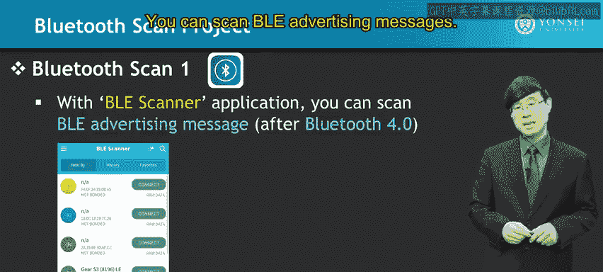
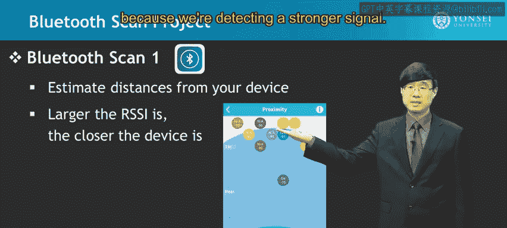
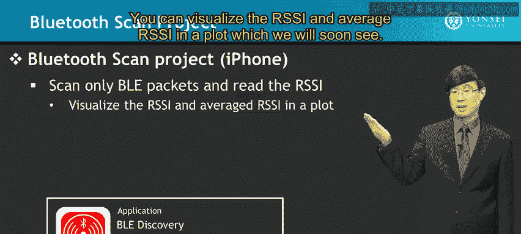
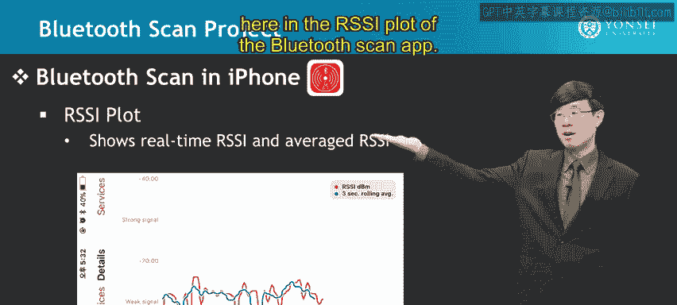

# 120：48_6.1 蓝牙扫描项目 📶

在本节课中，我们将学习蓝牙扫描项目。我们将通过具体的应用程序，实践如何扫描经典蓝牙和低功耗蓝牙设备，并解读扫描结果中的关键信息，如信号强度、设备版本和连接状态。

---

在物联网与云计算技术课程中，我们已经涵盖了无线通信的多个方面。现在，我们将进入直接支持物联网系统的无线通信实验环节。首先从蓝牙技术开始。我将与您一起完成蓝牙扫描项目。

项目包含一个安卓版本，您可以在图中看到两个应用：**BLE Scanner App 1** 和 **Bluetooth 4.0 Scanner App 2**。这些应用可在谷歌应用商店下载。

这些应用的主要功能是：
*   扫描经典蓝牙和低功耗蓝牙数据包。
*   根据扫描信息估算设备的蓝牙版本（通常以蓝牙4.0为分界点）。
*   基于接收信号强度指示估算距离。

---

## 蓝牙扫描一：低功耗蓝牙扫描器 📱

上一节我们介绍了项目概览，本节中我们来看看第一个具体的扫描应用：低功耗蓝牙扫描器。

此应用用于扫描配备蓝牙4.0及以上版本设备的BLE广播消息。

应用的界面如图所示。以下是界面中提供的信息解读：

1.  **框1**：显示数值 `-78`，这是**RSSI**。RSSI代表接收信号强度指示，显示了接收端的功率电平。其值越接近 `0 dBm`，信号越好。当前的 `-78 dBm` 远低于 `0 dBm`，表明信号相对较弱。
2.  **框2**：显示设备名称为 `Gear S3`。
3.  **框3**：显示连接状态和原始数据。

以下是关于数据包的详细信息：
*   **设备名称**：`Gear S3`（如框2所示）。
*   **设备MAC地址**：可供参考的唯一标识。
*   **连接状态**：显示设备是否已绑定。
*   **连接按钮**：尝试通过发送连接请求与设备建立绑定。
*   **原始数据**：以十六进制数字显示接收到的原始数据包内容。图中下方区域展示了实际的报文内容。

此外，该应用能根据RSSI估算设备与您的距离，并提供便捷的显示。**RSSI值越大（即负得越少），表示设备离得越近，因为检测到的信号更强。**

---

## 蓝牙扫描二：多版本蓝牙扫描器 🔍

了解了低功耗蓝牙扫描后，我们接下来看看能区分蓝牙版本的扫描应用。

蓝牙扫描二是项目的下一部分。此应用可以扫描不同蓝牙版本的数据包。

应用主要区分两种扫描模式：
*   **经典扫描**：针对蓝牙4.0之前的经典蓝牙版本。
*   **低能耗扫描**：针对蓝牙4.0及之后的低功耗蓝牙。

点击“开始扫描”按钮后，会显示如图界面。查看详细信息，可以看到：
*   设备标识旁会注明 **`L`**（代表低功耗蓝牙）或 **`Classic`**（代表经典模式）。
*   功率电平（RSSI）也会列在旁边。

从接收到的数据包中还能获取其他信息，包括供应商、描述和设备名称，这些信息都显示在列表中。接收端的RSSI功率值即为图中显示的数字。

---

## iPhone蓝牙扫描项目 📱

对于iPhone的蓝牙扫描项目，我推荐使用苹果应用商店中的 **BLE Discovery** 应用。

此应用可以将RSSI和平均RSSI以图表形式可视化显示，我们马上会看到。

该应用的功能包括：
*   显示广播数据包是否可连接。
*   显示数据包使用的是哪个物理层信道。

让我们用BLE Discovery应用来查看一下。如图所示，您可以扫描BLE广播消息。

在此部分，您可以获取的信息有：**RSSI**、**广播数据**、**本地名称**、**设备名称**。数据信道可能是第37、38或39信道。如果消息是可连接的，则会显示“是”；否则显示“否”，表示它只是一个广播消息，不支持数据通信。

**可连接消息**意味着该设备也支持后续的数据通信。

蓝牙扫描应用的RSSI图表会实时显示RSSI和平均RSSI值。

---

## 参考资料 📚

以上是我使用并推荐给您的参考资料。

---

**总结**

本节课中，我们一起学习了蓝牙扫描项目。我们实践了如何使用安卓和iOS平台上的特定应用（如BLE Scanner和BLE Discovery）来扫描经典蓝牙与低功耗蓝牙设备。我们重点解读了扫描结果中的关键参数：**RSSI（接收信号强度指示）** 用于估算距离，设备名称、MAC地址用于识别设备，以及数据包是否可连接、使用何种信道等信息。通过这个项目，您能够直观地理解蓝牙设备发现与广播的基本机制。