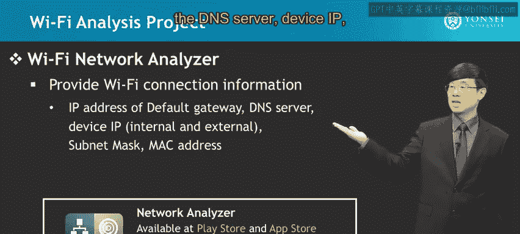
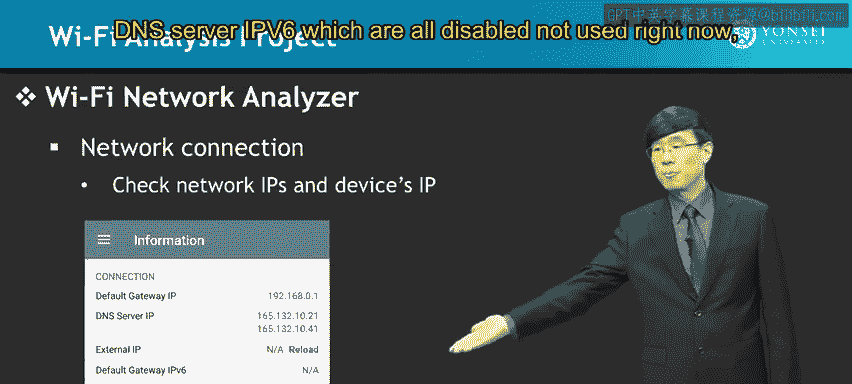
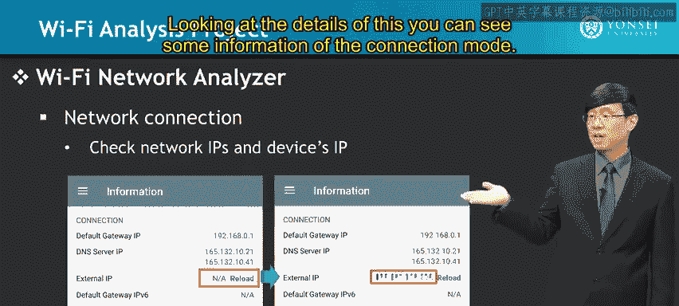
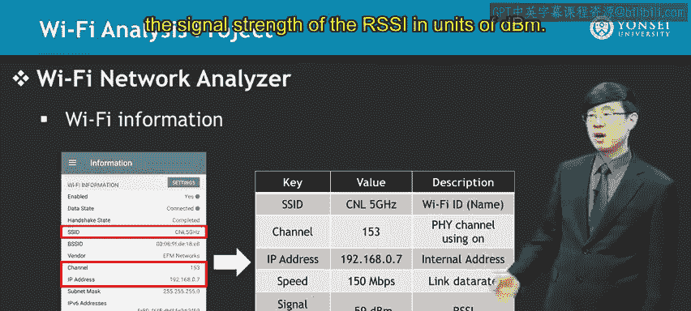
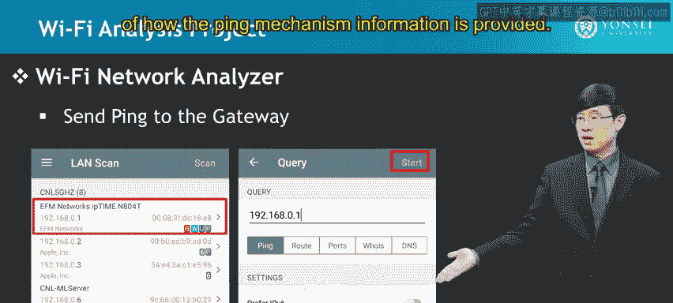
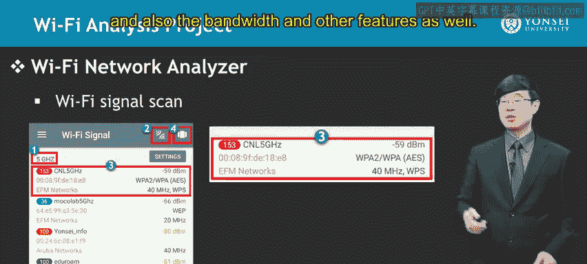
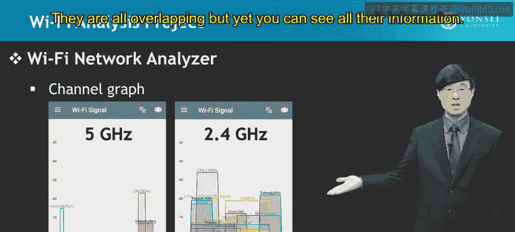

# 121：49_6.2 Wi-Fi分析项目 📶

在本节课中，我们将学习如何使用一款名为“网络分析器”的移动应用程序进行Wi-Fi网络分析。这款工具可以帮助我们查看详细的网络连接信息、扫描附近的接入点并分析信号质量。

---

## 应用获取与基础信息

“网络分析器”应用可在Google Play商店和Apple App Store下载。它能够提供丰富的Wi-Fi连接信息。

以下是该应用提供的基础网络信息：
*   **默认网关的IP地址**
*   **DNS服务器地址**
*   **设备IP地址**
*   **子网掩码**
*   **MAC地址**

---

## 网络连接详情

上一节我们介绍了应用提供的基础信息，本节中我们来看看更详细的网络连接状态。

在“网络连接”部分，你可以查看网络IP和设备IP。如下图所示，你可以看到：
*   默认网关（IPv4）
*   DNS服务器（IPv4）
*   外部IP（IPv4）
*   默认网关（IPv6，当前未启用）
*   DNS服务器（IPv6，当前未启用）
*   外部IP（IPv6）
*   HTTP代理设置

此外，你还可以查看连接模式的详细信息。

---

## Wi-Fi信息详解

接下来，我们将深入查看当前连接的Wi-Fi接入点的具体信息。应用会在这里提供更详细的数据。

我将信息整理并放大以便查看。例如，SSID显示为“CNL_5GHz”。“CNL”代表延世大学的通信网络实验室，这是我们实验室接入点的命名。
你可以看到以下信息：
*   **Wi-Fi名称（SSID）**
*   **正在使用的信道**
*   **内部IP地址**
*   **连接速度（链路数据速率）**
*   **信号强度（RSSI）**，单位为 **dBm**

---

## 局域网扫描功能

使用应用中的“扫描”按钮，我们可以对局域网进行扫描，获取网络内各种设备的信息。

扫描结果右侧的彩色方块字母代表不同的设备或服务类型，其含义如下：
*   **G**: 网关
*   **W**: 网络服务器（端口80或443开放）
*   **U**: 设备提供UPnP或DLNA服务
    *   **UPnP** 代表通用即插即用
    *   **DLNA** 代表数字生活网络联盟，这是一项用于共享多媒体服务的高级功能
*   **P**: 设备可响应ICMP Ping请求
*   **6**: 设备存在IPv6地址
*   **B**: 设备提供Bonjour服务（由苹果公司开发，用于发现打印机和文件共享服务器）
*   **S**: 正在执行扫描的设备（即你的设备）

在顶部区域，你可以向网关发送Ping请求。如图所示，扫描检测到了我们实验室使用的“IP Time”品牌接入点（由EFM Networks公司生产），并显示了Ping机制的反馈信息，包括时间戳和返回结果。

---

## Wi-Fi信号扫描与分析

现在，让我们进入Wi-Fi信号扫描的细节部分。这里可以查看在信号范围内检测到的不同接入点和其他信号。

你可以看到每个信号的**dBm**值，即其信号强度。界面主要分为几个部分：
1.  **频率波段指示**：显示当前查看的是5 GHz还是2.4 GHz频段。
2.  **频段切换按钮**：按下此按钮可在5 GHz和2.4 GHz频段之间切换。
3.  **选定接入点信息**：显示所选接入点的详细信息，包括使用的安全协议类型、带宽等特性。

此区域以列表形式展示了扫描到的所有接入点信息，包括：
*   **RSSI（信号强度）**
*   **SSID（网络名称）**
*   **MAC地址**
*   **带宽**
*   **物理层信道**
*   **加密方案**

下方还列出了加密方式、物理信道及其映射机制的对应关系。

---

## 信道图表可视化

最后，我们来看看一个非常实用的功能——信道图表。通过点击“Wi-Fi扫描”部分的“信道列表图表切换器”，你可以选择不同的视图选项。

现在，你可以看到5 GHz频段和2.4 GHz频段的信道使用情况图表。观察这些信道被使用的密集程度，这是一个非常好的可视化工具。尽管信号可能重叠，但图表通过颜色协调清晰地展示了所有信息，非常直观。

---

本节课中我们一起学习了如何使用“网络分析器”应用进行全面的Wi-Fi网络分析。我们从获取应用开始，逐步探索了如何查看基础网络信息、分析当前Wi-Fi连接详情、执行局域网设备扫描、解读扫描结果中的各种标识，以及利用信号扫描和信道图表功能来评估无线网络环境。这些技能对于理解网络构成、诊断连接问题以及优化无线信号覆盖都非常有帮助。