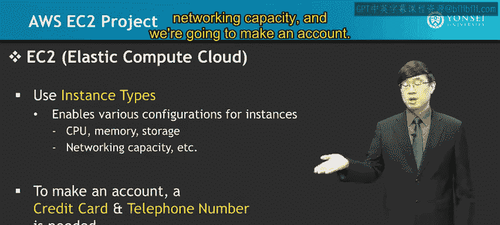
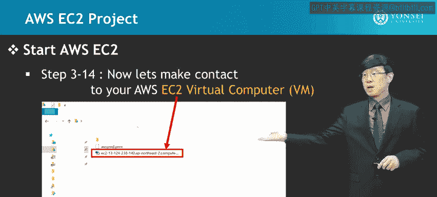
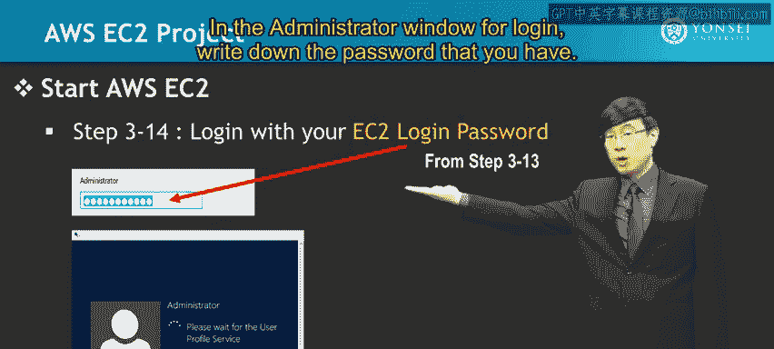
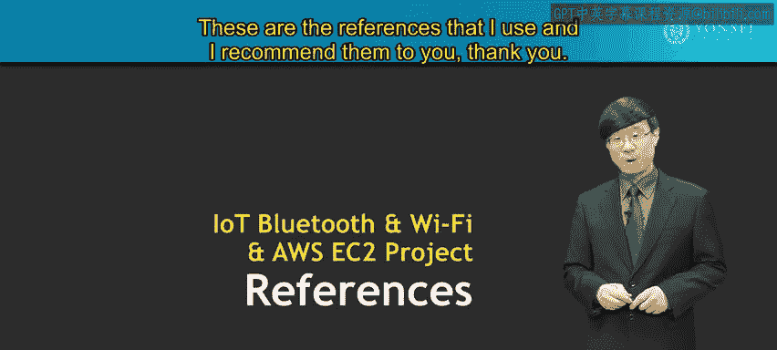

# 122：50_6.3 AWS EC2项目 🚀

在本节课中，我们将学习如何在亚马逊云服务中创建一个AWS EC2实例。EC2代表**弹性计算云**。我们将创建一个虚拟计算环境，即一个基于云的虚拟机系统。

## 概述

本节教程将指导你完成AWS EC2实例的创建过程。我们将使用预配置的亚马逊机器镜像来设置服务器，并配置计算资源。整个过程从注册账户开始，到成功登录你创建的虚拟机结束。

## 第一步：创建AWS账户并开始免费试用

为了创建EC2实例，你需要一个AWS账户。注册账户需要一张信用卡和一个电话号码。

以下是创建账户的步骤：

1.  访问AWS官网，点击注册按钮开始创建账户。
2.  设置你的AWS账户名称。
3.  账户类型选择“个人”模式。建议初学者从个人模式开始，以便熟悉系统，待熟练后再切换到专业模式。
4.  在指定区域填写你的信用卡或借记卡信息。
5.  提供一个电话号码以完成验证流程。
6.  在提供的套餐选项中，选择免费的“基础套餐”模式。

完成注册后，使用你的AWS账户邮箱地址登录控制台。

## 第二步：登录控制台并启动虚拟机

登录后，你将看到AWS控制台选项。在“构建解决方案”区域，我们将专注于启动一个虚拟机。

以下是具体操作：

1.  在“构建解决方案”选项中，选择“启动虚拟机”。
2.  系统会提示你选择一个**亚马逊机器镜像**。AMI是一个预配置的模板，包含了操作系统、服务器和应用程序。
3.  选择服务器所在的地理区域。例如，可以选择“首尔”区域。
4.  接下来，选择AMI的操作系统类型。AWS提供了多种选择，如Windows、Linux等。
5.  在本教程中，我们选择 **Windows Server 2012** 作为示例操作系统。
6.  选择实例类型。实例类型决定了CPU、内存、存储和网络容量等配置。建议点击查看详情，了解不同选项后再做选择。

## 第三步：配置实例并启动

上一节我们选择了实例的操作系统和类型，本节中我们来完成剩余的配置并启动实例。

以下是配置和启动流程：

1.  点击“下一步：配置实例详细信息”。
2.  在“添加存储”页面，设置所需的存储大小。在个人模式下，最大容量通常为30GB。我们可以选择使用30GB，然后点击“下一步：添加标签”。
3.  在标签页面，点击“添加标签”并为实例设置一个名称。标签由“键”和“值”组成。
4.  点击“下一步：配置安全组”。安全组充当虚拟防火墙。
5.  配置安全组名称和类型。请注意名为 **RDP** 的规则，它使用 **TCP** 协议，这是Windows远程桌面连接所必需的。
6.  检查所有启动设置，确认无误后，点击“启动”按钮。这个操作将为你创建并启动虚拟机。

## 第四步：创建密钥对并连接实例

启动实例后，系统会提示你选择或创建一个密钥对。密钥对用于安全地连接到你的实例。

以下是操作步骤：

1.  如果你没有现成的密钥对，选择“创建新密钥对”。
2.  在“密钥对名称”字段中输入一个名称。
3.  点击“下载密钥对”按钮。这将生成一个 `.pem` 格式的私钥文件，请妥善保存。
4.  完成设置后，点击“启动实例”。
5.  查看启动状态信息，并点击“查看实例”以监控实例的创建进度。

实例状态显示为“运行中”后，即可进行连接。

## 第五步：获取密码并登录EC2实例

要登录到我们创建的Windows实例，需要先获取解密密码。

以下是获取并登录的步骤：

1.  在实例列表中，选中你的实例，然后点击“连接”按钮。
2.  在连接对话框中，点击“下载远程桌面文件”。
3.  接着，点击“获取密码”功能。
4.  要生成密码，你需要使用在第三步中下载的密钥对文件（`.pem` 文件）。点击“浏览”上传该文件。
5.  系统会使用 **RSA加密私钥** 来解密并生成你的登录密码。生成的密码将显示在窗口中。
6.  **重要**：请务必记录此密码。建议将其写下或用手机拍照保存，后续登录时需要用到。

现在，使用下载的远程桌面文件和刚刚获取的密码，即可登录到你的AWS EC2虚拟计算机。

## 第六步：探索你的EC2虚拟机

欢迎使用你的EC2虚拟计算机！你现在登录的是位于AWS云上的Windows Server 2012系统。你可以看到IP地址等详细信息。

AWS EC2的强大之处在于它提供了多种操作系统选择。使用云技术，你不再受限于单一操作系统的物理计算机，可以根据需要轻松创建基于不同操作系统的实例，并尝试各种服务。

## 项目任务与总结

本节课中我们一起学习了如何从零开始创建并连接一个AWS EC2实例。

作为课后练习，请尝试以下操作：

*   基于另一种操作系统（如Ubuntu Linux）创建一个新的EC2实例。
*   探索AWS的其他服务，例如在“计算”类别下的EC2，以及在“存储”类别下的S3服务。
*   创建这些服务，并了解它们的功能。

通过动手实践，你将更深入地理解云计算虚拟机的灵活性和强大功能。

