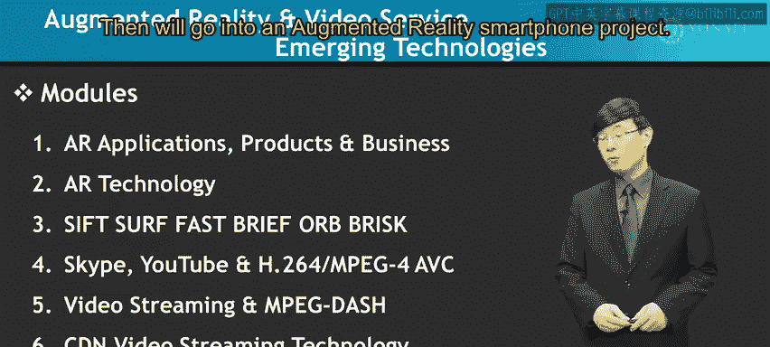
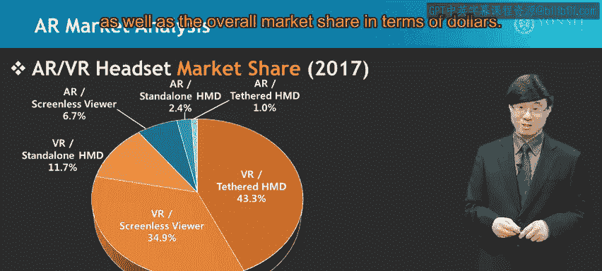
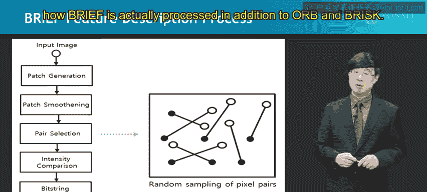
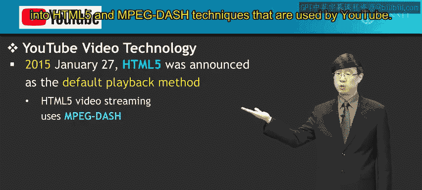
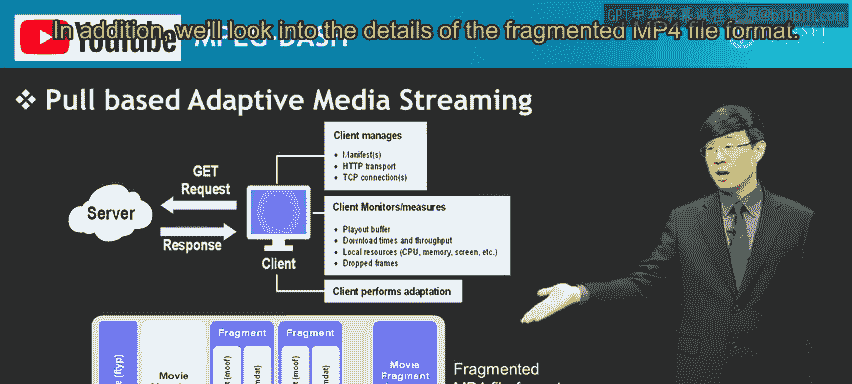
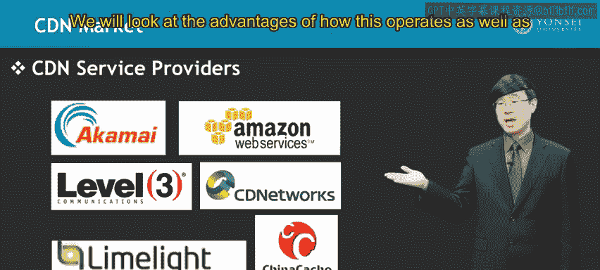
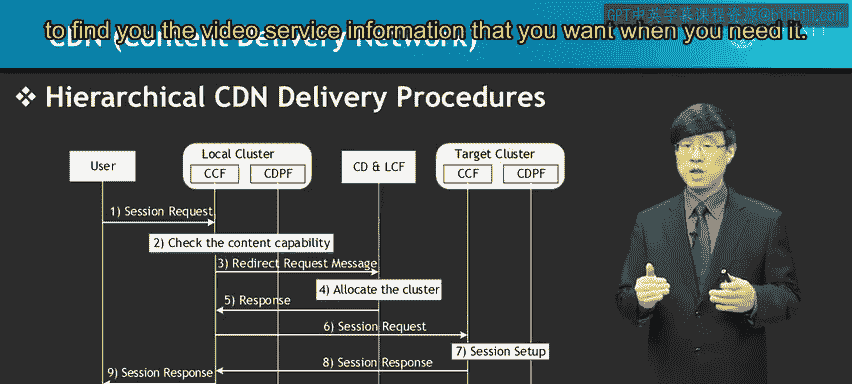
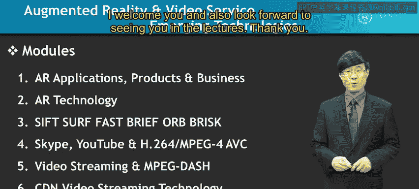

# 123：增强现实与视频服务导论 🚀

在本课程中，我们将学习增强现实（AR）与视频服务这两大新兴技术。课程内容涵盖AR的应用、技术原理、关键算法，以及以Skype和YouTube为代表的视频通信与流媒体技术。我们将深入探讨这些技术如何工作，并了解支撑其运行的网络架构。

---

欢迎来到“增强现实与视频服务新兴技术”课程。

本课程是“从智能手机到物联网再到大数据”专项课程的一部分。我是延世大学的钟文钟教授，欢迎大家。

本课程的模块包括：AR应用、产品与商业；AR技术；SIFT、SURF、FAST、BRIEF、ORB和BRISK等特征提取算法。之后，我们将深入研究Skype和YouTube及其所使用的视频技术，特别是H.264/MPEG-4 AVC。接着，我们会探讨视频流媒体及MPEG-DASH技术。我们将仔细研究基于CDN（内容分发网络）的视频流媒体技术，这项技术目前非常流行。最后，我们将进行一个增强现实智能手机项目。

---

上一节我们概述了课程框架，本节中我们来看看增强现实与虚拟现实（VR）的市场概况。

根据2017年的数据，我们可以看到整体的市场份额。此外，还有基于VR和AR技术的头戴式设备市场份额。在分析现状的同时，我们也将展望未来，预测这些技术将如何在新设备中发展和扩张，包括设备的销售数量以及以美元计的整体市场份额。

---

了解了市场前景后，接下来我们聚焦于正在迅猛增长的市场细分领域。

我们将研究AR设备类型，重点关注智能手机、基于眼镜的系统、头戴式显示器系统，以及实验室设置（例如我实验室中的配置）。

---

在介绍了AR设备类型后，下一讲我们将聚焦于AR技术的核心组件。

紧随其后的是实际的增强现实处理技术。它是如何工作的？我们将了解其细节。此外，如果我们使用**云卸载**技术来减轻AR眼镜、头戴式显示器或其他支持AR服务的智能手机设备的负担，情况会如何？让我们将大部分计算负担转移到云端来协助处理。这将有助于节省智能设备或AR设备的能量，同时基于更强大的计算能力和更大的数据库提供额外服务。

---

深入探究增强现实处理过程，最具挑战性的部分之一是**特征提取**。

我们将聚焦于其具体实现方式，并了解一些最常用的技术。这些是增强现实在特征检测与描述中使用的技术。由于这些技术几乎用于所有AR设备，我们将更仔细地研究它们。

以下是几种关键的特征提取算法：

*   **SIFT**：尺度不变特征变换。
*   **SURF**：加速稳健特征。
*   **FAST**：角点检测算法。
*   **BRIEF**：二进制鲁棒独立基本特征。
*   **ORB**：Oriented FAST and Rotated BRIEF。
*   **BRISK**：二进制稳健不变可扩展关键点。

---

在掌握了AR的核心技术后，我们将转向视频通信领域，深入研究Skype的视频会议技术。

我们将仔细审视Skype视频和音频编解码器的演进历程，但会更侧重于微软自2011年收购Skype以来所使用的视频编解码器，特别是**H.264/AVC**。

---

接下来，我们将探讨YouTube的视频技术。

我们将了解YouTube所使用的HTML5和**MPEG-DASH**技术，并研究各种视频分辨率以及MPEG-DASH在YouTube中的应用方式。

---

为了理解自适应媒体流技术的工作原理，我们需要看看MPEG-DASH如何支持YouTube等视频流媒体系统的服务。

我们将深入了解服务器与客户端如何交互和协作。此外，我们还会研究**分片MP4文件格式**的细节。

---

然后，我们将聚焦于HTTP技术，并举例说明所有这些技术如何协同工作。我们还将深入研究**MPD**的细节，这非常重要，因为许多信息以及各种内容的结构提供方式，都隐藏在此规范中。我们也会探讨**T模式**，这是您在使用YouTube时经常用到的一项服务，例如用手指按住并拖动以查看视频的不同部分。

为了解释这一点，我们将深入了解**I帧、P帧和B帧**以及整体的视频服务技术。此外，我们将了解最流行的视频流媒体系统如何通过CDN技术获得支持。我们将研究其运行方式的优势。

---

以下是主要服务提供商及其特点：

*   全球及区域性的CDN服务商。
*   它们各自的技术特点与覆盖范围。

随后是实际的网络架构，了解这些功能块的作用以及集群是如何形成的。

---

以及它们按时间顺序的操作流程，以确保在您需要时能为您找到所需的视频服务信息。

---

最后，我们将进行一个与**IKA Catalogta**相关的项目，下载一个应用程序并进行一些实验，重点关注各种类型的应用。然后，我们将进行一个与**Google Translate**相关的项目，查看各种模式并进行测试。我们将通过这两个增强现实应用程序，来了解最先进的AR支持系统的功能极限与潜力。

---

我欢迎大家学习所有这些基于以上模块的讲座。

我邀请大家与我一同完成“增强现实与视频服务新兴技术”这门课程。欢迎大家，并期待在讲座中与大家相见。谢谢。

---

在本节课中，我们一起学习了“增强现实与视频服务新兴技术”课程的总体框架。课程从AR与VR的市场分析入手，逐步深入到AR设备类型、核心技术（特别是特征提取算法），然后转向视频服务技术，涵盖了Skype的编解码器、YouTube的流媒体技术（MPEG-DASH）、CDN架构，最后以两个AR实践项目收尾。这门课程旨在为大家构建一个从理论到实践的完整知识体系。