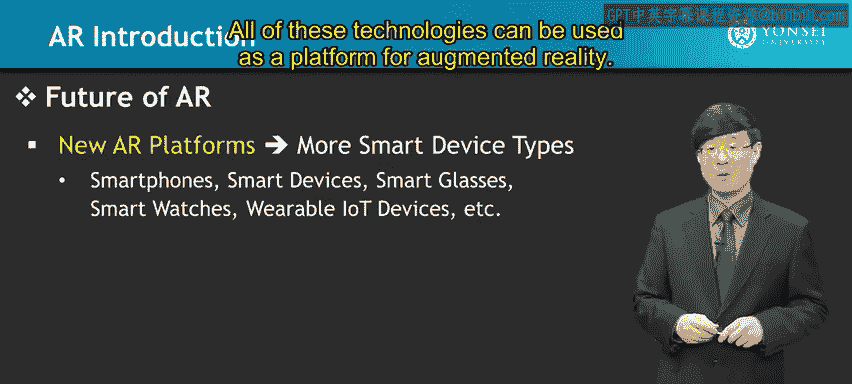

# 124：1_1.1 增强现实（AR）介绍 👓

在本节课中，我们将学习增强现实（AR）的基本概念。课程将从AR的应用、产品和商业领域的第一部分开始，首先介绍增强现实的定义、类型、发展历史以及其当前变得重要的原因。

---

## 增强现实的定义

增强现实是一种技术，它能够将计算机生成的虚拟文本或图像实时叠加到用户对现实世界的视野之上。

**公式**：`AR = 真实世界视图 + 计算机生成的虚拟信息`

---

## 增强现实的用户界面类型

增强现实可以使用的用户界面类型多种多样。以下是主要的几种：

*   **屏幕与显示器**：例如智能手机、平板电脑或电脑屏幕。
*   **头戴式设备**：包括头盔、面罩、眼镜、护目镜和头戴式显示器。
*   **其他表面**：例如车窗或汽车挡风玻璃。从实践角度讲，任何可用于现实世界视图的表面基本上都可以作为增强现实的显示界面。

---

## 手持式增强现实显示设备

在手持设备中，智能手机是实现增强现实的最佳选择。

智能手机是增强现实模型取得初步商业成功的原因。这是因为智能手机拥有强大的处理能力、优质的摄像头和显示屏。同时，这些设备的便携性使其成为增强现实的完美平台。

例如，下图展示了在智能手机上使用增强现实的一个模型。

---

## 增强现实眼镜

对于个人用户而言，增强现实眼镜是实施增强现实的第二佳平台。

谷歌眼镜是最早展示出在眼镜上实现增强现实潜力的产品之一。从外部看，其他人可能看不到投射给个人用户的内容，这带来了信息隐私方面的真正好处。此外，可以看到它配备了一个摄像头模块，摄像头捕捉到的信息被检测后，各种信息和字符会被投射到镜片内侧，仅供用户查看。

---

## 头戴式显示器

头戴式显示器比眼镜稍大一些，其功能和性能当然也更强大。

如下图所示，这是一种能够提供沉浸式增强现实体验的移动增强现实设备。

这里展示了一个飞机维护和航空领域的应用示例。

---

## 增强现实的描述

接下来，我们将讨论增强现实的描述方式。

虚拟文本或图像可以叠加在用户现实世界视图中的选定对象上。增强现实生成的叠加虚拟文本或图像是关于该选定对象或其周围相关对象的含义，其选择方式旨在增强为用户定制的信息。

因此，增强现实基于**情境感知计算**，这意味着显示的内容是经过选择并为用户定制的。如果你使用增强现实，显示在设备上的信息将根据你想看到的内容进行定制。

对于增强现实用户而言，现实世界和虚拟对象共存于同一视点。例如，当用智能手机观看博物馆中的一幅画时，增强现实设备可以叠加关于这幅画或艺术杰作的信息，你可以看到信息覆盖在原画之上。请注意，这只是一个演示；在实际的增强现实设备中，通常不会如此大面积地覆盖对象，以免妨碍对原始对象的观看。

---

## 增强现实开发环境

这是一个曾在我实验室与研究生们一起使用的增强现实开发环境。它基于我们早期测试和开发增强现实的模型之一。如图所示，我们的测试环境集成了测量系统功率和响应时间的所有单元。当然，也存在更大的单元。目前，我们正在更多平台上进行开发，包括头戴式显示器、眼镜以及智能手机。

---

## 增强现实与虚拟现实的简史

由于增强现实和虚拟现实共存且有一些相似之处，但也存在许多差异，我们需要了解两者。

*   **1901年**：作家弗兰克·鲍姆首次提出了“角色标记器”的概念，即一种覆盖在现实生活（尤其是人）之上的电子显示器。例如，一个人上方或附近会显示其姓名、年龄或其他对观看者有用或需要的信息。这是最初的概念。
*   **1989年**：杰伦·拉尼尔创造了“虚拟现实”一词及其概念模型。虚拟现实与增强现实不同。在虚拟现实中，你拥有一个虚拟的、动画化的环境，而非真实世界。其优点在于，这个世界可以是你想要的任何样子，可以被完全设计和动画化。此外，你在那个虚拟世界中互动的角色将是一个化身或某个对象，由你的动作控制。因此，虚拟现实世界中的一切都是虚构的，包括你自己，你可以被转化为某个对象、角色或化身。
*   **1990年**：增强现实的概念被整合提出。增强现实与虚拟现实之间的区别需要进一步审视，我们将在接下来的几页内容中进行探讨。

---

## 为何现在学习增强现实？

增强现实听起来像是一项相当古老的技术，因为其术语在1990年就已提出。那么，为什么我们现在要学习它？它为何现在变得重要？

探究其原因如下：

*   **高分辨率摄像头**：智能设备（包括头戴式显示器、智能手机和眼镜）上的高分辨率摄像头能够实现精确的图像和物体识别。
*   **强大的处理能力**：随着功能强大的CPU、GPU的发展以及各种其他软件技术的进步，使得捕捉到的图像能够被非常快速地处理，这是增强现实现在有用的另一个原因。
*   **快速且充足的内存**：这涉及图像处理，需要保存图像然后进行处理。这意味着我们必须拥有快速且充足的内存，这是现代技术的真正优势之一。
*   **高清显示屏**：我们的智能设备、各种头戴式显示器以及眼镜上的高清显示屏，使我们能够准确地显示附加对象或文本脚本，从而用信息增强现实。
*   **网络连接**：我们无法在设备本身完成所有处理，因为智能设备、眼镜类增强现实设备或头戴式显示器大多是便携式的。便携设备设计轻巧且电池能量有限。因此，当我们拥有可用的网络连接时，我们就不必在那些设备（如智能手机、眼镜或头戴式显示器）上完成所有的处理、信息检索和字符生成。我们可以依赖服务器、云端或增强现实计算机来协助我们，但这意味着我们需要通过网络（无线和有线网络）连接到它。随着这些技术的进步，增强现实正发挥其真正潜力，成为一种真正的服务和产品。
*   **多样化的新平台**：正如前面幻灯片所解释的，我们现在拥有非常强大的智能手机、智能设备、智能眼镜、智能手表、可穿戴物联网设备，所有这些技术都可以作为增强现实的平台。

因此，增强现实只会变得更好、更广泛，在从汽车到驾驶设备、无人机控制等各个领域得到更频繁的应用。正因为如此，技术将不断演进，使其更快、更准确、信息更丰富。此外，功耗将下降，并将出现新的节能方法，从而延长设备的使用寿命。它将更易于使用、更便携、更便宜，拥有更多功能和特性，并且更可靠、更耐用。增强现实的所有这些特性正在成为可能。我个人也正在与我的研究生进行研究以实现这些目标。因此，可以预见增强现实将以更强大的姿态、更丰富的形式出现在几乎每一种产品和每一个方面。这就是我推荐你深入学习本课程后续内容的原因，它将详细解释增强现实是如何实现的。

---

本节课中，我们一起学习了增强现实的基本定义、主要设备类型（如智能手机、眼镜和头戴式显示器）、其发展简史，以及推动其在当今时代蓬勃发展的关键技术因素（如处理能力、显示技术和网络连接）。增强现实作为一项融合现实与数字信息的技术，正随着硬件和软件的进步而不断演进，拥有广阔的应用前景。