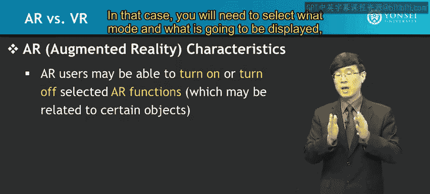
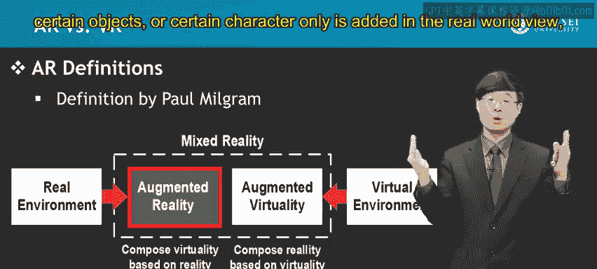

# 125：2_1.2 AR与VR的比较 🎮👓

在本节课中，我们将比较增强现实与虚拟现实，检查它们的定义、相似之处与不同之处。

---

## 概述

我们将从定义出发，探讨虚拟现实与增强现实的核心区别，并介绍增强现实所依赖的关键技术。理解这些概念是掌握后续更深入技术内容的基础。

---

## AR与VR的定义与核心区别

上一节我们介绍了新兴技术的背景，本节中我们来看看增强现实与虚拟现实的具体含义。

**虚拟现实** 的用户会完全沉浸在一个**人工构建的、非真实的环境**中。这个环境完全是虚构的。这非常适合游戏场景，因为你想让游戏玩家体验一个完全不同的世界。用户（玩家）通常会使用一个**虚拟化身**在虚拟现实空间中存在和互动。

用户在虚拟现实中的视野与现实环境不同。因此，幻想和错觉在虚拟世界中很容易创造。

**增强现实** 是现实生活与虚拟现实的混合。增强现实用户能够获取关于位置、物体的有用信息，并且可以与虚拟内容进行交互。增强现实基于**现实世界的视角**，其中特定的物体或项目通过添加信息、某种描述或象征性符号得到增强，以帮助用户完成特定任务。

而虚拟现实则完全是一个由虚构角色构成的、可以与之互动的虚构环境。

增强现实用户可以区分叠加的虚拟物体，这一点很重要。这样你可以识别出哪些部分被增强、添加或提升了。

增强现实用户可能能够开启或关闭特定功能。这是必要的，以便你可以选择处于何种模式以及需要哪些信息。此外，在某些情况下，增强现实显示器上可能有过多信息，遮挡了现实世界的视野，你可能不希望如此。在这种情况下，你需要选择显示何种模式与内容，增强现实技术应能让你正确地做到这一点。

---

## 现实-虚拟连续体与混合现实

与虚拟现实相比，增强现实用户通常感觉与现实世界的分离感较小。这是因为他们看到的是现实世界，只是世界被增强了。

虚拟角色或文本被添加到现实世界中，使得现实世界在信息层面得到增强。幻想和错觉可以被创造并叠加在现实世界视角上，这是增强现实的真正优势。

从定义的角度看，可以这样理解：一边是**真实环境**，一切都是真实的，没有虚构；另一边是**虚拟环境**，即虚拟现实领域。在虚拟现实领域，一切都是虚构的。此外，你在虚拟现实环境中存在的角色也是一个虚构角色，尽管它可能以某种方式被动画化，看起来像你，但总体上那不是你。

在真实环境与虚拟环境之间的这个**混合现实**领域，就是增强现实领域。我们可以这样看待：该领域包含**基于现实的虚拟合成**，而**基于虚拟的现实合成**则被称为“增强虚拟性”。

这意味着什么？可以这样想：增强现实是一个**现实世界视角**，其中添加了虚拟物体或虚拟文本。那么，什么是“增强虚拟性”？可以这样理解：你可能有一个虚拟现实领域，一切都是完全动画的。但当你打开某扇门或某个盒子时，你实际上可以看到一部分基于某个真实摄像头的现实世界景象。这就像在虚拟现实领域中拥有一个现实世界视角，那就是增强虚拟性。而增强现实是在现实世界中，只有部分文本、特定物体或特定角色被添加到现实世界视角中。这就是我们所说的区别。

---

## 增强现实的另一种定义与技术基础

另一种定义基于此：如果存在一个结合了现实世界和虚拟现实的领域，同时结合了一个我们可以共存于其中的**三维图像/空间**，并且因为我们在现实世界中而能够实现**实时交互**。那么，这三个领域交叉的区域，就是增强现实真正特性得以体现的地方，基于这个定义。

那么，基于增强现实的支撑技术有哪些？以下是主要类别：

*   **传感器基础**：例如**全球定位系统**用于告知你的经纬度位置；**陀螺仪传感器**显示设备的运动状态；**加速度计**告诉你沿某个方向加速或减速的快慢。这些传感器采集的数据可用于各种设备，使增强现实更真实、更精确。
*   **视觉基础**：这是我们本课程后续讲座中将深入研究的领域。其中会用到计算机视觉技术，例如**OpenGL**等开源图形库工具。我们使用这些工具来创建增强现实技术，以检测场景中的物体，识别我们感兴趣的对象，然后找到恰当的特征描述或信息显示在其附近或之上。
*   **混合追踪基础**：这就像是传感器基础与视觉基础的结合。对于典型的应用，如户外增强现实，你需要两者兼具：既需要传感器，也需要视觉基础的增强现实技术支持。

---

## 总结

本节课中，我们一起学习了增强现实与虚拟现实的核心区别。我们明确了VR构建完全虚构的沉浸环境，而AR则在现实世界基础上叠加虚拟信息。我们还探讨了“现实-虚拟连续体”的概念，区分了增强现实与增强虚拟性。最后，我们介绍了实现增强现实的三大技术支柱：传感器基础、视觉基础和混合追踪基础，为后续深入学习奠定了基础。

---
**参考资料**：（课程中提及的参考文献，建议进一步阅读）