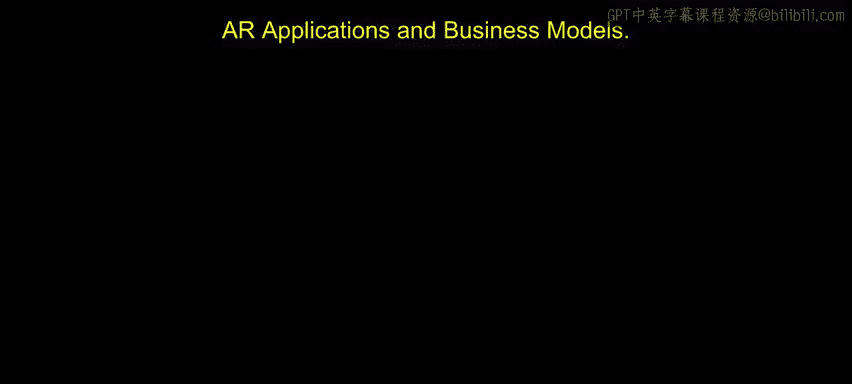
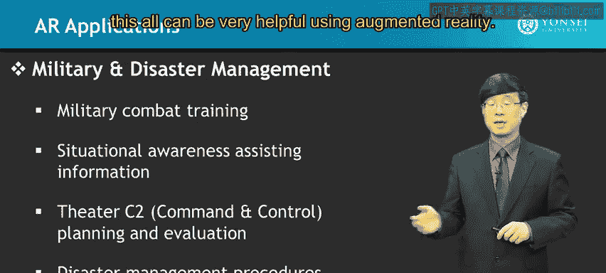
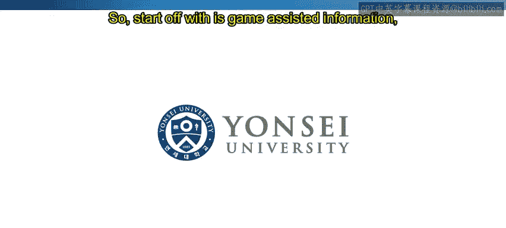

# 126：3_1.3 AR应用与商业模式（第1部分）📱➡️🌐➡️📊

在本节课中，我们将学习增强现实（AR）技术在不同领域的具体应用及其潜在的商业模式。AR不仅仅是游戏和滤镜，它在建筑、考古、商业、教育、医疗乃至军事等多个严肃领域都发挥着重要作用。

## 🏗️ 建筑与规划

上一节我们介绍了AR的基础概念，本节中我们来看看它在建筑与规划领域的应用。建筑与景观的规划设计绝对可以从增强现实技术中受益。

以下是AR在建筑领域的具体应用方向：

*   **建筑与景观规划**：利用AR技术，设计师可以将虚拟建筑模型叠加到真实环境中，直观地评估设计效果。
*   **遗址重建**：通过将考古信息叠加到对地形的扫描结果上，AR可以帮助我们可视化地重建历史遗迹的原貌。

当然，你可以看到增强现实技术如何真正地为这些领域做出贡献。

## 🎨 艺术与表演

从建筑规划转向创意领域，AR同样大有可为。在艺术与表演方面，全息与3D设计、动画设计辅助、乐谱辅助、声音协调服务以及图像与声音协调服务，这些都是增强现实技术可以发挥巨大作用的地方。

## 🛒 商业应用

在商业领域，AR的应用正变得越来越普遍。它可以帮助用户在商品目录中选择产品，查找关于某个产品或物体的详细信息，以及获取实时库存和销售信息。目前已经有一些技术支持上述功能。

我将在后续课程中深入讲解这些技术，但显然，你可以看到增强现实在哪些方面可以如此有效。对于杂志上只是一张图片的商品目录，它并不能给你带来良好的感受。但如果应用了增强现实技术，你可以将产品提升到一个新的层次：看到正在销售的实际物体，可以旋转它，从不同角度和光照条件下观察，甚至放大以看清表面的纹理。

这些功能，以及产品的操作方式，都可以基于AR服务提供商提供的信息来展示。这类功能使产品更具吸引力。此外，还有各种方法可以为客户创造额外的销售亮点，这些亮点是简单的图片和目录无法清晰展示的产品特性。

## 🏫 教育领域

接下来，我们看看AR如何变革教育。AR可以为学生提供定制化的辅助文本、图形、视频和音频支持。它还能创造对历史事件的交互式计算机模拟体验，并用于探索。

你可以看到它在这里的应用潜力：让学生和老师“回到”过去，前往他们无法亲身到访的地点。通过增强现实技术，他们可以看到如果没有这项技术支持就无法看到的事物。显然，AR有无数种方式可以提升教育体验。

## 🏥 医学科学与工程

从教育转向更专业的医学领域，AR的应用同样关键。这包括对患者生命体征的健康扫描。换句话说，当观察某个图像或扫描某个特征时，医生或护士可能无法捕捉到每一个微小而准确的细微迹象，然而机器可能能够以非常精确的方式捕捉到这些信息。

此外，在医学图像处理方面，例如查看CT扫描、MRI或X光片时，分析整体图像的人可能不易察觉某些细节，但增强现实设备或许能够发现医生或护士未能发现的东西。

在**机器人手术支持**方面，目前有许多机器人手术技术，它们不是进行大切口的大型手术，而是让小型机械臂进入并执行手术程序，从而显著缩短恢复时间。为了进行这种进入非常狭窄空间并对患者进行极其精确治疗的机器人手术，医生无法进入并打开那个部位进行观察。因此，增强现实的视觉呈现，以及精确定位摄像头所见的特定事物，可能会极大地帮助机器人手术。

在**麻醉程序支持**方面，当然，当你进行这类使特定区域麻木的程序时，针头需要进入特定位置，例如神经流经的地方，必须在非常精确的水平上释放一定量的麻醉药物。那么针头进入多深？它是否到达了正确的神经细胞？它在脊髓中的位置是否正确，以便安全地释放适量的药物？所有这些类型的程序都可以通过增强现实来增强，以指导医生和护士以正确的方式进行操作。

## ⚔️ 军事与灾难管理

最后，我们探讨AR在军事与灾难管理领域的应用。在这方面我们可以做很多事情，我也在这一领域进行大量研究。

这包括**军事战斗训练**和**态势感知辅助信息**。什么是态势感知？这是一项技术，通过它我们可以获得整个战场的全景视图，并想弄清楚正在发生什么、我们的防御状况如何、应该将军队部署在哪里、潜在的攻击可能如何发生以及敌人现在的位置。所有这些都可以通过态势感知辅助增强现实设备来提供。

因为军事应用大量使用伪装技术，使得即使敌人在野外，你也无法看到发生了什么。他们总是处于某种隐蔽位置或使用特殊覆盖物，以至于无法被轻易用人眼检测到。然而，增强现实设备或许能够通过特定模块检测到非常微小、不规则的运动或热辐射，从而发现那里存在的东西，比如军事敌人或恐怖袭击的迹象，而这些可能不易被人眼察觉。

特别是在战斗情况下，或者已经发生恐怖袭击威胁之后，参与灾难恢复或军事防御行动的人员会进入一个非常混乱、压力巨大的情境，他们必须立即做出反应和行动。因此，他们可能无法发现那些隐蔽的小细节，而增强现实在这方面可以提供真正的帮助。

这一切都是**战场C2技术**的一部分，它可以支持指挥与控制，包括规划与评估。所有这些结合起来构成了军事应用的整体范畴。

此外，对于**灾难管理程序和位置引导**，当你进入灾区时，很难判断发生了什么。而且，当你匆忙进行灾难管理时，你可能不知道该区域原来有什么或预设了什么。因此，在灾难发生后去查看时，你可能无法识别这个区域原本有什么。这时增强现实就能真正发挥作用，告诉你原始位置在哪里、那里曾经有什么，以及建筑物下方或某个设施内部需要小心注意的东西。此外，寻找人员、发现可能有人被困的特定房间，所有这些都可以通过增强现实技术得到极大帮助。

---

本节课中，我们一起学习了增强现实（AR）技术在建筑、艺术、商业、教育、医疗以及军事与灾难管理等六大核心领域的广泛应用。可以看到，AR技术正通过提供沉浸式、交互式和信息叠加的体验，深刻改变着我们规划、学习、购物、治疗乃至应对危机的方式。这些具体的应用场景，也为AR技术未来的商业模式创新奠定了坚实的基础。