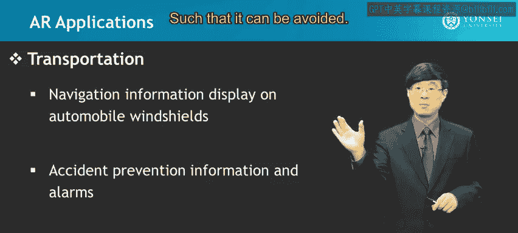
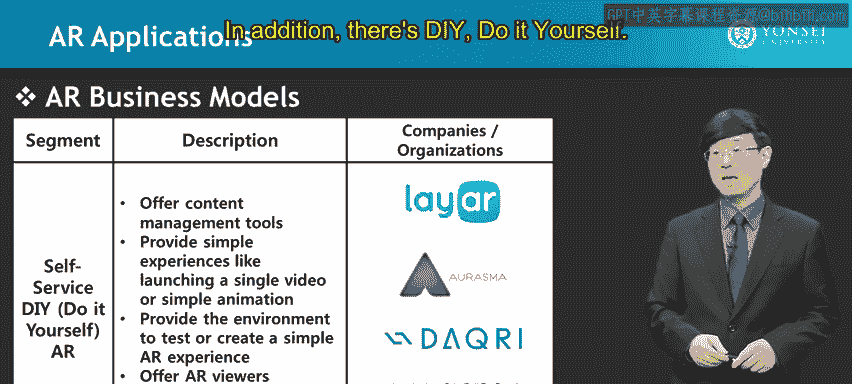
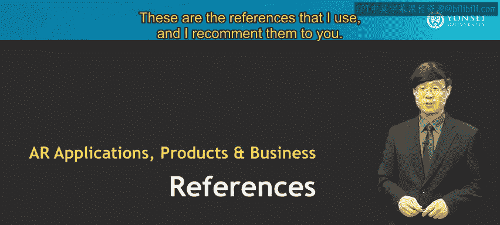
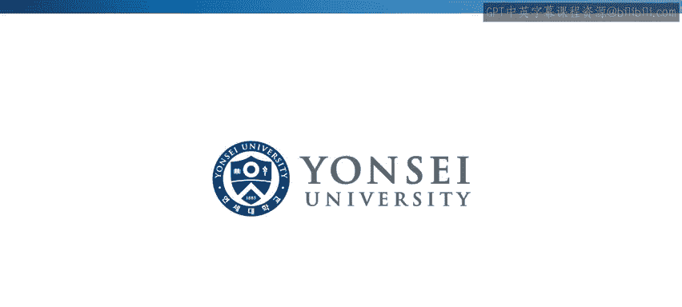

# 延世大学《新兴技术：从智能手机到物联网再到大数据》课程 - P127：4_1.3 AR应用和商业模式（第2部分）📱➡️🌐➡️📊

在本节课中，我们将继续探讨增强现实（AR）在体育娱乐、旅游观光和交通运输等领域的应用，并深入了解AR相关的商业模式和平台。我们将看到AR技术如何从多个维度改变我们的体验和商业运作方式。

## 🏈 体育与娱乐应用

上一节我们介绍了AR在游戏和基础信息展示中的应用，本节中我们来看看AR在专业体育和娱乐中的具体场景。

**比赛辅助信息**是AR在体育领域的重要应用。例如，在美式足球比赛中，有时很难判断“首攻线”的位置，因为标记物位于场地两侧。当观众注意力集中在赛场中央时，可能看不到这些标记。通过增强现实技术，可以在电视屏幕上绘制出这条线，使观众能清晰地看到球队需要到达的目标区域。这项技术已在足球比赛中应用，使观赛体验更有趣、更易懂。

此外，在网球比赛中，有“鹰眼”等系统。网球速度极快，裁判很难判断球是否压线、在线内还是线外。因此，利用增强现实技术来识别球的落点位置。这类系统已被广泛使用，并且会变得越来越好、越来越普及。

除了辅助判罚，AR还能提供**比赛规则与指导信息**。在观看比赛时，将特定、易懂的比赛规则显示在屏幕一侧的特定位置，有助于观众理解裁判的判罚。

**团队目标与战术指导信息**则可用于场边教练指导球队，或队员自身使用。如果队员佩戴增强现实眼镜，他们可以实时看到特定时刻需要移动到的位置，或团队执行特定行动（如自行车队形或其他团队协作）时需要保持的阵型。他们的位置和战略部署可以通过AR设备得到辅助。

## 💰 商业广告与赞助

从纯粹的比赛角度，这可能不那么重要。然而，无论是职业还是业余比赛，通常都需要赞助资金。**商业广告实时叠加到用户视野中**是另一个非常重要的方面。广告可能是获得比赛资金、装备、以及租用所需场馆的资源。因此，尽管这不直接关乎运动本身，但它具有明确的商业价值，能让你在特定地点使用合适的设备进行比赛。

## 🗺️ 旅游与观光应用

旅游观光无疑是增强现实技术大展身手的绝佳领域。

以下是AR在旅游中的主要应用方向：
*   **历史事件、地点与物品的导览展示**：AR可以将历史信息叠加在实景上。
*   **旅游路线展示**：显示酒店、汽车旅馆、餐厅和洗手间的位置。
*   **导航工具**：这在身处异国、无法读懂所有标识时尤其有帮助。

## 🗣️ 翻译与口译支持

翻译与口译是AR的典型应用。在后续课程中，我将展示一些已经存在的支持此类功能的应用。

以下是AR在语言支持方面的具体表现：
*   **外语翻译**：文本、标识和菜单的翻译都能得到AR应用的支持，未来此类应用会越来越多。
*   **增强现实语音翻译支持**：将声音输出翻译成外语。因此，AR可用于显示语音信息（作为声学系统）。此外，就像观看外语电影时，演员的台词以字幕形式显示在画面上一样，AR也能实现类似功能，将翻译文本直接叠加在你的视野中。

## 🚗 交通运输应用

在交通运输领域，AR同样发挥着重要作用。

**导航信息显示在汽车挡风玻璃上**已经实现。此外，**敌方目标获取信息**也早已显示在包括喷气式飞机在内的军事载具和其他作战系统上。

对于民用汽车而言，这无疑是极具吸引力的领域，可以辅助驾驶导航和预防事故。

接下来是**事故预防信息警报本身**。换句话说，在挡风玻璃上，如果有物体进入特定区域并可能对驾驶员造成事故风险，该物体可以被标记特定颜色，以引起驾驶员的特别注意，从而避免事故，保障所有人的安全。

## 🏢 AR平台与商业模式

了解了广泛的应用场景后，我们来看看支撑这些应用的AR平台和相关的商业模式。

在增强现实领域，存在一些**AR平台**，它们提供增强现实基础框架和工具箱，帮助提供定制服务。下图列出了一些提供此类服务的公司产品。

**增强现实产品与游戏**领域则有巨大的开发空间，公司可以开发和销售自己专属的AR产品。产品类型包括书籍、游戏等等。

然后是**定制品牌应用开发**，直接与品牌营销人员和代理商合作。这将使营销人员能够结合独一无二的定制增强现实体验、3D建模服务以及与其他软件或平台的集成。提供相关技术的公司如下图所示。

此外，还有**行业特定的垂直增强现实解决方案**，服务于利基商业垂直领域。例如奢侈品零售、医疗服务、制药和化妆品公司。

最后是**DIY（自己动手）** 模式。因为许多人希望开发产品，他们不想完全依赖其他公司，而是希望自己完成概念验证，测试产品性能，并添加功能。之后，他们可能就此完成，或者将最终设计（包括所有硬件和软件组件）交给其他公司的工厂进行大规模生产。无论哪种方式，你都希望能够使用DIY AR系统自行进行研发。支持此模式的公司列在下图中，它们提供内容管理工具、提供简单的体验（如启动单个视频或简单动画）、提供测试或创建简单AR体验的环境、提供AR查看器、定制服务和白标选项。

## 📚 课程总结

本节课中，我们一起深入学习了增强现实（AR）技术在体育娱乐、旅游观光、交通运输等多个领域的实际应用案例，从辅助判罚、战术指导到商业广告、语言翻译和行车安全。我们还探讨了AR产业的生态系统，包括提供基础工具的平台、开发专属产品的公司、定制化服务以及支持自主研发的DIY模式。这些内容展示了AR技术如何从概念走向实践，并正在塑造未来的交互方式和商业模式。

以下是本讲使用的参考文献，推荐给大家。

