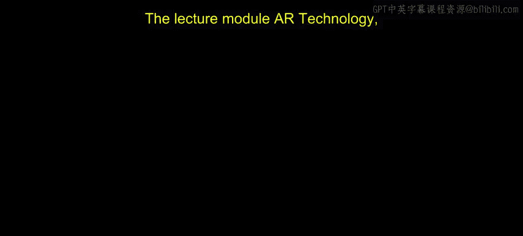
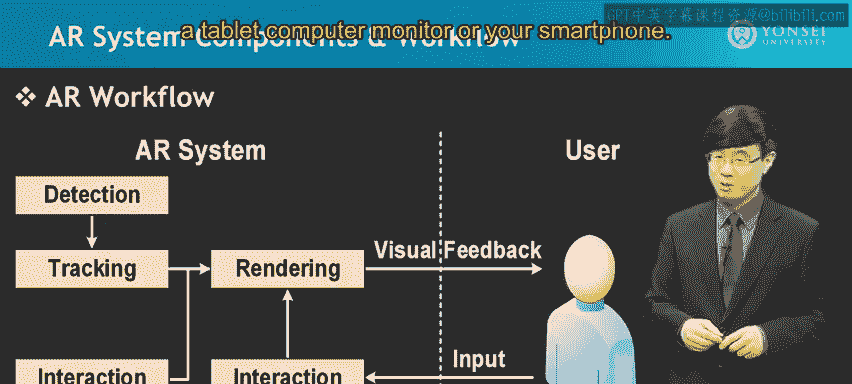
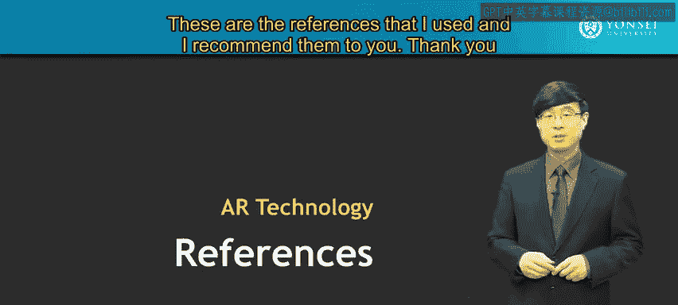

# 129：AR系统组件与工作流程 📱➡️🌐➡️📊

在本节课中，我们将学习增强现实（AR）技术，首先探讨AR系统的核心组件及其工作流程。

## 概述

我们将从AR系统的构成部分入手，了解内容提供方、服务器、通信协议以及用户端软件框架等关键元素。接着，我们会详细解析AR系统的工作流程，包括检测、跟踪、渲染和交互等环节如何协同运作。

## AR技术组件

AR系统主要由内容提供方和基于服务器的系统构成。

内容提供方负责存储AR应用所需的数据。部分内容可以经过精简，存储在便携移动设备上，例如智能手机、头戴式显示器或AR眼镜。然而，原始数据库的主体部分通常位于内容提供方的服务器上。

内容文件的数据格式多样，主要包括：
*   **3D图形资源**
*   **地理信息**
*   **文本**
*   **图像**
*   **视频**
*   **AR内容容器**
*   **兴趣点信息**

这些构成了我们研究的核心数据领域。

## 通信协议

在服务器与用户设备之间，需要通过通信协议进行交互。

协议部分包含了视频传输协议和网络协议。关于这些协议的更多细节，将在本课程后续的讲座模块中详细讨论。

## 用户端软件

现在，我们来看看用户端。用户端主要包括软件框架、应用程序以及浏览器。

软件框架单元集成了运行AR应用所必需的软件，包括固件、操作系统和用户应用软件。这里也包含大量的视频处理软件，本课程后续讲座会详细解释。

应用程序和浏览器单元则负责支持具体的AR应用设备。它们决定了当完整的增强现实信息被提供后，如何被用来服务于特定的应用场景。浏览器则用于在更广泛的领域中查找信息，以便准确地检索定制化应用或用户设计、所需的信息。

## 核心处理模块

在用户端，需要执行几个核心的处理模块。以下是这些模块的详细介绍：

**检测与跟踪技术**：此模块专注于识别单元，涉及计算机视觉、标记与特征识别、跟踪传感器以及摄像头API的执行。

**渲染过程**：此过程负责支持可视化，由支持计算机图形API、视频合成和深度合成的技术构成。

**交互技术**：此部分需要设计用户界面（UI），确保其易于使用且功能高效。此外，还包括手势识别、语音交互和**触觉反馈技术**。

> **触觉技术**是指在虚拟或增强现实领域中，虽然你并未实际触摸到物体（例如在空中按下按钮），但设备会通过产生特定的震动或脉冲，让你获得仿佛触摸或推动真实物体的触感。简而言之，它是一种为虚拟动作提供真实触感的虚拟技术。

## AR系统工作流程

上一节我们介绍了各个核心模块，现在来看看它们如何在AR系统中协同工作。

检测模块将信息传递给AR系统中的跟踪单元。同时，AR系统的交互部分会与跟踪信息结合，并一同发送给渲染单元。

接着，这些信息将与来自用户的任何形式的输入相结合。用户的输入会通过用户界面或触觉界面等单元纳入系统，并汇入渲染单元。

最终，所有输入信息经过渲染处理，生成视觉反馈呈现给用户。用户可以通过多种设备查看这些信息，例如：
*   AR眼镜
*   头戴式显示器
*   车窗（作为显示屏）
*   电脑显示器
*   笔记本或笔记本电脑显示器
*   平板电脑显示器
*   智能手机

## 总结

本节课中，我们一起学习了增强现实（AR）系统的基本构成。我们了解了从内容服务器到用户设备的数据流，认识了软件框架、应用程序和浏览器在用户端的作用，并详细探讨了检测跟踪、渲染和交互（包括触觉技术）等核心处理模块。最后，我们梳理了这些模块如何协同工作，最终将增强后的视觉信息呈现给用户。掌握这些组件和工作流程是理解更复杂AR应用的基础。

---

以上是我所使用的参考资料，推荐给你。谢谢。

