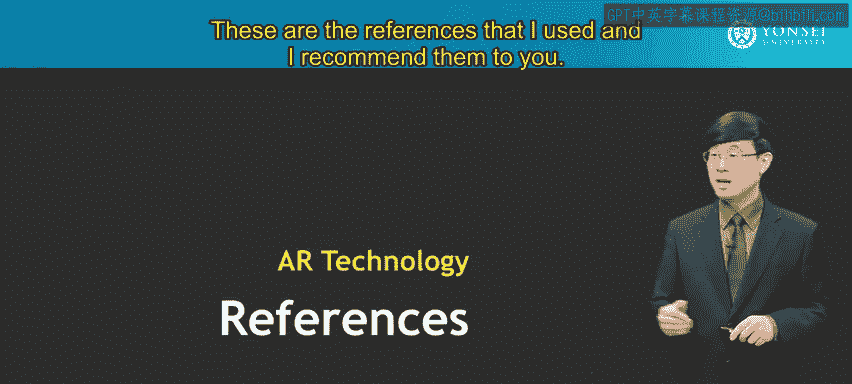

# 130：7_2.2 AR特征检测与描述技术 📱➡️🌐➡️📊

在本节课中，我们将学习增强现实（AR）的核心技术之一：特征检测与描述。我们将探讨如何识别现实世界中的物体，以便在其上叠加数字信息或物体，并了解实现这一过程所需的技术要求与算法。

---

## 增强现实特征检测

为了在现实世界视图中的特定实体上显示信息或放置物体，首先必须检测到该物体。你需要决定在现实世界视图中选择哪个部分来叠加文本、图像或角色。这需要特征检测与描述技术。

**增强现实特征检测**是指识别图像的特征基元。这一过程通过突出显示独特的视觉线索来完成。目前存在多种特征检测技术，其目标是高效、有效地提取稳定的视觉特征。

这意味着，如果计算处理任务过于繁重，或者计算方式不正确导致结果出错，那么增强现实就无法实现。正因如此，早期的设备无法支持增强现实。如今，增强现实之所以变得强大，是因为我们能够高效、快速地进行处理，同时降低计算量，从而节省AR设备的电池消耗。此外，检测结果非常可靠、准确，叠加的信息也非常有效。因此，整体效果和效率的提升使得增强现实应用成为可能，这也是AR如今如此流行并将在未来更加普及的原因。

---

## 增强现实特征检测器的要求

上一节我们介绍了特征检测的基本概念，本节中我们来看看一个合格的AR特征检测器需要满足哪些要求。

首先，它必须**对变化的成像条件具有鲁棒性**。增强现实不同于虚拟现实，后者的环境和角色都是虚构的。增强现实是在你当前使用的眼镜等设备上，看到真实世界的视图。你不可能固定在一个位置盯着一个物体看，你会在日常活动、工作或娱乐中移动并从不同角度观察物体。

因此，你对特定物体或环境的视图会持续变化。光线、角度以及周围环境都会不断改变。基于这些变化的成像条件，增强现实特征检测技术必须保持鲁棒和可靠。即使你在不同光线、环境或角度下观察同一物体，它也应该能以相同的方式检测到该物体，并正确提供你所需的信息。

其次，它需要**满足应用的服务质量要求**。服务质量包括设备续航时间，因为无论设备多好，如果只能使用五分钟，它就没有市场价值。此外，信息显示的准确性也至关重要。使用AR眼镜的用户不会一直盯着同一个物体等待信息弹出。他们需要立即看到叠加在现实视图上的增强信息或物体，延迟可能需要低至10到50毫秒甚至更快。

因此，设备必须在用户视线移开、新视图进入视野范围之前，快速、准确且低功耗地完成整个AR处理过程。这些服务质量要求对于以特定方式使用的产品来说必须得到满足。

---

## AR特征检测的影响因素

了解了检测器的要求后，我们来看看哪些因素会影响AR特征检测的效果。

影响因素包括**环境**，因为环境会持续变化。**视点变化**也很重要，即使在相同环境下，从不同角度观察也会得到物体不同的视图。

**图像尺度**是另一个关键因素。当你靠近或远离物体时，物体会显得更大或更小。无论是通过放大镜观察细节，还是宏观地看整体景观，物体的尺寸和图像分辨率都会发生显著变化。你的AR设备需要能在放大和缩小的尺度下正常工作。

**分辨率**也会产生影响。你的摄像头可能具有不同的分辨率，分辨率可能根据光线设置、设备剩余电量或网络连接状况而改变。如果网络变慢、吞吐量降低、数据速率变小、排队延迟增加，但你又需要网络支持来获取AR服务，那么摄入图像的视频分辨率可能会降低。

**光线**同样是一个重要因素。环境是明亮还是黑暗？在非常黑暗的情况下，如果设备配备红外功能，可能会切换到红外模式。此时，摄入图像的红外摄像头分辨率可能与白天的普通摄像头不同，分辨率可能会下降。

我们将在本课程最后一个模块的“增强现实智能手机测试项目”中观察这类现象。请坚持学习，我们将在一些有趣的应用程序上进行测试。

---

## 兴趣点与特征描述符

在兴趣点检测过程中检测到的**兴趣点**，可用于获取**特征描述符**。其基本方法是以检测到的兴趣点为中心，划定一个圆形或方形区域。

如下图所示，图像中有许多圆圈，圆圈的大小根据区域的尺度进行匹配，因此有大圆也有小圆。图中使用了圆圈，有时也会使用正方形来表示被识别的物体。

**特征检测**是指检测具有独特兴趣点的图像特征。**特征描述符**则使用一个采样区域来表征这些图像特征。具体是如何实现的呢？我们将在本课程及后续课程中详细讨论。

基于检测到的兴趣点周围的图像块进行采样，是特征检测引擎最主要的工作区域。

---

## 特征检测与描述方法

以下是两种主要的特征检测与描述方法。

**方法一：使用频谱描述符**
这种方法通过考虑局部图像区域的梯度来生成频谱描述符。支持此技术的一些算法包括SIFT和SURF，我们后续会详细学习。
*   **梯度**是什么？在特征检测的方法一中，梯度用于局部图像区域处理。你可以这样理解：梯度是导数的多变量推广。导数是单变量（通常是标量）的导数，而梯度作用于多个变量，通常用向量表示。使用方法一中的梯度，将使我们能够生成频谱描述符。

**方法二：使用局部二值特征**
这种方法通过简单的点对像素强度比较来识别局部二值特征。这里所说的点对像素强度比较，就是基于局部二值特征。我们试图做的是，不使用涉及微分过程的梯度，而是采用更简单、计算负担更轻的方法。因此，你可以更快地执行它们，并且设备的能耗显著降低。这就是这些技术的目的。
*   能够在特征检测中使用此方法的算法包括BRIEF、ORB和BRISK，我们当然也会详细学习。

---

## 特征检测与描述方案

以下是一些特征检测与描述方案。
*   **同时进行检测与描述的方案**：SIFT、SURF、ORB、BRISK。
*   **仅进行特征描述的方案**：BRIEF。
*   **特征检测器方案**：FAST。

我们将详细研究这些算法。

---

## AR方案混合匹配

什么是混合匹配？特征检测的结果是在特定尺度下被识别为兴趣点的一组特定像素。可以将不同的特征描述方案应用于不同的兴趣点，以生成特征描述。这是因为某些方案在处理特定类型数据时具有独特的优势。因此，你可能会希望混合匹配特定的方案序列，以实现特定的功能，同时达到一定的可靠性、鲁棒性、准确性，并且足够快速和低功耗。

基于应用和兴趣点特性进行方案选择是可能的，你会看到一些混合匹配来创建特定算法，例如ORB，我很快会详细解释。

这些是我使用的参考文献，也推荐给你，谢谢。

---

## 总结

本节课中我们一起学习了增强现实特征检测与描述技术。我们了解了AR特征检测的基本概念、检测器需要满足的鲁棒性和服务质量要求，以及环境、视点、尺度、分辨率、光线等因素对检测的影响。我们还介绍了兴趣点、特征描述符的概念，并概述了两种主要的特征检测方法（频谱描述符和局部二值特征）以及相关的算法方案（如SIFT、SURF、ORB、BRIEF等）。最后，我们提到了可以根据需求混合匹配不同方案来优化AR应用性能。掌握这些基础知识是理解后续具体算法和实际应用的关键。