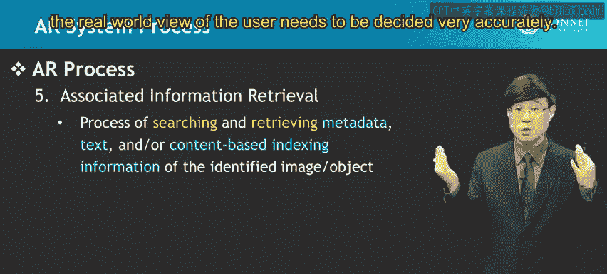

# 课程名称：延世大学《新兴技术：从智能手机到物联网再到大数据》 - P131：8_2.3 AR系统流程（第1部分）📱➡️🌐

## 概述
在本节课中，我们将要学习增强现实（AR）系统的基本工作流程。我们将以一个智能手机AR应用为例，详细拆解从捕捉图像到最终信息叠加显示的五个核心步骤。请注意，虽然示例使用智能手机，但该流程同样适用于眼镜、头戴显示器等多种设备。

---

## AR系统流程详解 🛠️

上一节我们概述了AR技术，本节中我们来看看一个完整的AR系统是如何运作的。整个过程始于设备摄像头捕捉的现实世界画面。

### 1. 图像采集 📸
流程的第一步是**图像采集**。这是从设备的摄像头获取实时视频图像或静态照片的过程。获取的图像将作为整个AR处理的输入源。

### 2. 特征提取 🔍
图像进入系统后，下一步是**特征提取**。此步骤基于初始的测量数据，生成具有信息性且非冗余的特征值，以便于后续的特征学习和泛化。

以下是该过程的核心：
*   **兴趣点检测**：算法会找出图像中所有独特的“兴趣点”。
*   **特征生成**：将选定的兴趣点组合起来，形成能够唯一标识某个物体或场景的“特征”。

**需要特别注意**：特征提取是整个AR流程中计算最复杂、最耗资源的步骤。它会显著消耗设备电量，并且需要对图像进行多方面的渲染、处理和分析。我们将在后续的专门模块中深入讲解其流行技术。

### 3. 特征匹配 🧩
提取特征后，需要进行**特征匹配**。此步骤需要数据库的支持，因为系统需要将刚提取的特征与数据库中预存的特征及其相关信息进行比对，以识别出当前看到的物体是什么。

此过程涉及对图像信息进行抽象计算，并对所有图像点进行判断，以确定是否存在匹配的图像特征。

### 4. 几何验证 📐
匹配成功后，系统会进行**几何验证**。这是一个在数据库的图像数据中，确认所找到的特征在几何关系上是否一致的过程，以确保匹配的准确性，避免误识别。

### 5. 关联信息检索与显示 💡
最后一步是**关联信息检索**。系统根据识别出的物体，搜索并检索与之相关的元数据、文本或基于内容的索引信息。

检索到的信息将用于在AR屏幕上显示。通常，这些信息会以文字、符号或虚拟形象（Avatar）的形式，叠加在真实世界视野中对应物体或图像的附近。

以下是设计显示方式时需要考虑的关键点：
*   **显示形式**：是叠加虚拟形象，还是显示简单文字？
*   **信息量**：显示多少信息？信息过少可能无法满足用户需求，信息过多则会遮挡真实视野，引起用户反感。
*   **布局原则**：在实际产品中，信息通常不会完全覆盖原物体（如示例图中所示的大块文字），而是以不阻碍用户观察真实世界的方式进行巧妙叠加。示例中的方式仅用于直观演示“信息被添加”这一概念。

---

## 总结
本节课中，我们一起学习了AR系统的核心五步流程：**图像采集**、**特征提取**、**特征匹配**、**几何验证**以及**关联信息检索与显示**。我们了解到，特征提取是计算负担最重的环节，而最终的信息叠加需要精心设计以平衡信息量与用户体验。理解这个流程是深入掌握AR技术如何“增强”现实世界的基础。