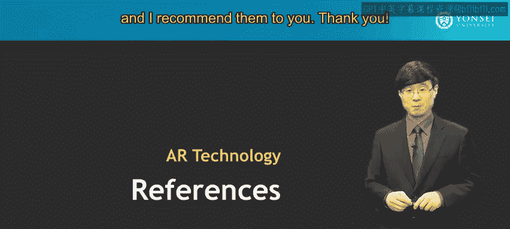

# 课程9：从智能手机到物联网再到大数据 - 2.3 AR系统流程（第二部分）☁️➡️📱

在本节课中，我们将学习增强现实（AR）系统中的**云端协同计算**概念。我们将探讨为何需要将部分计算任务从AR设备转移到云端，以及如何根据网络和设备状况**自适应地**做出决策，以实现高效、节能的AR体验。

---

上一节我们介绍了AR系统的基本流程。本节中，我们来看看如何通过**云端协同计算**来优化这个流程，解决AR设备在计算能力、存储空间和电池续航方面的限制。

## 云端协同计算概述

所有物体信息无法全部存储在AR设备上。AR需要一个大型数据库，这一点我们已经讨论过。AR需要大量计算来处理任务，这非常消耗能量。此外，设备本身可能无法以足够快的速度计算所有信息并快速检索。因此，除了能耗问题，还存在速度问题。

AR处理量直接影响AR设备的电池功耗。许多AR设备由电池供电，因此能源供应有限。为了减轻AR设备上的处理负载，并克服使用小型AR数据库的限制（因为我们需要一个大型AR数据库），可以采用**AR云端计算卸载**。

## 什么是计算卸载？🔄

计算卸载是指将部分计算任务从本地设备转移到云端服务器执行。具体来说，可以这样理解：

设想一个完全在智能手机上运行的增强现实应用。那么，智能手机将拥有一个小型数据库，并且需要完成所有处理流程才能给出响应。此外，特征提取过程非常耗能且负担沉重。

那么，是否有办法从其他地方获得帮助，替我完成部分工作？例如，让特征匹配、几何验证和相关信息检索从一个拥有海量数据的大型数据库中进行，而我只需要选择所需的部分。如果数据库足够大，这将是可能的。但在智能手机上，你不可能存放一个庞大的数据库。

## 为何需要云端数据库？🗄️

你需要思考：你将在智能手机、眼镜或头戴式显示器上查看什么？实际上，可能进入你视野的物体种类是极其多样，甚至是无限的。如果你长时间使用头戴式显示器或AR眼镜，你将会接触到近乎无限数量的物体。将所有信息都存储在智能手机或AR眼镜上的概率为零，你必须依赖一个庞大的数据库支持。

这正是**云端卸载**的作用。在这个例子中，图像采集和特征提取在智能手机上完成，其余流程则通过有线或无线网络发送到云端。云端完成剩余处理后，只将最终信息发送回AR设备（本例中是智能手机）。

在某些情况下，借助云端卸载的支持，你甚至可以将特征提取也放到云端进行。这样，你的智能手机只需进行图像采集，其余一切都可以在云端完成。在本例中，我展示了特征提取在智能手机上进行的情况，但这一步同样可以在云端完成。

## 云端卸载的优势与挑战⚡

这就是云端卸载所做的事情。换句话说，它减轻了设备承载大型数据库以及执行所有这三个流程（特征提取、特征匹配、几何验证与信息检索）的负担。如果你希望将非常耗能和消耗计算资源的特征提取过程也交由处理能力充足的云端完成，那么你可以将这项工作卸载到云端，待全部完成后接收返回结果。

然而，尽管这听起来很好，但存在一个要求：当你将信息发送到云端时，它需要传输到别处，通常是一段距离之外。此外，信息（如图像）需要通过网络传输。因此，在使用云端卸载时，AR面临的挑战是：

你只有在网络速度非常快的情况下才应使用云端卸载。这个过程必须保证非常迅速，信息能够快速返回，因为你需要发送数据、等待云端处理、再接收结果。你必须确保整个流程足够快，比在本地设备上处理更高效。

因此，尽管这听起来很有吸引力，但并非在所有情况下都可用。换句话说，如果网络拥堵且速度很慢，那么你不如在智能手机上完成整个处理流程，而不是使用卸载。因为如果你尝试卸载，可能什么也做不了。

## 云端卸载虚拟化💻

云端卸载虚拟化允许云服务器供应商在虚拟机上运行各种应用。在云计算中，这类似于**基础设施即服务**的运作模式。

云服务器供应商提供计算周期，AR设备可以利用这些计算周期来减轻自身的计算负载。云计算卸载单元有助于节省能源并提升AR服务的响应速度。再次强调，在云服务中，这必须快速且准确，你需要快速云服务和快速网络的支持。

## 边缘计算与自适应卸载🎯

现在我需要提一下，在本课程的同一系列中，我另一门关于物联网和云计算的课程。在云计算讲座中，我将讨论**边缘计算技术**。该技术将云部署在更靠近无线设备的位置，这将减少网络访问时间。

一些设备可能没有主云那样庞大的数据库。然而，它们的规模可以做得足够大，使其比你的眼镜、头戴式显示器或智能手机装备更完善。同时，它们部署在足够近的设备上，使得快速的无线网络支持可以让你立即访问。这类技术包括基于移动边缘计算的云计算、云微簇和雾计算技术。如果你了解这些技术如何运作以及它们如何支持增强现实，那么云端卸载选项将变得更容易使用。因此，请查阅物联网和云计算的新兴技术讲座，以了解更多关于如何使用该技术的信息。

因此，**自适应云端卸载**是我们希望使用的一个选项。无条件的卸载可能导致过度的延迟，所以我们需要更智能。我们需要审视网络、云端以及自身设备的状况，并找出处理此AR应用的最佳方式。

然后，我们根据设备、网络和云端的环境状况，找出最佳方式，并决定以何种模式进行处理。这就是我们在此提到的**自适应组件**。

以下是自适应云端卸载决策所依赖的关键参数：

*   **网络状况**：网络延迟和带宽直接影响数据传输速度。
*   **云服务器状态**：云端可能因工作负载过重而变得缓慢。即使它能支持你，但如果速度慢，对于通常要求快速响应的AR应用服务质量而言，可能无法使用。
*   **AR设备的能量状态**：你的设备可能有充足的能量在本地计算，也可能剩余能量极少，无法持续在设备上进行特征提取处理。在后一种情况下，你可能需要在图像采集后，直接将其发送到云端，并期望快速获得正确的信息返回以进行显示。
*   **目标体验质量水平**：这个AR设备用于什么用途？是用于交通引导、导航吗？你的应用能允许一点延迟吗？或者，如果它用于自动驾驶汽车，一点延迟会对自动行驶车辆的安全性产生关键影响吗？你需要弄清楚这些，而这类要求正是影响目标体验质量的因素。这是基于特定应用的**服务质量**需求。

---

本节课中，我们一起学习了增强现实中的**云端协同计算**与**自适应卸载**。我们了解到，为了克服AR设备在计算、存储和能耗上的限制，可以将部分任务卸载到云端。但这一过程高度依赖于**网络速度**、**云端负载**和**设备状态**。通过**自适应决策**，根据实时条件选择本地处理或云端卸载，才能实现高效、流畅的AR体验。理解这些概念是构建鲁棒、实用AR系统的重要基础。