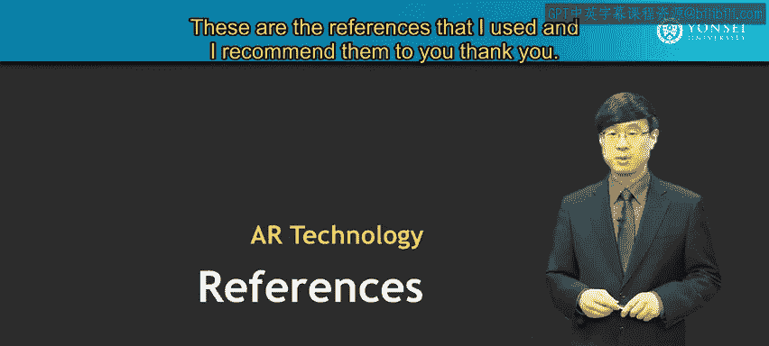

# 课程10：增强现实特征提取 🎯

在本节课中，我们将学习增强现实（AR）中的特征提取技术。特征提取是AR流程中的关键步骤，它负责从捕获的图像中识别出我们感兴趣的关键点，以便后续进行对象识别和跟踪。

---

## 概述

特征提取过程将输入的图像转换为一种形式，使我们能够检测到兴趣点并提取特征。例如，图像上标记的红色圆圈就围绕着我们感兴趣对象的特定区域。这个过程要求严格且复杂，因此我们需要深入理解。

上一节我们介绍了AR的整体流程，本节中我们来看看特征提取的具体步骤。

---

## 基于SURF技术的特征提取步骤

以下是特征提取涉及的六个核心步骤：

1.  **灰度图像生成**
2.  **积分图像生成**
3.  **响应图生成**
4.  **兴趣点检测**
5.  **方向分配**
6.  **描述符提取**

接下来，我们将逐一详细探讨每个步骤。

---

### 1. 灰度图像生成

这是第一步。AR设备捕获的原始图像被转换为灰度值。这样做的目的是增强算法对颜色变化的鲁棒性。

因为光照颜色会改变物体呈现的颜色。例如，如果房间里的灯光变成蓝色，我看起来就会是蓝色的；如果变成绿色或红色，我也会相应地变色。因此，为了减少光源引起的颜色变化的巨大影响，我们选择使用灰度图像技术。

---

### 2. 积分图像生成

这是一个从灰度图像构建积分图像的过程。这个过程使得快速计算图像子区域的和成为可能。

积分图像的公式有助于加速后续计算：
`I(x, y) = i(x, y) + I(x-1, y) + I(x, y-1) - I(x-1, y-1)`
其中 `I` 是积分图像，`i` 是原始灰度图像。

---

### 3. 响应图生成

为了检测兴趣点，我们需要先进行这一步。响应图生成是兴趣点检测前的一个阶段，它通过计算图像Hessian矩阵的行列式来为检测做准备。

响应图生成过程构建了图像的尺度空间。利用这个尺度空间，我们才能进入下一步的兴趣点检测。

---

### 4. 兴趣点检测

基于生成的尺度响应图，检测其中的极大值和极小值（即极值点），并将这些点作为兴趣点。

检测到兴趣点本身就是一个重大成果，但这还不够完整。

---

### 5. 方向分配

每个检测到的兴趣点都会被分配一个可重现的方向，以提供旋转不变性。

为什么这是必要的？因为AR处理的是实时的视觉画面，不是静态图像或固定视频。当用户移动头部或改变视角时，视野中的对象方向会不断变化。如果检测机制不具备旋转不变性，就可能出现视角轻微移动后无法识别同一物体的情况。因此，我们需要将旋转不变性纳入检测机制。

---

### 6. 描述符提取

这是一个唯一标识兴趣点的过程，使其能与其他兴趣点区分开来。

在进行兴趣点检测时，会出现大量兴趣点。其中一些可能与视野中某个特定对象无关，因为视野中可能包含多个物体。因此，我们需要聚焦于围绕某个特定对象周围的那些兴趣点，并将它们关联起来，以识别并提取该对象的特征。

---

## 特征提取流程总结

整个特征提取的流程可以概括为：找到图像或视频中的兴趣点，从兴趣点中检测描述符，然后将这些描述符与数据库中的数据进行比较。

例如，从原始图像开始，先转换为灰度图，然后检测兴趣点，最后提取描述符。将它们组合起来，我们就能识别出一个对象。

---

## 描述符的要求与类型

描述符需要具备一定的鲁棒性，即使在有噪声干扰的情况下也能正常工作。这些干扰因素包括：
*   **尺度变化**：物体远近不同导致的大小变化。
*   **旋转变化**：视角改变导致物体像在旋转。
*   **视角变化**：观察角度的不同。

理想的描述符应能不受这些因素影响。

我们可以使用哪些类型的描述符呢？主要有以下三种：
*   **角点**
*   **斑点**
*   **区域**

在后续关于各种特征提取技术的细节中，我们将看到斑点、角点或区域描述符的应用实例。

---

### 斑点检测示例

我们已经看过基于斑点检测结果的图像。斑点检测是检测图像中斑点的过程。

什么是斑点？斑点是图像中具有恒定图像属性的区域。在某些情况下，可能不是完全恒定，而是近似恒定，会有一个阈值范围。如果区域属性落在该范围内，它就符合斑点的条件，可以用于增强现实。

斑点中的所有点都被认为是彼此相似的，因此我们将它们分组。在我们之前看到的花朵示例中，用圆圈来表示它们。当然，有时也会使用正方形或矩形。

在比较过程中，会利用与亮度、颜色等相关的图像属性，与周围区域进行比较，从而识别出作为斑点的特定属性。

---

## 常见的特征提取技术

一些典型的特征提取技术包括：
*   **Harris角点检测**
*   **SIFT（尺度不变特征变换）**
*   **SURF（加速稳健特征）**
*   **ORB（定向FAST和旋转BRIEF）**

在接下来的课程模块中，我将更详细地介绍和比较六种最流行且被所有AR设备使用的特征提取与描述技术。

---

## 总结

本节课中，我们一起学习了增强现实中特征提取的核心概念与完整流程。我们从灰度转换开始，逐步了解了积分图像、响应图生成、兴趣点检测、方向分配，直到最后的描述符提取。我们还探讨了描述符需要满足的鲁棒性要求（如对尺度、旋转的不变性）以及常见的描述符类型（如角点、斑点）。理解这些步骤是构建高效、准确AR应用的基础。在接下来的课程中，我们将深入更多技术细节。