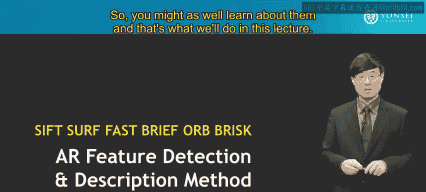

# 课程11：增强现实特征检测与描述方法比较 🧐

在本节课中，我们将学习增强现实（AR）中几种核心的特征检测与描述方法，包括SIFT、SURF、FAST、BRIEF、ORB和BRISK。我们将比较它们的技术特点、优缺点以及演进关系，帮助你理解为何会从一种方法发展到另一种。

---

## 概述 📋

本模块介绍SIFT、SURF、FAST、BRIEF、ORB和BRISK。这些是增强现实领域中用于特征检测和描述的最著名方法。如果你在智能手机、头戴式显示器、笔记本电脑或任何设备上使用过增强现实，那么很可能已经接触过这些技术。因此，了解它们的工作原理和区别是非常有价值的。

---

## 技术演进与比较 🔄

上一节我们介绍了这些方法的重要性，本节中我们来看看它们的具体比较和演进历程。

以下是六种最流行方法的对比，我们还将探讨它们为何会从一种演进到另一种。如果最初开发的方法在各方面都完美，就没有必要创造更多。但显然，最初的方法并非完美无缺，这正是技术演进的起点。

从下图可以看出，这些方法按创建年份排列：SIFT（1999年）、SURF（2006年）、FAST（2006年）、BRIEF（2010年）、ORB（2011年）和BRISK（2011年）。

首先谈谈SIFT。SIFT具有非常优秀的特性，其特点备受青睐。然而，它的计算负担非常高。即使在1999年它被创建时，计算负担也极大。

考虑到现代智能手机摄像头分辨率越来越高，并且每年都在提升，处理SIFT特征的负担变得更加沉重。因此，我们需要找到一种方法，既能保留SIFT的优点，又能大幅降低计算负担，从而节省能源、提高速度，使其适用于增强现实设备。

我们将聚焦于SIFT的一些优缺点，并观察技术演进的趋势。

---

## 详细技术对比表 📊

以下是各项技术的核心参数对比：

| 特性 | SIFT | SURF | FAST | BRIEF | ORB | BRISK |
|------|------|------|------|-------|-----|-------|
| **特征检测器** | 高斯差分 (DoG) | 快速Hessian | 二进制比较 | 不适用 | FAST | FAST或AGAST |
| **描述符** | 局部梯度幅值 | 积分盒滤波 | 不适用 | 局部二进制 | 局部二进制 | 局部二进制 |
| **方向性** | 是 | 是 | 否 | 否 | 是 | 是 |
| **特征形状** | 正方形 | 矩形 | 不适用 | 不适用 | 正方形 | 正方形 |
| **特征模式** | 正方形 | 密集技术 | 不适用 | 随机点对像素 | 训练点对像素 | 训练点对像素 |
| **距离函数** | 欧几里得距离 | 欧几里得距离 | 不适用 | 汉明距离 | 汉明距离 | 汉明距离 |
| **鲁棒性** | 6（亮度、旋转、对比度、仿射变换、尺度、噪声） | 4（尺度、旋转、光照、噪声） | 2（亮度、对比度） | 3（亮度、对比度、旋转） | 4（亮度、对比度、旋转、有限尺度） | 4（亮度、对比度、旋转、尺度） |

---

## 核心概念详解 🧠

上一节我们通过表格快速对比了各项技术，本节我们来深入理解其中的关键概念。

**高斯差分 (DoG)** 是SIFT使用的特征检测方法，其公式可表示为：
`DoG(x, y, σ) = (G(x, y, kσ) - G(x, y, σ)) * I(x, y)`
其中 `G` 是高斯函数，`I` 是图像，`σ` 是尺度参数。

**汉明距离** 用于BRIEF、ORB和BRISK等二进制描述符的比较。它计算两个等长二进制字符串在相同位置上值不同的数量。例如，字符串“10101”和“00110”的汉明距离为3。

**欧几里得距离** 用于SIFT和SURF，计算两个特征向量在空间中的直线距离，公式为：
`distance = √((x₂ - x₁)² + (y₂ - y₁)²)`

---

## 优缺点分析 ⚖️

了解技术细节后，我们来看看每种方法的优缺点，这对于选择合适的技术至关重要。

以下是各种方法的优缺点列表：

*   **SIFT & SURF**
    *   **优点**： 非常准确。
    *   **缺点**： 计算量大，速度慢；两者均受专利保护，使用时需要许可并支付费用。

*   **FAST**
    *   **优点**： 速度快，适用于实时应用。
    *   **缺点**： 可能生成过多的兴趣点。

*   **BRIEF**
    *   **优点**： 速度快，适用于实时应用。
    *   **缺点**： 不具备尺度和旋转不变性。

*   **ORB & BRISK**
    *   **优点**： 速度快，适用于实时应用；ORB是FAST和BRIEF的结合与改进。
    *   **缺点**： 尺度不变性较差。

对于增强现实系统来说，**快速**和**适用于实时**处理是至关重要的优势，这也是FAST、BRIEF、ORB和BRISK等方法被创建的主要原因。真正的增强现实技术正是在实时应用和设备中展现其魅力的。

---

## 总结 🎯

本节课中，我们一起学习了增强现实领域六种核心的特征检测与描述方法：SIFT、SURF、FAST、BRIEF、ORB和BRISK。

我们了解到SIFT虽然功能强大、鲁棒性高，但计算成本高昂。为了满足实时增强现实应用的需求，后续的技术（如SURF、FAST、BRIEF、ORB、BRISK）在保证一定性能的同时，通过使用近似计算（如局部二进制模式）、更高效的距离度量（汉明距离）以及改进的检测器（如FAST及其变体AGAST）来大幅提升速度。

选择哪种技术取决于具体的应用场景，需要在**准确性**、**计算速度**、**鲁棒性**（如对尺度、旋转、光照的适应性）以及**专利限制**之间进行权衡。对于大多数实时移动端增强现实应用，ORB和BRISK因其良好的平衡性而成为流行选择。

本概述为我们后续深入探讨每一种具体方法奠定了坚实的基础。