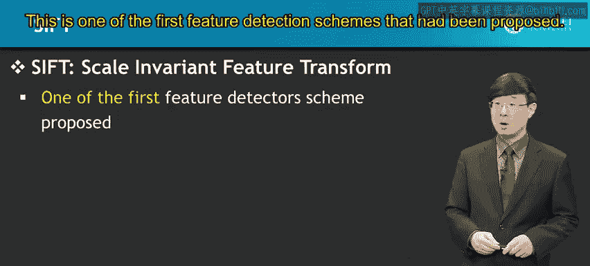
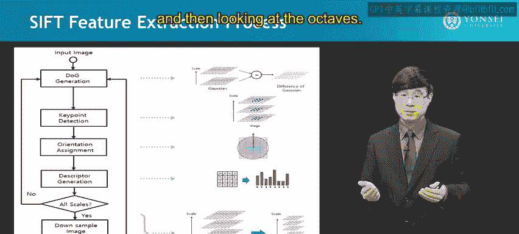
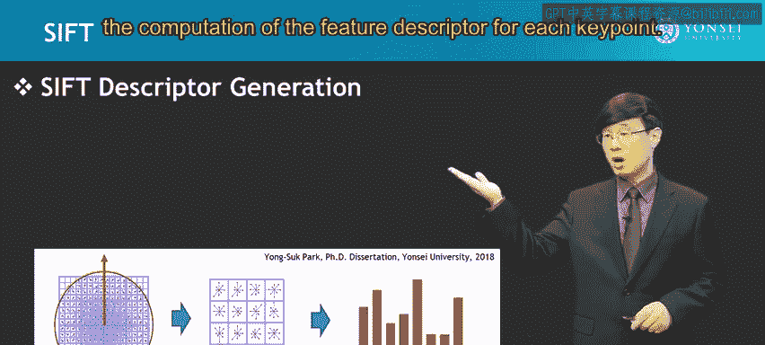
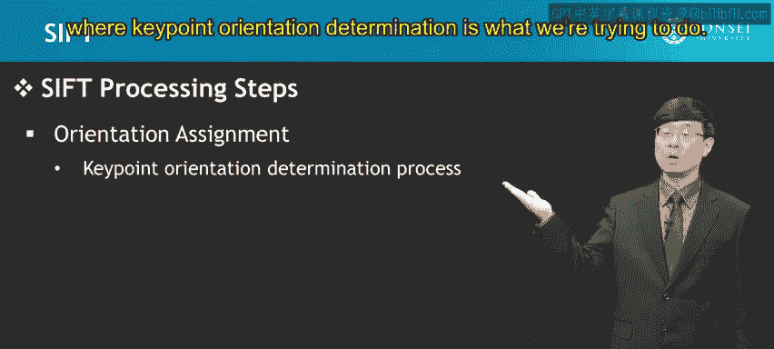
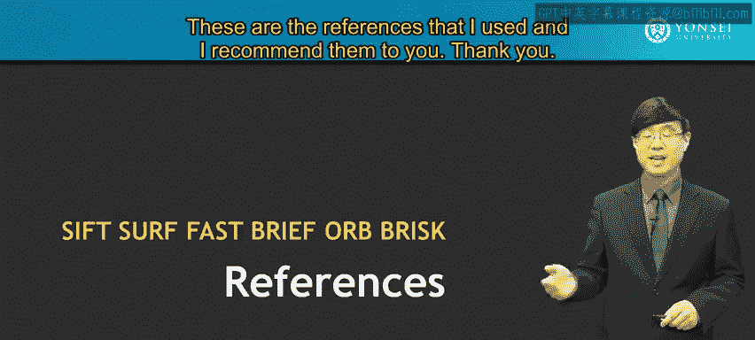

# 135：SIFT 算法详解 🧩

在本节课中，我们将学习 SIFT（尺度不变特征变换）算法。这是一种经典的特征检测与匹配方法，广泛应用于计算机视觉领域。我们将了解其核心原理、处理步骤以及优缺点。

---

## 概述

SIFT 是 Scale Invariant Feature Transform 的缩写。它是最早被提出的特征检测方案之一，在特征检测与匹配过程中使用了图像变换技术。

SIFT 的特点是精度高，但计算复杂度也高，这限制了其在实时应用中的使用。

上一节我们介绍了特征检测的基本概念，本节中我们来看看 SIFT 这一具体算法的实现细节。

---

## SIFT 的整体流程

下图展示了 SIFT 特征提取的整体流程：

流程始于顶部的 DOG（高斯差分）生成。DOG 基于高斯技术，我们提取其差异。之后，流程进入关键点检测机制。

关键点检测基于图像在不同尺度下产生的不同层级，寻找极值点（最大值或最小值点）。随后是方向分配技术，最后是描述符生成技术。

图像会进行下采样，并观察其“八度”（octaves）。我们将在下页详述这些细节。

---

## 高斯差分（DOG）生成

DOG 生成使用基于 DOG 技术的近似方法构建尺度空间。

在 SIFT 及其后续的 SURF 算法中，尺度空间被用作启动增强现实过程的核心技术。

以下是 DOG 生成的核心步骤：

1.  **构建尺度空间与高斯金字塔**：在尺度空间中，我们从抽象尺度空间到完整尺度空间，将它们堆叠起来，形成一个图像金字塔。这个过程基于高斯处理，涉及卷积或模糊技术。这些高斯图像根据八度的数量，在每次迭代后进行下采样。
2.  **选择兴趣点**：在不同尺度下的 DOG 图像中，选择局部极值点作为兴趣点。局部极值是指在图像的局部范围内，基于图像特性划分出的区域中的极值点（最大值或最小值）。

---

## 为何使用 DOG？

DOG 是拉普拉斯高斯（LOG）的一种近似方法。我们本希望使用 LOG，但为了降低计算负担，采用了更简单、计算复杂度更低的 DOG 技术。

以下是 DOG 与 LOG 的对比：

*   **LOG（拉普拉斯高斯）**：这是一个基于二阶高斯尺度空间导数的过程。它对噪声敏感且需要大量计算。LOG 在应用于多图像尺度时具有尺度不变性，这是其流行的重要原因。
*   **DOG（高斯差分）**：与 LOG 相比，DOG 计算复杂度低。此外，DOG 不需要像 LOG 那样进行偏导数计算。DOG 通过高斯差分技术获取图像的局部极值。

因此，在 SIFT 中，我们使用 DOG 技术来代替 LOG 技术。

---

## SIFT 处理步骤详解

SIFT 的处理主要包括三个步骤：关键点检测、方向分配和描述符生成。

### 1. 关键点检测与定位

此步骤进行关键点定位。DOG 图像中的每个像素都会与其相邻像素进行比较。

比较过程在当前尺度以及其上方两个尺度和下方两个尺度上进行，目的是寻找关键点。

以下是关键点筛选过程：
*   候选关键点是局部最大值或最小值的像素（即极值点）。
*   最终的关键点集合将排除低对比度的点。因为即使一个值在其局部范围内是极值，如果对比度低，也可能不准确或存在误差，因此不予采用。

### 2. 方向分配

此步骤旨在确定关键点的方向。关键点的方向由其邻域内局部图像梯度直方图决定。

梯度显示了变化率。直方图是一种图形技术，显示了变化量最大和最小的位置。

因此，通过观察梯度直方图，我们可以找到关键点的方向。具体方法是：
*   选择梯度直方图中的峰值作为主导方向，因为那里检测到的变化最多。

### 3. SIFT 描述符生成

此步骤为每个关键点计算特征描述符。

特征描述符由 128 个方向直方图组成。在下图中，您可以看到图像梯度、关键点描述符以及作为一个关键点的 128 维特征序列。

---

## 总结

本节课中，我们一起学习了 SIFT 算法。我们了解到 SIFT 是一种高精度的尺度不变特征变换方法，它通过构建高斯金字塔和 DOG 尺度空间来检测稳定的关键点，并为每个关键点分配方向和生成 128 维的描述符。尽管其计算复杂度较高，不利于实时应用，但 SIFT 为许多现代特征检测算法奠定了基础。

---

**参考文献**

（以上图表来自延世大学 Park 博士的毕业论文，特此说明并致谢。）