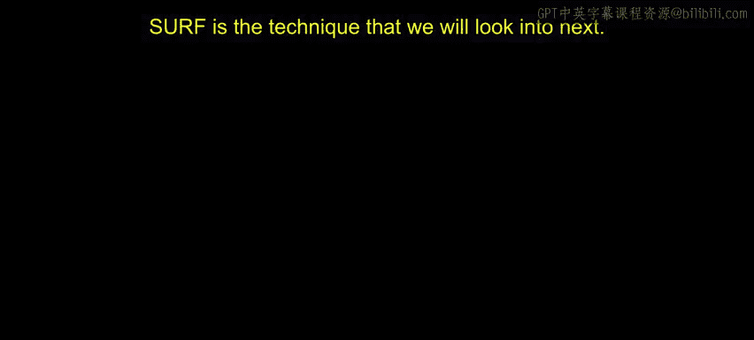
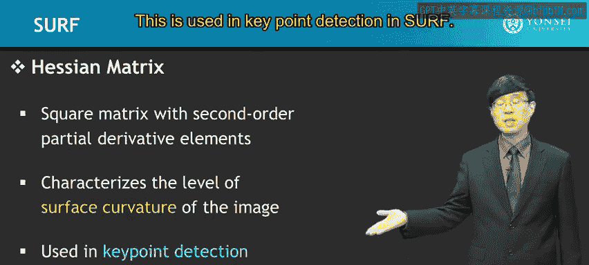
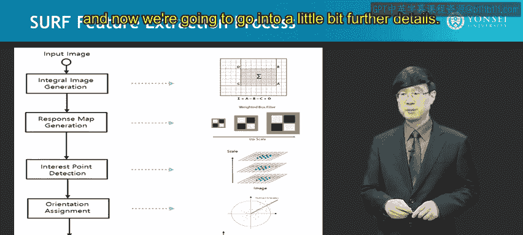
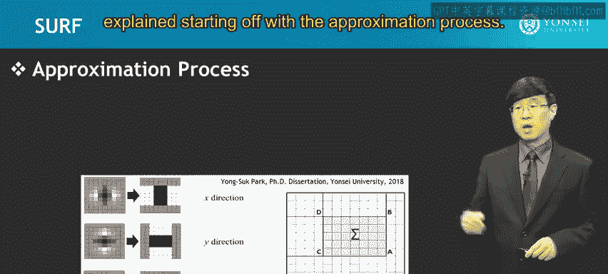
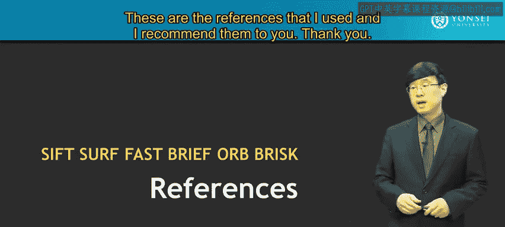

# 136：从智能手机到物联网再到大数据 - 3.3 SURF算法 🚀

在本节课中，我们将要学习SURF算法。SURF是SIFT算法的一种快速近似技术，旨在保持相似准确度的同时，显著提升兴趣点检测的处理速度。我们将了解其核心原理、关键步骤以及它与SIFT的区别。

---

上一节我们介绍了SIFT算法，本节中我们来看看它的加速版本——SURF算法。

SURF是“Speeded Up Robust Features”的缩写。这是一种近似技术，用于在兴趣点检测中获得比SIFT更快且精度相近的处理效果。SIFT性能良好，但因其繁重的计算而速度较慢。SURF的目标是以更快的速度获得接近SIFT的性能。

SURF在其处理过程中会使用**Hessian矩阵的行列式**。这被用于兴趣点检测机制。同时，SURF会使用**盒式滤波器**来近似计算Hessian矩阵行列式。换句话说，Hessian矩阵的计算过程将通过盒式滤波来近似。

那么，Hessian矩阵是什么？这是一个包含二阶偏导数元素的方阵，因此在该矩阵中需要进行偏导数计算。它表征了图像表面的曲率程度，因此在SURF的关键点检测中非常重要。

---

在上一讲中，我们已经基于SURF的整体框架介绍了特征提取和检测机制。现在，我们将进一步深入其细节。

以下是SURF操作的主要步骤：
1.  **积分图像生成**
2.  **响应图生成**
3.  **兴趣点检测**
4.  **方向分配**
5.  **描述符提取**

---

首先从近似处理开始。SURF使用盒式滤波来近似SIFT中的高斯差分。

这里使用方形盒式滤波器进行近似，而不是对图像进行高斯平均。你可以在此看到X方向、Y方向以及XY方向的机制示例。图中展示了SURF中使用的积分图像的盒式滤波器，这实现了快速近似。

为了生成积分图像，需要进行盒区域计算。积分图像用于快速卷积计算。SURF在不同尺度的图像上使用多并行处理的盒式滤波技术来近似拉普拉斯高斯过程。

兴趣点检测过程将基于斑点检测使用Hessian矩阵。特征描述符方案基于兴趣点，其中兴趣点的邻域像素被划分为多个子区域。SURF描述符基于尺度无关的邻域来描述像素强度分布，其中每个子区域的小波响应会被使用。

---

本节课中我们一起学习了SURF算法。我们了解到SURF通过使用Hessian矩阵行列式和盒式滤波器近似，在保持鲁棒性的同时大幅提升了计算速度。其流程包括积分图像生成、兴趣点检测和特征描述符提取等关键步骤，是计算机视觉中一项高效的特征检测技术。