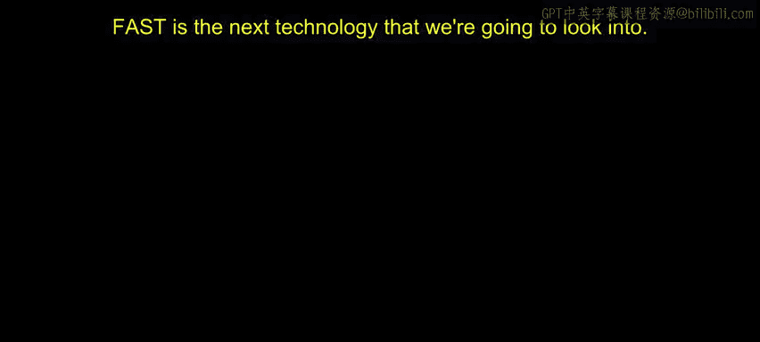
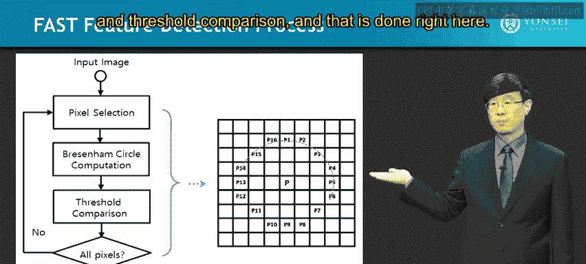
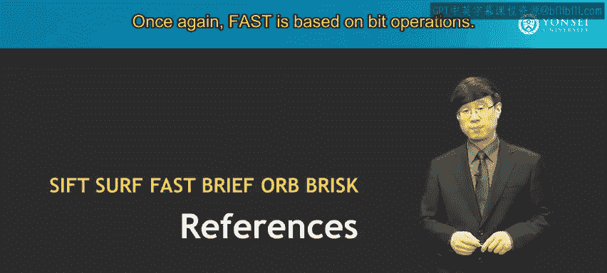

# 137：14_3.4 FAST算法 🚀

在本节课中，我们将要学习FAST算法。FAST是一种用于检测图像中关键点（兴趣点）的技术，以其快速和高效的计算特性而闻名。我们将了解其基本概念、工作原理以及它与其他检测技术的区别。

---

## FAST算法概述

FAST是“Features from Accelerated Segment Test”的缩写。它是一种基于模板的角点检测方案，因此主要用于检测角点。角点可以被理解为在固定尺度下的兴趣点。

上一节我们介绍了其他特征检测技术，本节中我们来看看FAST算法如何实现快速匹配和低计算量。

---

## FAST算法的优势

与SIFT和SURF等尺度空间检测技术相比，FAST算法能够在给定尺度下检测出更多的兴趣点。这主要得益于其高效的计算方法。

---

## FAST特征检测流程

FAST特征检测过程主要包含以下几个步骤：像素选择、Bresenham圆计算和阈值比较。以下是具体步骤：

1.  **像素选择**：算法首先选择一个中心像素点。
2.  **Bresenham圆计算**：围绕中心像素，在一个圆形模板（基于Bresenham圆）上选取一系列像素进行比较。
3.  **阈值比较**：将圆形模板上的像素与中心像素的强度值进行比较。

---

## 角点检测与圆形模板

Bresenham圆的计算基于这样一个事实：每个角点都有一个具有两个主导且不同梯度方向的点。通过圆形模板进行强度比较来检测角点。

通常，我们使用16个可能的像素点，并关注其中连续像素区域的大小。以下是常见的两种配置：

*   当使用9个连续像素时，称为FAST-9。
*   当使用10个连续像素时，称为FAST-10。

---

## 阈值比较与决策树

在FAST算法中，阈值比较是关键步骤。每个像素都与一个预设的阈值进行比较，目的是确定该像素值是否大于或小于中心像素值。

为了加速这个过程，算法采用了决策树，使得像素比较能够更快完成。

---

## FAST描述符输出

FAST描述符的输出是一个相邻的位向量形式。需要再次强调的是，FAST算法主要基于位操作，这进一步提升了其计算效率。

---

## 总结

本节课中我们一起学习了FAST算法。我们了解到FAST是一种快速、高效的角点检测算法，它通过圆形模板和阈值比较来识别兴趣点，并利用决策树和位操作来优化计算速度。与SIFT等方法相比，FAST在保持良好检测能力的同时，显著降低了计算复杂度。

---

## 参考资料 📚

以下是我使用并推荐给您的参考资料。

