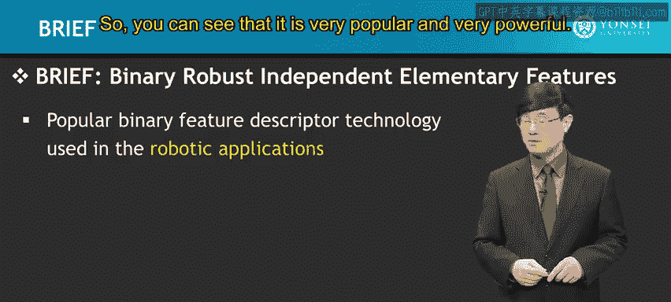
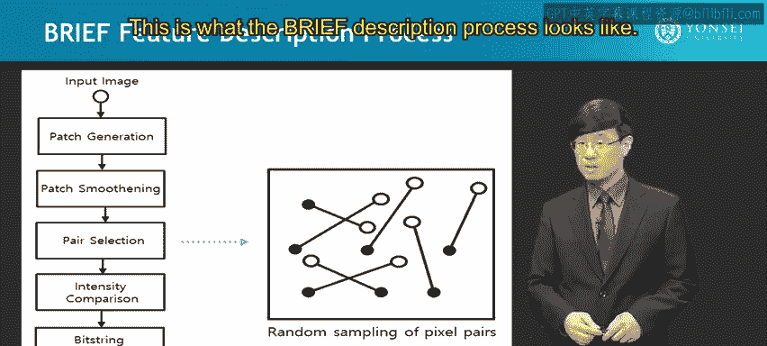

# 138：15_3.5 BRIEF算法 🧠

在本节课中，我们将要学习BRIEF算法。BRIEF是一种在机器人视觉等领域广泛应用的二进制特征描述技术。我们将了解其核心概念、工作原理以及关键特性。

---

BRIEF技术。BRIEF代表**二进制鲁棒独立基本特征**。从名称中可以看到，除了“鲁棒独立基本特征”外，它还包含“二进制”一词。鲁棒性是我们将要探讨的另一个特性。

这是一种在机器人应用（如机器人视觉）中非常流行且功能强大的二进制特征描述技术。

---

上一节我们介绍了BRIEF的基本概念，本节中我们来看看它的工作原理。

它使用随机生成的分布模式，这与许多其他方法有很大不同。

以下是其工作流程的关键组成部分：

*   **分布模式**：由256个像素点对组成。
*   **描述符生成**：通过对这些点对进行二进制比较来生成描述符。

BRIEF的整体特征描述过程如下：
1.  生成图像块。
2.  对图像块进行平滑处理。
3.  生成点对（如下图所示，使用像素对的随机采样）。
4.  进行强度比较。
5.  生成比特字符串。

这就是BRIEF的描述过程。

---

了解了整体流程后，现在我们来深入探讨其细节部分，特别是二进制描述符的构成。

以下是BRIEF算法的几个关键细节：

*   **采样模式**：这是重要的部分。采样模式用于在描述符周围的区域中采样点。
*   **方向补偿**：关键点的方向由所需的方向补偿大小决定，这是为了补偿图像中的旋转变化。这一点至关重要，因为我们处理的是现实世界或增强现实设备中的实时图像，而非静态图像或固定录制的视频，因此旋转变化必然会发生。
*   **采样点对**：最终的描述符是通过比较采样点对生成的。BRIEF没有复杂的采样模式或方向补偿机制，它**比较随机点对**，这是其一个关键特点，正如在处理流程图中所示。
*   **噪声敏感性**：BRIEF描述符使用基于单个像素位置的信息，这使其对噪声敏感。因此，通常会使用**高斯滤波器**来减轻噪声敏感性，使其更加鲁棒。

---

本节课中我们一起学习了BRIEF算法。我们了解到BRIEF是一种高效的二进制特征描述符，它通过随机比较像素点对来生成特征描述，具有计算速度快的特点。同时，我们也认识到它对噪声敏感，通常需要配合高斯滤波等预处理步骤来提升鲁棒性。这些知识对于理解现代计算机视觉和机器人感知系统至关重要。