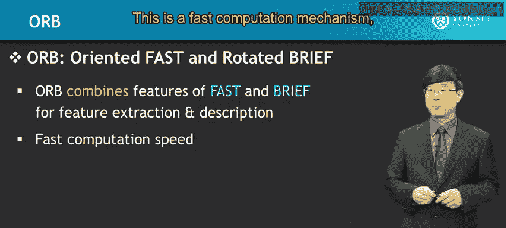
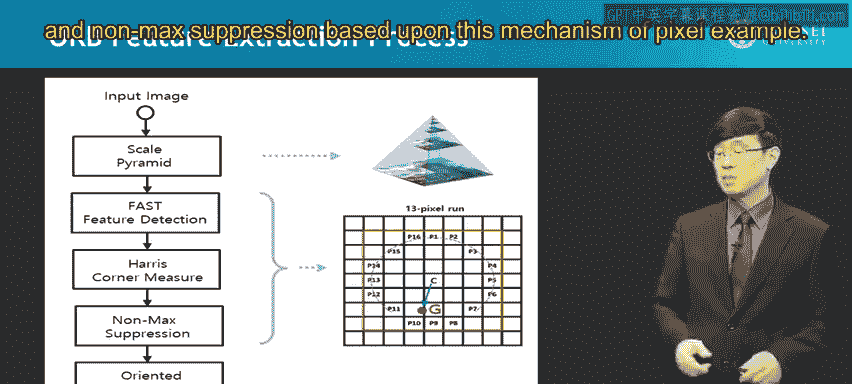

# 延世大学《新兴技术从智能手机到物联网再到大数据》课程 - P139：16_3.6 ORB算法 🎯

在本节课中，我们将要学习ORB算法。ORB算法是一种结合了FAST特征点检测与BRIEF描述子的特征提取与描述技术，因其高效性在实时应用中非常流行。

## 概述

ORB代表Oriented FAST and Rotated BRIEF。该算法是FAST特征检测技术与BRIEF描述子技术的结合体，主要用于从图像中提取和描述关键特征点。

## ORB算法的核心优势

上一节我们介绍了ORB的基本概念，本节中我们来看看它为何如此有吸引力。ORB算法具有以下几个显著优点：

*   **计算速度快**：其机制设计旨在实现快速计算。
*   **内存使用高效**：这种结合使其在内存使用上非常高效。
*   **匹配精度高**：这在增强现实等应用中至关重要。
*   **基于二进制运算**：由于FAST和BRIEF都基于汉明距离和二进制运算，这使得ORB速度更快，计算负担更小，更适合实时应用。

因此，在许多场景下，ORB可以替代SIFT和SURF算法进行特征提取，并成为一种流行的应用机制。

## ORB算法流程

了解了ORB的优势后，我们来看看它的具体工作流程。ORB的处理过程遵循一个清晰的步骤序列。

以下是ORB算法的主要步骤：
1.  **构建尺度金字塔**：使用多尺度图像金字塔来处理不同尺度的特征。
2.  **FAST特征检测**：在金字塔的每一层应用FAST角点检测器来寻找关键点。
3.  **Harris角点度量**：对FAST检测出的点应用Harris角点响应值进行度量。
4.  **非极大值抑制**：基于Harris响应值，抑制非极大值点，筛选出最强的角点。
5.  **方向计算**：为每个关键点计算主方向，以实现旋转不变性。
6.  **旋转BRIEF描述**：使用计算出的方向信息，生成旋转不变的BRIEF描述子。

## 关键技术细节详解

接下来，我们将对流程中的几个关键技术环节进行深入说明。

### 1. 多尺度图像金字塔

ORB使用基于尺度的图像金字塔来检测不同尺度下的特征。FAST和旋转BRIEF（R-BRIEF）被应用于金字塔的每一层。

### 2. FAST特征检测与Harris筛选

FAST特征检测使用FAST角点检测器来定位关键点。因为采用了FAST，所以自然引入了角点检测机制。这个过程展示了特征检测与描述子技术是可以混合匹配的，ORB本身就是一个优化后的混合匹配结果。

随后，对检测出的关键点应用**Harris角点度量**，以筛选出FAST响应最强的顶级点。这些点将成为候选关键点。

### 3. 方向计算与旋转BRIEF

为了实现旋转不变性，ORB为每个关键点计算了一个方向。

*   **质心**：首先计算图像块的质心 `G`（重心），这通过图像矩来改善旋转不变性。
*   **方向向量**：关键点的方向基于从该关键点指向质心 `G` 的向量方向来确定。
*   **旋转BRIEF**：BRIEF描述子利用上述方向信息进行调整，从而成为旋转不变的描述子。这就是ORB中“旋转”BRIEF（Rotated BRIEF）发挥作用的地方，它作为二进制描述子被使用。

> **注意**：在文献中，旋转BRIEF可能被写作“R-BRIEF”（大写R）或“rBRIEF”（小写r），两者均指代ORB中使用的旋转版本BRIEF描述子。

## 搜索与匹配过程

最后，我们来看ORB如何匹配特征点。ORB在特征匹配阶段采用了高效的搜索策略。

对应的搜索过程使用**MPLSH**（多探针局部敏感哈希）技术。当匹配失败时，算法会搜索相邻的哈希桶以寻找匹配。MPLSH使用更少的哈希表来节省内存消耗，并且与原始的BRIEF技术相比，它使用了更一致的哈希桶大小。

## 总结

本节课中，我们一起学习了ORB算法。ORB是一种高效的特征点检测与描述算法，它通过结合FAST的快速检测和BRIEF的简洁描述，并引入方向性实现旋转不变性，在速度、内存和精度之间取得了良好平衡，使其成为实时计算机视觉应用（如增强现实）中的热门选择。

