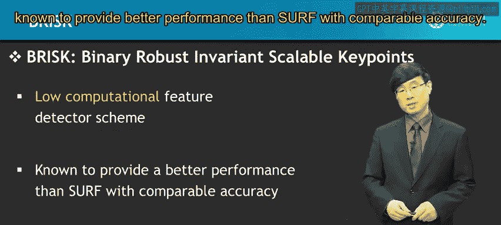
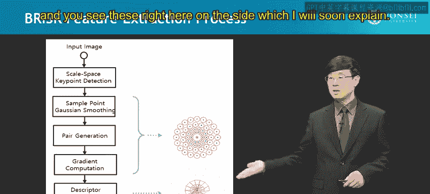
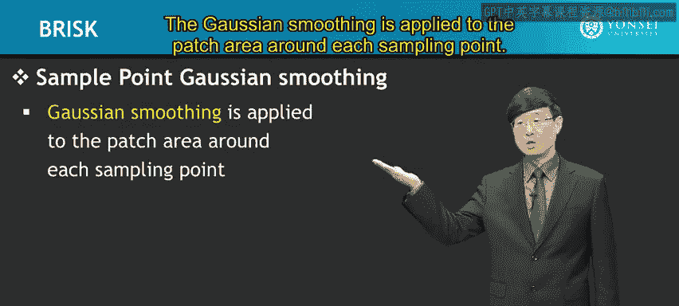
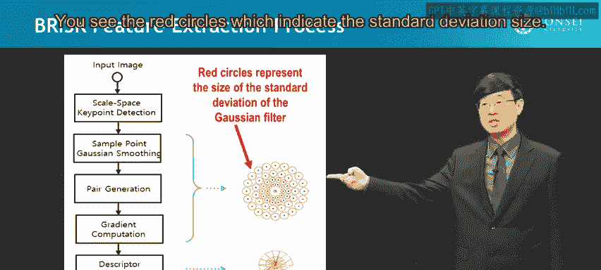

# 140：17_3.7 BRISK算法 🧠

在本节课中，我们将学习BRISK算法。BRISK是一种低计算量的特征检测方案，以其在保持相当准确性的同时，提供优于SURF算法的性能而闻名。我们将逐步解析其工作机制，从关键点检测到最终描述符的生成。

---

## 候选兴趣点检测机制

BRISK算法始于候选兴趣点检测机制。该机制使用AGAST检测器。

AGAST是一种基于加速分段测试的自适应通用角点检测器。简单来说，AGAST是一种角点检测机制。它是FAST算法的扩展，因此是一种改进的FAST机制。AGAST使用具有60个点对的圆形对称模式区域形状，并将这些点对线分配安排在四个同心圆环中。

---

## 尺度空间关键点检测

上一节我们介绍了兴趣点检测，本节中我们来看看尺度空间关键点检测。该步骤基于使用八度和层内八度的尺度空间。

以下是创建尺度空间的过程：
*   首先创建八度和层内八度。
*   每个八度从前一个八度进行半采样得到。
*   层内八度则通过下采样，放置在两个八度之间。

随后，尺度空间关键点检测会在每个八度和层内八度上应用非极大值抑制。
*   在图像块内计算亚像素级最大值。
*   跨尺度计算连续最大值。

这就是BRISK算法中使用的尺度空间关键点检测机制。

---

## 采样点与高斯平滑

在确定了关键点后，需要对关键点周围的区域进行处理。采样点高斯平滑随即被应用。

高斯平滑被应用于每个采样点周围的图像块区域。图像中的红色圆圈代表了高斯滤波器标准偏差的大小，直观地显示了平滑的范围。

---

## 点对生成

处理完平滑后，接下来是生成用于计算的特征点对。点对生成步骤将像素点对分离成两组。

以下是点对的分组方式：
*   **长距离点对**：用于粗略分辨率。
*   **短距离点对**：用于精细分辨率。

这种长短点对的分离处理，旨在实现算法的尺度不变性。

---

## 梯度计算

生成了点对，我们就可以计算梯度信息了。梯度计算首先在长距离点对上进行。

因为算法需要先确定特征的主方向。随后，轮到短距离点对。

在短距离点对上计算梯度，是为了确定相对于由长距离点对梯度处理所确定的主方向，图像发生了多少旋转。

---

## 二进制描述符生成

最后，基于旋转后的短距离点对，生成二进制描述符。这些描述符构成了图像特征的最终表示。

---

本节课中，我们一起学习了BRISK算法。我们从其高效的AGAST角点检测开始，逐步了解了尺度空间构建、高斯平滑、长短点对生成、梯度计算以确定方向和旋转，最终生成了用于特征匹配的二进制描述符。这个过程体现了BRISK在平衡计算效率和特征鲁棒性方面的设计思路。