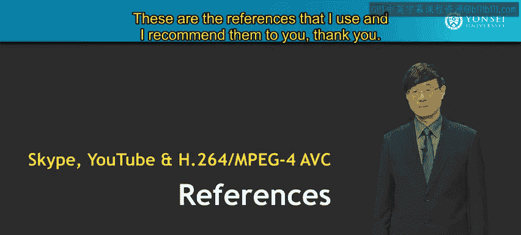

# 141：Skype 📞

在本节课中，我们将学习 Skype 及其相关技术。我们将探讨 Skype 的基本概念、架构、支持的编解码器、应用平台以及其发展历史。

---

## 概述

本节我们将从 Skype 开始讨论。Skype 是一项支持视频聊天和语音通话服务的应用程序，其标志广为人知。

Skype 这一术语源自“天空”（sky）和“点对点”（peer-to-peer）两个词的组合，形成了一个非常酷的名字。Skype 通过互联网，利用麦克风、扬声器和网络摄像头进行语音和视频通信，这些模块共同协作，实现了 Skype 的交互功能。

---

## Skype 的架构与技术

上一节我们介绍了 Skype 的基本概念，本节中我们来看看其技术架构。

Skype 的架构基于**混合点对点机制**，同时也采用了**客户端-服务器机制**。

以下是 Skype 支持的核心技术：

*   **音频编解码器**：包括 `G.729`、`SFO`、`PC`、`Silk` 和 `Opus`。
*   **视频编解码器**：包括 `H.264`，我们将在本讲座中进一步详细讨论。
*   **支持的应用**：包括网络电话（VoIP）、视频会议、即时消息和文件传输。

所有这些技术都非常重要，因此我们需要更详细地研究它们。

---

## 支持的平台与设备

了解了技术基础后，我们来看看 Skype 可以在哪些平台上运行。

Skype 视频会议通话可以通过智能手机、平板电脑、个人电脑和各种其他设备在各种平台上进行。

以下是支持 Skype 的客户端操作系统：

*   **桌面操作系统**：
    *   支持一系列 Windows 产品。
    *   通用 Windows 平台客户端操作系统包括 `Windows 10`、`Windows 10 Mobile` 以及 `HoloLens`。HoloLens 是一种增强现实设备，它支持视频等多种技术，是进行 Skype 视频会议以及其他增强现实应用的绝佳平台。
    *   其他桌面操作系统包括 `OS X` 和 `Linux`（包括 `Ubuntu`、`Linux Alpha` 等版本）。
*   **移动设备操作系统**：
    *   包括苹果 iPhone 和 iPad 的 `iOS`、`Android`、`Blackberry 10`、`Fire OS`、`Nokia X`。
    *   过去也曾为选定的 `Symbian` 和 `Blackberry` 操作系统设备提供支持。

---

## 服务模式与类似技术

Skype 在 Skype 服务内对其他 Skype 用户的通话是免费的。然而，Skype 也可以用于拨打传统电话（固定电话和手机），这需要通过 Skype 信用点或订阅的方式，基于用户账户扣费。

支持网络电话（VoIP）和视频会议（Videoconferencing）的类似技术包括基于 `SIP` 和 `H.323` 协议的服务，例如由 `Linphone` 和 `Google Hangouts` 等公司使用的技术。

---

## Skype 发展历史

现在，让我们回顾一下 Skype 的发展历程，这有助于理解其如何成为今天广泛使用的服务。

*   **2003年**：Skype 由来自瑞典、丹麦和爱沙尼亚的专家和开发者创立。同年8月，Skype 的第一个公开测试版发布。
*   **2005年**：Skype 与波兰门户网站达成协议，成功进入波兰市场。同年9月，eBay 同意以约 **25亿美元** 收购 Skype Technologies S.A.。
*   **2009年9月**：基于 Skype 被评估为 **27.5亿美元** 的价值，eBay 宣布出售其65%的股份，价值 **19亿美元**。
*   **2010年**：Skype 拥有 **6.63亿** 注册用户，可见这款新创建的酷炫应用获得了巨大的增长和依赖。
*   **2011年**：这是一个重要的转折点，微软以 **85亿美元** 收购了 Skype，并开始将 Skype 服务整合到各种微软产品中。
*   **2013年2月**：微软推出了 Office 2013，在 Office 365 消费者计划（针对家庭、个人和大学使用）中包含了每月60分钟的 Skype 通话时长，这使其变得极其流行，并有助于推广该产品本身以及微软的技术产品。
*   **2013年4月**：Windows Live Messenger 即时消息服务被逐步淘汰，以推广 Skype。
*   **2014年11月**：微软宣布将在2015年用 Skype for Business 取代 Lync。后续版本结合了 Lync 和消费者版 Skype 软件的功能，组织可以选择将其用户从默认的 Lync 界面切换到 Skype for Business 界面。

---

## 总结

本节课中，我们一起学习了关于 Skype 的各个方面。我们从 Skype 的基本定义和其名称由来开始，深入探讨了其基于混合点对点和客户端-服务器机制的架构，了解了其支持的音频（如 `Opus`）和视频（如 `H.264`）编解码器，以及 VoIP、视频会议等核心功能。我们还查看了 Skype 广泛支持的平台，从桌面系统到移动设备，甚至包括增强现实设备 HoloLens。最后，我们回顾了 Skype 从创立到被微软收购的重要发展历程，理解了它如何成长为一项全球性的通信服务。