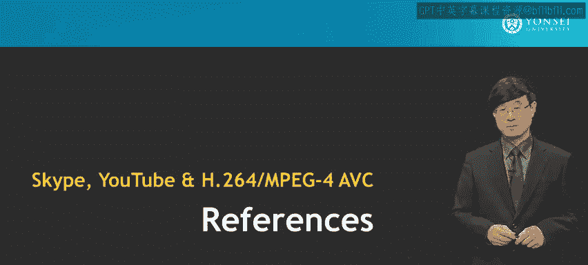

# 142：19_4.2 Skype编解码器 📞

在本节课中，我们将学习Skype所使用的音频与视频编解码器技术。我们将从Skype最初采用的音频编解码器开始，逐步了解其发展历程，并深入探讨其核心的Silk、Opus以及视频编解码器的工作原理与规格。

---

## 音频编解码器：从G.729到Silk

上一节我们介绍了VoIP的基本概念，本节中我们来看看Skype具体使用的音频编解码器。

最初，Skype在其VoIP应用中使用的是**G.729**和**SVOPC**编解码器。从Skype 4.0 for Windows及其他客户端版本开始，Skype引入了**Silk**编解码器。

Silk是由Skype公司开发的一款轻量级、可嵌入的音频编解码器。它是一个音频压缩格式与编解码器，于2009年3月首次发布，其最新的SDK发布于2012年。

以下是Silk的主要技术规格：
*   **音频采样频率**：8、12、16或24千赫兹。
*   **比特率范围**：6至40千比特每秒。
*   **低算法延迟**：基于25毫秒，其中帧大小为20毫秒，并包含5毫秒的前瞻部分。
*   **参考编程语言**：C语言。
*   **编解码基础**：基于**线性预测编码**。
*   **可用性**：提供Silk二进制SDK（软件开发工具包），便于新技术的开发。

---

## 音频编解码器：Opus

了解了专有的Silk编解码器后，我们再来看看Skype后来采用的开放标准——Opus编解码器。

Skype音频编解码器Opus被设计为一种有损音频编码格式，旨在高效地将语音和通用音频编码为单一格式。Opus的设计目标是结合Silk和CELT技术，根据需要在其间切换或组合，以实现最高效率。

Opus同样保持了低延迟特性，足以满足实时交互通信的需求。它的设计具有低复杂度，可以在低端的ARM处理器上运行，这意味着即使不是最先进的移动设备也能轻松支持运行Skype所需的Opus操作。

Opus已在IETF RFC 6716文件中标准化。**CELT**是“约束能量Lapped变换”的缩写，这是一种开放、免版税的有损音频压缩技术。它具有极低的算法延迟以支持低延迟音频通信，其设计采用了低延迟的**MDCT**技术，即“改进的离散余弦变换”。

---

## 视频编解码器：从VP7到H.264

在了解了音频编解码器之后，本节我们将目光转向Skype的视频编解码器发展历程。

Skype的视频编解码始于**VP7**，在Skype 5.5版本之前，它被用作视频编解码器。2005年后，Skype使用了TrueMotion VP7编解码器，这是原始VP7的演进版本。2011年初，Skype 5.5转向了更先进的**VP8**版本。

TrueMotion VP7和VP8是由On2 Technologies为Google开发的。Skype 5.7版本在群组和一对一标准清晰度视频聊天中均使用了VP8。

一个重大的变化发生在2011年Skype被微软收购之后。随后，视频编解码器更改为**H.264**，这是一种功能非常强大的协议，我们将在本讲座模块中详细解释。

---

## Skype视频通话质量规格

最后，我们来具体看一下Skype不同模式下的视频通话质量参数。

以下是Skype视频通话的几种质量模式及其规格：
*   **标准模式**：视频分辨率为**320 x 240像素**，帧率为**15帧每秒**。
*   **高质量模式**：视频分辨率为**640 x 480像素**，帧率为**30帧每秒**。
*   **高清模式**：最高分辨率达**1280 x 720像素**，帧率为**30帧每秒**。

此外，其他H.264编解码器也用于群组和点对点（一对一）视频聊天中。

---

本节课中我们一起学习了Skype编解码器的演进与技术细节。我们从最初的G.729音频编解码器开始，探讨了轻量级的Silk和高效的Opus音频编解码器。接着，我们回顾了视频编解码器从VP7、VP8到行业标准H.264的发展过程，并了解了不同通话模式下的具体视频质量参数。这些编解码器技术是保障Skype实现高质量、低延迟实时通信的核心基础。

**参考资料**：本讲所提及的技术规格与历史信息。