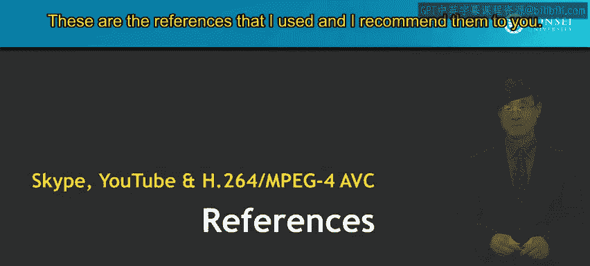
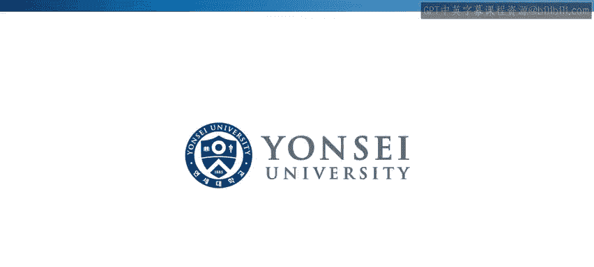

# 143：20_4.3 YouTube 🎬

在本节课中，我们将学习全球最大的视频分享平台——YouTube。我们将了解它的历史、核心技术以及它在互联网视频服务中的分类和地位。

## YouTube简介与历史 📜

YouTube是一个全球性的视频分享网站，它使用**H.264、MPEG-4 AVC、WebM**以及**Adobe Flash Video**等技术。

现在，让我们回顾一下YouTube的发展历程。

以下是YouTube发展过程中的关键节点：

*   **2005年2月**：三名前PayPal员工创立了YouTube。创始人查德·赫尔利和陈士骏的灵感来源于难以在线找到2004年超级碗中场表演视频的经历，以及分享2004年印度洋海啸视频的需求。另一位创始人贾韦德·卡里姆的动机则是希望创建一个使用视频的在线交友服务。
*   **2005年2月14日**：域名 `www.youtube.com` 被激活。
*   **2005年4月**：首个视频《我在动物园》在圣地亚哥动物园被上传，内容展示了联合创始人贾韦德·卡里姆。
*   **2005年9月**：一则耐克广告首次达到100万次观看。
*   **2005年11月至2006年4月**：YouTube获得了1150万美元的风险投资。
*   **2005年12月**：YouTube官方网站正式上线。
*   **2006年7月**：YouTube宣布每天有超过6.5万个新视频被上传。
*   **2006年11月**：谷歌收购了YouTube。
*   **2010年**：总部迁至加利福尼亚州圣布鲁诺。
*   **2011年4月**：数据显示，30%的视频占据了YouTube总观看次数的99%，这表明少数视频主导了大部分流量。
*   **2014年**：YouTube宣布每分钟有300小时的新视频被上传。
*   **2015年**：YouTube成为全球访问量第三大的网站，每月吸引超过150亿访客，成为世界顶级的电视和视频网站。
*   **2016年1月**：圣布鲁诺总部扩建，可容纳2800名员工，总投资达2.15亿美元。

## 互联网视频服务分类 📺

上一节我们回顾了YouTube的成长史，本节中我们来看看互联网视频技术基于服务的分类。

互联网视频服务主要分为以下几类：

1.  **用户生成内容**：这是YouTube的核心内容类型，主要由业余用户创建和生成。
2.  **专业生成内容**：这是我们通常观看的传统视频内容，由工作室或广播公司制作，用于推广商业产品和服务，也包括广告。例如`ABC.com`、`Hulu`等平台的内容。
3.  **直接电影销售**：指通过互联网直接向消费者销售电子版电影，即EST。流行的服务包括`Netflix`、`Apple TV`、`Ultraviolet`等。

## 什么是OTT技术？ 📡

了解了视频内容的来源后，我们来看看承载这些内容的关键技术——OTT。

在媒体广播中，**OTT**指的是通过互联网直接向终端用户提供的媒体内容。互联网服务提供商仅负责传输IP数据包，即提供网络连接。

这与传统方式不同：传统上，媒体内容通常通过ISP购买；而在OTT模式中，ISP只提供网络和服务，内容通过其他方式购买。

消费者可以通过以下联网设备访问OTT媒体内容：有线或卫星电视机顶盒、智能电视、智能手机、个人电脑、笔记本电脑、平板电脑、游戏机等。

“Over The Top”这个术语最初来源于“在电视机顶盒之上”的概念，意指内容绕过传统有线电视网，通过互联网传输。如今，OTT的概念已经大大扩展。

## YouTube的视频技术演进 🔧

前面提到YouTube使用多种技术，其视频播放技术也经历了一次重要演进。

YouTube早期的视频技术基于**Adobe Flash Player插件**。用户需要在个人电脑的浏览器中安装此插件才能观看YouTube视频。

2010年1月，YouTube实验站点开始利用**HTML5**内置的多媒体功能，使用户无需安装Flash Player即可观看视频。

由于HTML5的成功及其特性，2015年1月，HTML5被宣布为YouTube默认的播放方式。

需要注意的是，HTML5视频流使用**MPEG-DASH**技术。MPEG-DASH是基于HTTP的动态自适应流媒体技术。它不仅是YouTube使用的核心技术，也是当今世界上几乎所有视频系统主导的视频流技术。因此，后续课程将单独重点讲解MPEG-DASH。

**MPEG-DASH**通过根据网络状况控制视频和音频质量，支持基于HTTP的自适应比特率流媒体传输。

## 总结 📝

本节课中，我们一起学习了YouTube的发展历程，了解了它从创立到成为全球视频巨头的关键节点。我们探讨了互联网视频服务的三大分类：用户生成内容、专业生成内容和直接电影销售。我们还学习了OTT技术的概念及其与传统媒体分发的区别。最后，我们回顾了YouTube视频技术的演进，从早期的Adobe Flash Player过渡到如今基于HTML5和**MPEG-DASH**标准的自适应流媒体技术，这为其提供高质量、流畅的视频体验奠定了坚实基础。

这些是我使用的参考资料，推荐给你。

