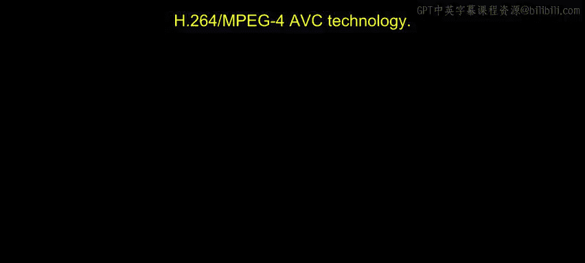
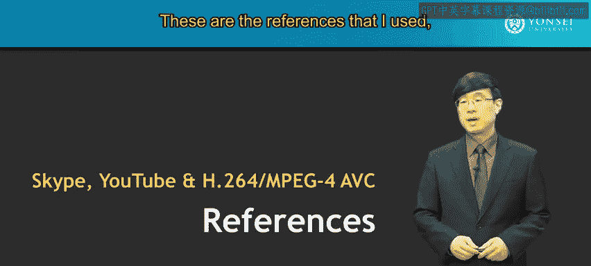

# 延世大学《新兴技术从智能手机到物联网再到大数据》课程 - P144：21_4.4 H.264/MPEG-4 AVC 🎬

在本节课中，我们将要学习H.264/MPEG-4 AVC视频编码技术。这项技术极其重要，因此本讲将重点介绍它。

## 概述：什么是H.264/MPEG-4 AVC？

H.264，即MPEG-4第10部分高级视频编码协议。当我们提到AVC时，我们指的是高级视频编码技术。

它是目前用于视频录制、压缩和分发最流行的标准。因此，它被广泛应用于Skype和YouTube等平台。了解这项技术至关重要。

## 技术背景与发展组织

从整体规范来看，H.264是由联合视频工作组开发的。JVT是ITU-T VCEG和ISO/IEC MPEG组成的联合视频团队。

深入了解细节，会发现其中涉及许多缩写和强大的国际标准化组织。以下是ITU-T和ISO/IEC JTC1等组织的描述。

该标准旨在以最低的比特率实现高质量视频。

## 核心技术原理

H.264是一种采用基于块的运动补偿压缩的视频标准。

它是一种基于运动补偿的压缩技术，其补偿单元是面向块的、经过选择的块单元。

这项压缩技术非常出色，因为它能在保证足够分辨率和画质的前提下，将文件体积压缩得非常小。这使得视频易于存储，也便于在网络中传输。

正是这两个特性使其如此流行，以至于Skype、YouTube以及几乎所有的视频流媒体和应用都使用它。

## 性能优势与特点

因此，我们需要进一步了解细节。H.264的设计目标是与MPEG-2、H.263或MPEG-4第2部分相比，比特率减半或更低。

实现比特率减半或更低，意味着在网络中传输更容易，或在内存中保存时文件体积更小。

这一目标的实现并未过多增加编码复杂性。然而，计算复杂度确实有所增加，但增幅不大。

考虑到现代设备拥有更强大的GPU和CPU，它们能够在相同的有限时间内完成这些计算任务。

## H.264标准家族与编码配置

H.264是一个标准家族，并非单一类型，其内部包含多个不同的视频编码配置。

H.264解码器可能无法解码所有配置，因此需要告知可解码的配置。

H.264压缩可实现低比特率和较低分辨率。

H.264无损编码是可能的，但很少使用，因为它会导致文件体积变大。

## 后续发展与主要应用

H.265是MPEG-H第2部分，即高效视频编码，它是H.264/MPEG-4 AVC的继任者。

H.264的应用范围包括蓝光光盘、互联网流媒体源，这也是YouTube、Skype、iTunes Store和Vimeo都采用它的原因。

网络软件方面，Adobe Flash Player、Microsoft Silverlight等也包含在内。

高清电视广播公司同样使用它。此外，有线电视服务以及基于DVB-S和DVB-S2的卫星服务也采用该标准。

H.264的专利由多方持有，其许可由位于美国科罗拉多州丹佛市的专利池管理机构MPEG LA管理。

## 主要编码配置详解

以下是H.264的主要编码配置。

**非可扩展2D视频应用配置**包括：
*   **CBP**：受限基线配置，用于视频会议和移动应用等低成本场景。
*   **BP**：基线配置，用于需要额外数据丢失鲁棒性的低成本应用，同样用于视频会议和移动应用。
*   **XP**：扩展配置，用于流媒体视频，具有较高的压缩能力和增强的鲁棒性，以支持数据丢失和服务器流切换。

**MP**：主配置，用于采用MPEG-4标准的标清数字电视广播。MP也曾用于高清电视，但在2004年高级配置开发出来后已很少使用。

**HP**：高级配置，用于高清电视广播和光盘存储应用。它被用作蓝光光盘存储格式和高清电视广播服务。

**ProHiP**：逐行扫描高级配置，与HP类似，但不包含场编码功能。

**CHiP**：受限高级配置，与ProHiP类似，但不包含B条带。

**High 10P**：在HP基础上构建，增加了对解码图像精度高达每样本10比特的支持。

**High 4:2:2P**：用于使用隔行视频的专业应用。在High 10P基础上构建，增加了对4:2:2色度二次采样格式的支持，同时使用高达每样本10比特的解码图像精度。

**High 4:4:4P**：在High 4:2:2P之上构建，支持高达4:4:4的色度采样和每样本高达14比特的精度。

## 其他专业配置

H.264配置还包括仅帧内编码配置、编辑和专业应用配置。

以下是四个主要用于涉及摄像和编辑系统的专业应用的仅帧内配置。

**可伸缩视频编码配置**包括：
*   **可伸缩受限基线配置**：主要用于实时通信应用。
*   **可伸缩高级配置**：主要用于广播和流媒体应用。
*   **可伸缩受限高级配置**：主要用于实时通信应用。
*   **可伸缩高级仅帧内配置**：用于仅限于全帧内使用的制作应用。

**多视点视频编码配置**包括：
*   **立体高级配置**：用于双视点立体3D视频的配置。
*   **多视点高级配置**：用于两个或更多视点，同时使用基于时间的帧间预测和MVC帧间预测。
*   **多视点深度高级配置**。

以上是我使用的参考文献，我推荐给你们。谢谢。

## 总结

本节课中，我们一起学习了H.264/MPEG-4 AVC视频编码标准。我们了解了它的定义、开发组织、核心的基于块的运动补偿压缩原理，以及其低比特率、高画质、小体积的核心优势。我们还详细介绍了其庞大的标准家族，包括面向不同应用场景的各种编码配置，如用于移动和视频会议的基线配置，用于广播和蓝光的高级配置，以及面向专业制作和3D视频的可伸缩与多视点配置。理解H.264是理解当今主流视频技术应用的基础。