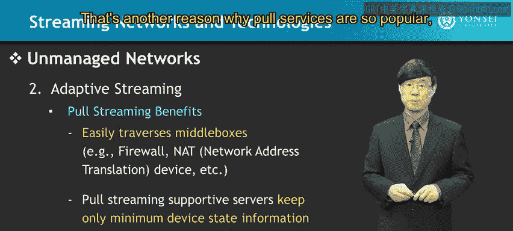

# 延世大学《新兴技术从智能手机到物联网再到大数据》课程 - P145：22_5.1 流媒体网络与技术（第1部分）📺

在本节课中，我们将学习流媒体网络与技术的基础知识。我们将从流媒体服务的网络类型开始，然后探讨不同的流媒体方法，包括渐进式下载和自适应流媒体，并分析它们各自的优缺点。

## 网络类型：管理式与非管理式网络 🏗️

首先，我们来了解两种主要的流媒体网络类型：管理式网络和非管理式网络。

### 管理式网络

管理式网络包括有线电视和IPTV服务。这类服务的特点是经过精心规划。

以下是管理式网络的主要特征：
*   节目表会提前公布。
*   在电影、电视剧、电视节目和新闻广播之间，会插入适量的广告。
*   这些服务之所以可靠，是因为它们管理完善、预先排期，并且到您家中的传输机制也经过周密规划。
*   它们使用**组播传输技术**，并具备受控的**服务质量**功能，从而提供非常可靠的服务。

### 非管理式网络

另一方面，非管理式网络使用**单播连接**向观众传输内容。

常见的传输方式是从服务器或内容分发网络进行交付。
*   服务器可以是像YouTube服务器这样的广播服务器。
*   CDN指的是**内容分发网络**，这是一种用于在各种广域网络（包括可能跨越洲际的互联网）上进行视频流媒体和内容分发的网络。

因此，我们需要研究CDN技术，这将是本课程下一个模块的主题。

## 流媒体方法 📡

上一节我们介绍了流媒体网络的基础类型，本节中我们来看看具体的流媒体方法。流媒体方法主要分为专有流媒体协议和基于HTTP的流媒体。

流媒体协议包括运行在TCP或UDP上的专有协议。此外，还有基于TCP的HTTP流媒体，这在渐进式下载技术中很流行。

我们还需要关注传统流媒体与自适应流媒体技术，尤其是因为自适应流媒体是当前的主流，并且未来网络也将依赖它。我们将在本课程中学习其技术原理。

### 传统流媒体服务

传统流媒体服务包括微软的Windows Media、苹果的QuickTime、Adobe Flash等，这些都是您可能已经使用过的流行媒体服务技术。

### 渐进式下载

渐进式下载使用基于TCP的HTTP协议。只要下载并缓冲了必要数量的数据（大约2到10秒的视频信息），视频就可以开始播放。

当然，由于视频被缓冲并存储在内存中，您可以决定何时开始播放、暂停，或者快进、快退观看视频的不同部分。您不能快进到尚未接收到的部分，但可以稍微快进，查看设备是否已经下载并接收了那部分视频。

渐进式下载有其优点和缺点。

以下是渐进式下载的优点：
*   轻松支持暂停和重新缓冲。
*   轻松支持**特技模式**，使您能够执行快进、定位播放、倒带等功能。

以下是渐进式下载的缺点：
*   服务器必须存储同一视频的多个分辨率版本，这会占用服务器更多空间。

### 关于特技模式的更多细节

特技模式的一个例子是，当您在YouTube上观看视频时，您观看到了某个点，想要跳到后面或倒回到某个位置查看视频的不同部分。您所做的就是按住进度条上的红点并移动它，旁边出现的小窗口会显示如果您在那个位置重新开始播放，视频将从何处开始。这就是我们所说的特技模式，它使视频观看变得非常方便。

## 自适应流媒体技术 🔄

传统流媒体技术依赖于固定的传输速率，而自适应流媒体则是一项更高级的技术。在这种技术中，观看设备会监控其回放缓冲区和网络状况。

网络状况与带宽、误码率、吞吐量、各种延迟组件有关。设备将选择最合适的视频版本（即视频分辨率），并使用渐进式下载来决定显示哪个级别的视频。

例如，可能存在普通模式，但如果网络状况良好且缓冲区有一定空间，您或许可以切换到高清模式。高清模式下每秒帧数会增加，同时每幅图像的分辨率也会提高，这将增加接收的数据速率。只有当您的网络状况和回放缓冲区有足够空间时，才能这样做。

一些自适应流媒体服务示例包括：
*   **MPEG-DASH**：DASH代表基于HTTP的动态自适应流媒体，这是全球最流行的网络技术。
*   微软平滑流媒体。
*   苹果HTTP直播流媒体。
*   Adobe HTTP动态流媒体。

其中，MPEG-DASH是最流行的。

## 基于HTTP的自适应流媒体优势 🌐

使用基于HTTP的自适应流媒体的优势基于以下事实：HTTP具有无处不在的连接性，意味着几乎所有设备都支持HTTP连接。

HTTP是一种**拉取协议**。拉取协议与推送协议相反。基于HTTP的自适应流媒体之所以具有优势，是因为拉取流媒体具有以下好处。

以下是拉取流媒体的主要优势：
*   **易于穿越中间设备**：中间设备包括防火墙、网关、网络地址转换设备等。这是因为它是拉取服务，设备会发出请求，要求发送特定数量的视频信息。这样，中间设备就能看到设备请求了多少，然后看到服务器发送了相应数量。因此，它可以信任发送到网络给用户的量是合适的。
*   **服务器仅需维护最少的设备状态信息**：如果使用推送服务，服务器需要跟踪它向移动设备发送了多少数据、网络状况、是否有错误以及是否需要重传。如果您同时控制许多移动用户，这需要跟踪大量信息，使服务器需要跟踪的控制机制变得非常复杂。另一方面，在拉取服务中，您的智能手机会根据它看到的网络状况、拥有的内存量以及当前显示的视频状态来请求所需的数据量。因此，服务器需要跟踪的工作量在拉取服务中是最小的。
*   **可扩展性更强**：与推送流媒体服务器相比，拉取服务的可扩展性更强。这意味着，一台支持多个用户的服务器，在使用拉取模式时，可以支持比推送模式多得多的用户。可扩展性的好处正源于此。

## 总结 📝

本节课中，我们一起学习了流媒体网络与技术的基础。我们从管理式和非管理式网络入手，了解了有线电视、IPTV与互联网流媒体的区别。接着，我们探讨了不同的流媒体方法，包括传统流媒体、支持特技模式的渐进式下载，以及更先进的自适应流媒体技术。我们重点分析了基于HTTP的自适应流媒体（如MPEG-DASH）的工作原理和核心优势，特别是其拉取协议的特性如何带来穿越防火墙能力强、服务器负担轻和可扩展性高等好处。理解这些基础概念是掌握现代视频传输服务的关键。