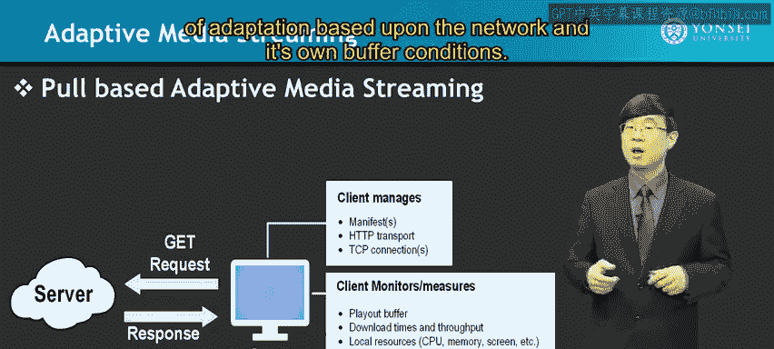

# 课程23：流媒体网络与技术（第二部分）📡

在本节课中，我们将深入探讨流媒体技术的两种核心传输模式：基于推送（Push-based）和基于拉取（Pull-based）的自适应流媒体。我们将了解它们的工作原理、优缺点以及相关的技术标准。

---

## 基于推送的流媒体技术

上一节我们介绍了流媒体的基本概念，本节中我们来看看基于推送的流媒体技术。

在这种模式下，服务器持续向客户端发送数据包，直到客户端停止或中断会话。其形式是服务器不断发送数据，直到接收设备发出停止信号。服务器维护与客户端的会话状态，并监听客户端关于会话状态变化的指令。

以下是两种流行的基于推送的流媒体服务协议：

*   **RTSP**：实时流协议，是一个基于RFC 2326的IETF标准。通常使用TCP作为会话控制协议。
*   **RTP**：实时传输协议，是一个基于RFC 3550的IETF标准。通常使用UDP。`RTP over UDP` 允许服务器向客户端推送数据包。

服务器的比特率由应用的服务质量要求以及客户端和服务器的特性决定。比特率指的是以比特每秒为单位测量的数据流量，可以表示为 `bits/second` 或简写为 `bps`。

### 基于推送流媒体的缺点

以下是基于推送流媒体技术的主要缺点：

*   **服务器负担过重**：服务器需要处理太多任务。
*   **设备状态难以追踪**：由于服务器与移动设备距离遥远，当设备经历某种状态并报告回服务器时存在时间差，因此服务器总是试图追赶你设备上正在发生的当前状态。
*   **防火墙可能阻挡RTP数据包**：许多防火墙会阻挡RTP数据包，因为它们无法判断发送到移动设备的数据包是基于设备请求还是一种安全攻击。
*   **网络支持有限**：许多已被CDN替代的互联网服务网络不支持RTP，因为RTP可能具有危险性并可用于网络攻击。

内容分发网络是视频流服务中使用的核心技术之一，我们将在下一个模块中学习CDN。

---

## 基于拉取的自适应流媒体技术

了解了推送模式的局限性后，现在我们转向更主流的基于拉取的自适应流媒体技术。

在这种模式下，媒体客户端（如你的智能手机或个人电脑）向服务器发送HTTP请求，以突发模式快速拉取内容数据包。这意味着当你请求内容时，你希望它能被非常快速地发送，以便你按顺序接收数据包，将其存入内存，然后在移动设备上回放。

当所需的最小缓冲水平被填满后，媒体客户端就能够播放并在媒体播放器上显示内容。服务器以匹配媒体消费速率的媒体编码比特率进行传输。视频以特定速率显示，使得内存中的视频数据包被消耗，而媒体编码比特率的设置方式将与该速率匹配。

此外，如果客户端缓冲水平大致稳定在某个固定水平，网络资源将被高效利用。为了让客户端设备的缓冲水平保持稳定，意味着视频数据包在显示器上被消耗和显示的速度，与数据包到达缓冲区（内存）的速度大致相同，这样整体缓冲水平才能保持稳定。在这种情况下，网络资源的使用效率很高。

如果网络数据包丢失或遇到传输延迟，则会发生**缓冲区欠载**，缓冲区会变空，因为数据包无法正常到达。因此，播放可能会中断，视频会在中途停止。服务器会动态切换到较低的比特率流以防止缓冲区欠载。这意味着传入的视频数据包将以支持较低分辨率视频的方式制作，从而减少发送的数据包数量和大小。因此，整体流媒体速度可以维持，因为你发送的数据量匹配了较小的网络吞吐量。当然，你损失的是视频的分辨率。

为了避免明显的视频质量下降，会采用**渐进的比特率流降低**。这意味着如果网络条件恶化，则逐渐降低视频质量，从而需要更少的数据包和吞吐量。如果网络条件改善，则服务器切换到更高的比特率，直到恢复媒体编码比特率。如果错误条件改善，你会希望恢复到之前使用的高质量，这需要网络吞吐量和网络中的其他条件能够支持这种更高的分辨率和吞吐量。

基于拉取的自适应媒体流工作方式如下：存在各种电影比特率和片段。细节将在后续幻灯片中解释。

首先，让我们看一个例子，它始于对电影A的清单请求。服务器回复一个清单给将要播放视频的设备。收到这个清单意味着服务器将支持你对电影A的请求。然后，拉取过程开始。客户端将请求每秒200千比特的数据速率，这是视频流发送给自身的数据速率，参考时间为零。随着视频数据包的到来，客户端会看到网络条件相当好，因此它会请求更高的分辨率，数据速率在2秒时上升到每秒400千比特。然后它要求更高质量升级，在4秒时请求每秒800千比特，随后接收到更高的数据速率。但是，当我们以每秒800千比特的更高速率接收时，遇到了一些数据包丢失和延迟，因此客户端决定降低速率，在6秒时请求每秒400千比特的速率。之后网络条件改善，它又回到更高的速率，在视频服务开始8秒时请求此服务。这就是我们达到这个范围的方式，也是自适应媒体流媒体的实现方式，你可以看到它基于拉取机制，请求什么就得到什么。

---

## 媒体流结构解析

现在我们来剖析一下媒体流的结构。基于MP4技术的文件格式，首先你会看到开头是文件类型。然后我们有电影元数据部分。接着我们进入片段部分，在片段部分，你可以看到音视频数据位于MDAT框中。MDAT代表媒体数据。MDAT框和元数据形成一个片段。此外，片段通过HTTP GET请求消息检索。

观察片段内部，我们有整体的MOOF（电影片段部分），然后是我们解释过的媒体数据部分。这就是一个片段中包含的内容。然后我们有电影片段随机访问部分，我们将使用这部分。

查看HTTP请求消息的例子，你可以看到这是一个GET消息。每个片段基于唯一的HTTP请求-响应对进行下载。此外，HTTP请求消息头包含两条重要信息：一是比特率，二是请求片段的时间偏移量。你可以从这里估计这些信息。

---

## 客户端自适应流媒体实现

最后，我们来看看基于拉取的自适应媒体流结构与服务器交互的细节。顶部有一个GET请求，底部是响应。客户端管理这些组件，客户端监视和测量这些因素，然后客户端将根据网络及其自身缓冲区条件执行一定程度的自适应。

现在我们将看到一个通用的客户端侧、基于拉取的自适应流媒体实现示例。客户端根据播放缓冲区状态和其他条件（包括网络状态），从一个或多个连接获取文件的片段媒体。GET请求和响应部分是关键组件。至少，服务器提供对HTTP GET请求的标准响应，意味着它可以提供至少标准响应或更多信息。

客户端获取一个清单文件，该文件标识整体媒体呈现和替代比特率。这些替代比特率用于更高或更低分辨率的视频和音频。

然后是客户端管理组件。客户端需要一个客户端侧清单或播放列表文件，以将片段请求映射到特定文件，或将字节范围或时间偏移映射到文件。此外，在一些自适应流媒体技术中，服务器上的类似文件会转换客户端请求。

接着是客户端监视和测量组件，其中播放缓冲区管理根据缓冲区状态和其他变量，从特定比特率的文件中选择片段。你可以看到实际测量和监视的组件。此外，客户端基于这些监视值执行自适应。

自适应流媒体客户端保存几秒钟的播放缓冲区，并希望以稳定的方式维持这个水平，因为如果保持稳定，网络将被高效利用。它试图保持大约5到30秒的视频播放时间。

---

## 总结

本节课中，我们一起学习了流媒体网络的两种关键技术。我们探讨了基于推送的流媒体（如RTSP/RTP）的工作原理及其在服务器负担和网络兼容性方面的缺点。接着，我们深入研究了基于拉取的自适应流媒体技术，了解了客户端如何根据网络条件和缓冲区状态，通过HTTP请求动态调整视频质量（比特率）以实现平滑播放。我们还分析了媒体流的结构（如基于MP4的片段格式）以及客户端实现自适应的关键组件。理解这些机制是掌握现代视频流服务（如YouTube、Netflix）如何高效运作的基础。