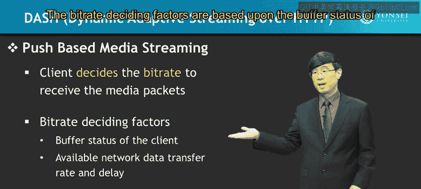
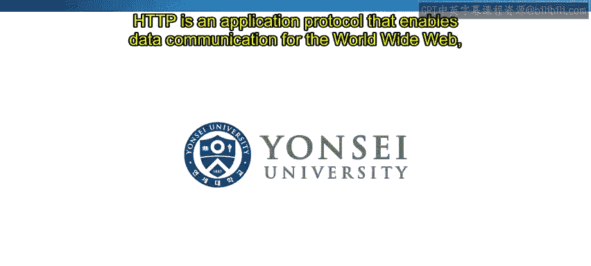

# 147：24_5.2 视频帧和HTTP（第1部分）📹

在本节课中，我们将要学习视频压缩中的关键帧类型，以及基于HTTP的渐进式下载流媒体技术。理解这些概念对于掌握现代视频传输和存储至关重要。

## 视频帧类型解析 🎞️

视频片段由不同类型的帧组成，它们共同协作以实现高效压缩。

以下是三种主要的视频帧类型：

*   **I帧（帧内编码帧）**：这是一个独立编码的图像。如果你获得一个I帧并尝试在显示器上呈现，它可以正常工作，因为它包含了图像的全部信息。
*   **P帧（预测帧）**：为了提升压缩率，我们使用P帧。一个P帧依赖于一个先前解码的I帧或P帧。与I帧相比，P帧的尺寸更小，因为它只编码相对于前一帧发生变化的部分，这显著提高了压缩率。
*   **B帧（双向预测帧）**：B帧依赖于多个先前解码的图像。这意味着它可以从前后的参考帧中获取信息来构建自身。通过结合少量来自多个帧的图像信息，可以用非常低的数据率创建新图像，从而使压缩非常高效，生成的文件非常小。

P帧和B帧具有更高的压缩率，这使得视频流文件非常小，这是非常理想的。它们编码的是运动补偿差异，即仅包含相对于其他帧的相对信息，这就是它们能保持小尺寸并实现高压缩率的原因。

## 图像组（GOP）的概念 🔄

视频帧基于视频片段，这些片段由一个或多个GOP组成。GOP代表图像组。

每个图像组以一个I帧开始，后面跟着P帧或B帧。与全部使用I帧相比，这导致了更小的视频文件尺寸，因为I帧由于包含图像的完整信息而体积较大。

在GOP中使用P帧和B帧可以实现非常高的数据压缩率。

GOP有两种类型：

*   **封闭式GOP**：其中的P帧和B帧的解码仅依赖于该GOP内的帧。
*   **开放式GOP**：其中的P帧或B帧会依赖于超出其所在GOP范围的帧。

当你使用开放式GOP时，需要将其他一些GOP打开并保存在内存中，因为开放式GOP中的一些P帧和B帧需要从那些先前已打开并在视频中播放过的GOP中获取信息。然而，当你使用封闭式GOP时，为视频流播放分配的内存缓冲区总体大小可以更小，因为一切都是自包含的。你打开一个GOP，所有的关联都在那个GOP内部。因此，基于封闭式和开放式，你可以实现不同级别的缓冲区管理，视频回放的方式也取决于你使用的GOP类型。

## HTTP渐进式下载 📥

上一节我们介绍了视频压缩的基础，本节中我们来看看一种广泛应用的流媒体传输方法。

HTTP渐进式下载是最广泛使用的基于拉取的媒体流方法之一。这是因为它具有普遍存在的连接性。几乎所有的移动设备、个人电脑、笔记本电脑、平板电脑都使用这项技术，这就是它如此流行以及你需要了解它的原因。

它被用于互联网上几乎所有的应用程序和网络服务。YouTube使用基于TCP的HTTP，各种其他视频流技术也使用它。

TCP支持错误恢复、数据段重排序。错误和丢失的数据包由TCP协议恢复。

YouTube需要提供自适应传输控制以避免视频卡顿，而这正是MPEG-DASH所做的事情。

以下是基于HTTP的拉取式媒体流的特点：

*   这是用于视频服务交付和各种媒体流交付的最常见协议。
*   媒体客户端是主动向媒体服务器请求内容的实体。
*   服务器的响应取决于客户端的请求，因此你可以看到这是一种直接的拉取机制，除非被请求，否则服务器不会将内容发送到你的智能手机。
*   此外，客户端决定接收媒体数据包的比特率。

比特率的决定因素基于客户端的缓冲区状态以及可用的网络数据传输速率和延迟。

本节课中我们一起学习了视频压缩中的I帧、P帧和B帧，理解了它们如何通过图像组（GOP）协作以实现高效压缩。我们还探讨了HTTP渐进式下载作为主流流媒体传输协议的工作原理，包括其拉取机制和自适应比特率选择。这些知识是理解现代视频技术从存储到传输全过程的基础。