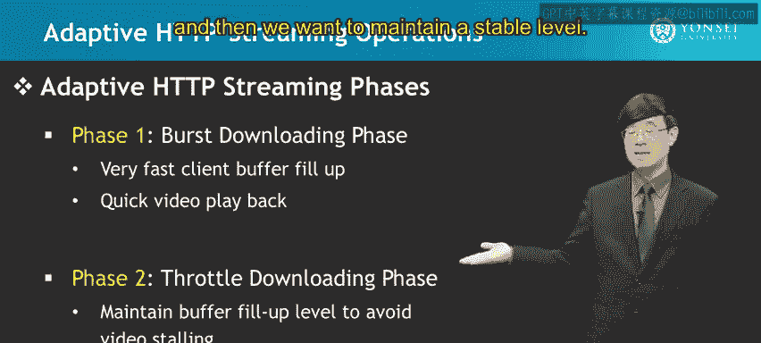

# 延世大学《新兴技术从智能手机到物联网再到大数据》课程 - P148：25_5.2 视频帧和HTTP（第2部分）📡

在本节课中，我们将要学习超文本传输协议（HTTP）的基本概念、发展历史、工作原理及其在视频流媒体中的应用。我们将了解HTTP如何作为万维网数据通信的基石，并探讨其与TCP协议的结合如何支持稳定的视频传输。

---

## HTTP概述 🌐

HTTP是一种应用层协议，它实现了万维网的数据通信。HTTP非常流行，它支持分布式、协作式的超媒体信息系统。此外，HTTP是用于交换或传输超文本的协议。

超文本是一种结构化的文本，用于个人电脑、智能手机和服务器之间的超链接。网站地址就是通过具有特殊格式的文本来使用和请求的，这些格式支持网站和各种超文本服务。因此，HTTP是必需的，并且基于其“拉取”机制的特性，它自然变得非常流行。

## HTTP的历史与发展 📜

HTTP的历史相当有趣。它于1989年由欧洲核子研究组织（CERN）创建，并由互联网工程任务组（IETF）和万维网联盟（W3C）标准化。从一开始，它就是被设计用作网络互联网支持机制的，并且无疑实现了其最初的目的。

以下是HTTP的主要版本演进：

*   **HTTP 1.0**：原始版本。它为接收到的每个资源请求都与同一服务器建立单独的连接。
*   **HTTP 1.1**：升级版本，于1997年发布（RFC 2068）。这种机制可以多次复用同一个连接来下载视频、音频和数据，显著提高了支持多连接的效率。1999年发布的RFC 2616修订并取代了RFC 2068，这是现今互联网上常用的版本。
*   **HTTP/2**：于2015年标准化，目前已被主流网络服务器支持。

## HTTP的工作原理 ⚙️

HTTP作为一种基于客户端-服务器计算模型的请求-响应协议运行。客户端发出请求，服务器发送响应。这是一种典型的基于拉取的机制：客户端发出拉取请求，服务器进行响应。

一个例子是：客户端是网络浏览器，服务器是托管网站的计算上运行的应用程序。

上图展示了一个示例：客户端向服务器发送HTTP请求消息。你可以看到请求消息基于`GET`方法、URL和HTTP版本1.1。服务器会发回一个包含`OK`状态码的响应消息，资源数据随之返回给客户端。当然，数据也可以从服务器流向客户端，正如前一页示例中所讨论的。

服务器向客户端提供资源（如HTML文件、视频内容）或功能。服务器向客户端发回响应消息，该响应包含请求处理的状态信息。

HTTP允许中间网络元素来改善或促成客户端与服务器之间的通信。

## HTTP与传输层协议的结合 🔗

HTTP是一种需要可靠传输层协议的应用层协议。这就是HTTP与TCP配合良好的原因，因为TCP提供会话控制和基于窗口的流量控制，这使得通信非常可靠。因此，**HTTP over TCP**是一个良好的组合，这也是YouTube视频使用它的原因。

HTTP也可以使用不可靠的协议，例如在HTTPU和简单服务发现协议（SSDP）中。

## HTTP的关键特性与优势 ✨

HTTP资源在互联网上使用统一资源定位符（URL）进行标识。URL使用`http://`和`https://`的URI方案。URL是超文本标记语言（HTML）文档中的超链接，这些文档相互链接形成超文本文档。

HTTP通常受到防火墙的支持，因此由于安全问题导致的连接阻塞很少发生。这再次归功于其基于拉取的机制。

以下是HTTP的一些核心优势：

*   **客户端控制**：客户端设备控制流媒体，因为它基于拉取机制。
*   **无状态**：服务器无需维护客户端设备的会话状态信息，再次因为它基于拉取机制。
*   **连接复用**：HTTP 1.1可以多次复用同一个连接，这是1.1版本的优势之一，可用于下载视频、音频和数据。
*   **缓存优势**：热门网站可以从网络缓存服务器中受益。这些服务器可以代表上游服务器发送先前存储的内容，以减少响应时间。这不仅能加快响应速度，还能防止不必要的流量在互联网上交换，从而有助于提高互联网质量。
*   **代理支持**：位于私有网络边界的HTTP代理服务器可以通过中继与外部服务器的消息，来促进没有全局路由地址的客户端进行通信。

## 自适应HTTP流媒体技术 🎥

上一节我们介绍了HTTP的基础，本节中我们来看看它在现代视频流媒体中的关键应用：自适应HTTP流媒体。

自适应视频码率控制与渐进式下载相结合，是使用自适应HTTP流媒体的典型技术。

在专有服务中包括：
*   微软平滑流式处理
*   Adobe HTTP动态流
*   苹果HTTP实时流

它是一种自适应视频码率控制与渐进式下载的结合。

以下是其工作原理：
服务器上存储着同一视频的多种不同质量的版本（表述）以供下载。你会在MPEG-DASH标准中看到这一点。

视频通常被分割成长度为2到10秒的片段。客户端设备基于片段长度，每2到10秒定期检查一次网络状况，并可能做出调整。这些调整是基于片段单元的。因此，在一个片段内，你观看正在播放的内容；对于下一个片段，我可能想要不同的数据速率或不同的视频质量。因此，控制单元是基于片段段的，这就是为什么每2到10秒（基于片段大小）也是进行定期检查的参考依据。

## 客户端缓冲策略与码率选择 🎯

客户端设备试图避免视频卡顿，因为我们希望视频流畅播放，因此我们希望避免缓冲区被清空。我们不希望发生**缓冲区饥饿**。我们希望缓冲区维持在一个稳定、良好的水平，使得视频播放和视频数据包到达的速率相同或几乎相同，从而以稳定的方式维持缓冲区水平。

一个常用的选择方案是：我们希望选择的视频播放器质量等级略低于网络所能支持的比特率。因为如果你使用了网络的全部容量，那么网络吞吐量的微小变化都会对正在接收的视频流产生波动影响。我们不希望那样，我们希望它尽可能稳定。这就是为什么我们不使用吞吐量所能支持的全部容量，而是希望将其降低一点，并以稳定、平稳的方式使用该水平。

这样做还有节省网络带宽的效果，同时使视频播放非常稳定，从而避免缓冲区清空（缓冲区饥饿）的发生。

## 自适应流媒体的两阶段过程 🔄

自适应HTTP流媒体的下载过程通常分为两个阶段：

1.  **突发下载阶段**：实现非常快速的客户端缓冲区填充，并尝试快速启动视频播放。
2.  **节流下载阶段**：维持缓冲区填充水平，以避免视频卡顿。

首先，我们为了尽快开始播放视频而进入突发模式，大量下载数据并快速开始播放。然后，我们希望维持一个稳定的水平。

---

本节课中我们一起学习了HTTP协议的核心概念、发展历程及其作为视频流媒体传输基础的关键作用。我们探讨了HTTP与TCP协议的可靠结合、其基于客户端拉取的无状态特性带来的优势，并深入分析了自适应HTTP流媒体技术如何通过分段、码率自适应和两阶段缓冲策略来确保视频流畅播放，避免卡顿。理解这些原理是掌握现代网络视频传输技术的基础。