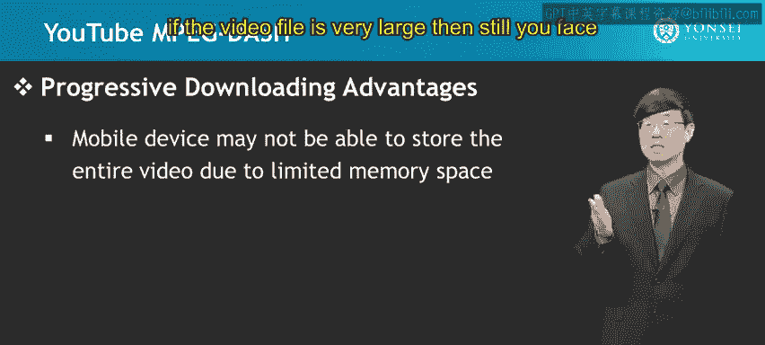
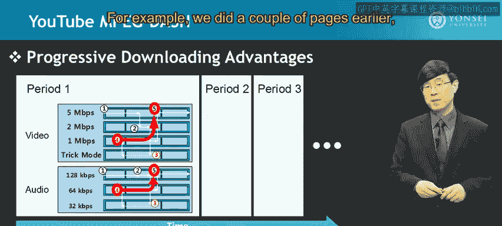

# 延世大学《新兴技术从智能手机到物联网再到大数据》课程 - P149：26_5.3 YouTube的MPEG-DASH（第1部分）📺

在本节课中，我们将要学习YouTube如何利用MPEG-DASH和自适应HTTP流媒体技术来传输视频。我们将了解视频分辨率的概念、不同类型的HTTP流媒体技术，并详细解析MPEG-DASH的工作流程。

## YouTube的MPEG-DASH示例 🎬

YouTube使用MPEG-DASH和自适应HTTP流媒体技术。在这个例子中，可以看到YouTube使用了八种视频分辨率。

以下是YouTube使用的八种视频分辨率：
*   144p
*   240p
*   360p
*   480p
*   720p
*   1080p
*   1440p
*   2160p

这里的“p”代表像素。它显示了图像的高度像素数，并以此定义分辨率。例如，144p对应一个256x144像素的图像。

与最低的144p分辨率相比，其他分辨率的像素数量更高。例如，240p的分辨率大约是144p的1.6倍，360p则大约是2.5倍。随着分辨率提高，像素数量显著增加。

## HTTP流媒体类型 📡

互联网上的视频流媒体最常用的是基于TCP的HTTP流媒体，YouTube就使用这种技术。Netflix和Hulu等其他流行服务也使用它。

以下是三种主要的HTTP视频流媒体类型：
*   **常规HTTP流媒体**：将整个视频完全下载到客户端设备。
*   **渐进式下载**：以固定质量逐步下载视频。
*   **自适应流媒体**：这是基于HTTP的自适应流媒体，它结合了自适应视频质量、自适应码率控制和渐进式下载技术。YouTube使用的MPEG-DASH就是典型技术。

## 渐进式下载的优势 💾

上一节我们介绍了流媒体类型，本节中我们来看看渐进式下载的具体优势。

对于内存空间有限的移动设备，可能无法存储整个视频文件。渐进式下载技术非常有用，因为它不需要完全下载整个视频。

以下是渐进式下载的两个主要优势：
*   **节省设备存储空间**：该技术允许设备只下载并缓冲几秒到几十秒的视频内容进行播放，已观看的部分可以被清除，因此无需保存整个文件。这对于内存有限的设备或播放超大视频文件时是极佳的解决方案。
*   **节省数据与带宽**：许多用户不会观看整个视频。分析发现，在YouTube等服务中，很多人只观看约20%的视频内容。如果下载整个视频，未观看的80%将浪费个人数据流量和互联网带宽。渐进式下载避免了这种浪费。

这些优势使得MPEG-DASH技术极具吸引力，这也是YouTube采用它的原因。

## YouTube DASH服务示例 🔄

这是一个基于YouTube MPEG-DASH视频服务的示例。请注意，视频和音频包含多种质量等级，数据速率更高的等级对应更高的分辨率。

让我们详细解析这个过程：
1.  从参考点1开始，视频和音频处于初始质量。
2.  随着网络条件变差（吞吐量下降、延迟增加、出现数据包错误），服务会降低到较低的数据速率。在此例中，视频质量从5 Mbps降至2 Mbps，而音频质量保持不变。这是因为降低视频质量能节省更多带宽。
3.  网络条件继续恶化，我们从2 Mbps降至“特技模式”。此时，音频质量也从128 Kbps降至更低的模式。
4.  在“特技模式”下，如果你用手指拖动视频进度条回退到某个已观看的位置（即执行回放操作），视频和音频需要同步跳转到该时间点，这个效果会同时体现在音视频上。
5.  从点4重新开始播放后，随着网络条件改善，音视频质量会一同提升到更高级别。

这就是YouTube和DASH控制流媒体的方式。此例中只展示了三种视频分辨率和特技模式，但实际的YouTube视频可以包含更多分辨率等级，如前所述，最多可达八级。

## MPEG-DASH技术规范 ⚙️

上一节我们通过示例了解了DASH的运作，本节中我们来看看其技术规范。MPEG-DASH规范基于ISO/IEC 23009-1标准。

MPEG-DASH标准主要定义了**媒体呈现描述（MPD）**和**媒体段格式**。MPD描述了媒体编码的交付格式，包括视频段、自适应下载和码率控制等，这些由客户端设备上的应用程序决定。

在HTTP服务器上，存储着MPD文件以及视频和音频数据段。

## DASH客户端播放流程 🖥️

DASH客户端的播放基于以下步骤，这是一个典型的“拉取”机制：
1.  **请求MPD**：DASH客户端向服务器请求MPD文件。
2.  **交付MPD**：MPD通过HTTP、电子邮件、U盘、广播或其他机制交付给客户端。
3.  **解析MPD**：客户端解析MPD文件。
4.  **读取信息**：客户端MPEG-DASH应用程序读取MPD中的信息，包括节目时间、媒体内容可用性、媒体类型、分辨率、最小和最大带宽、可用多媒体分辨率类型等。
5.  **选择并开始流媒体**：客户端选择合适的编码版本，并通过发送HTTP GET请求获取媒体段来开始流媒体播放。
6.  **缓冲与监控**：使用适当的缓冲来补偿网络吞吐量的变化。客户端持续获取后续段，并监控网络带宽波动。
7.  **自适应调整**：客户端通过获取更低或更高比特率的段来适应可用带宽，以维持充足的缓冲区。

## 系统架构概览 🏗️

在HTTP服务器端，存有媒体段、片段和MPD。在DASH客户端，包含以下组件：
*   MPD解析器
*   媒体段解析器（用于视频流数据）
*   媒体播放器单元
*   HTTP客户端（此例基于HTTP/1.1，也可以是HTTP/2.0）
*   控制启发式引擎

所有这些组件在DASH客户端内协同工作，使得在服务器的帮助下，MPEG-DASH视频可以在你的设备上播放。这正是YouTube MPEG-DASH所使用的技术。

## 总结 📝

本节课中我们一起学习了YouTube视频流媒体的核心技术MPEG-DASH。我们了解了从144p到2160p的各种视频分辨率，认识了常规HTTP流媒体、渐进式下载和自适应流媒体（如DASH）的区别，并重点剖析了渐进式下载在节省存储和带宽方面的优势。通过一个生动的示例，我们看到了DASH如何根据网络条件动态调整音视频质量。最后，我们深入探讨了MPEG-DASH的技术规范、基于客户端“拉取”机制的完整工作流程，以及服务器和客户端各自的关键组件。这些知识帮助我们理解了像YouTube这样的大型平台如何高效、自适应地向全球用户交付视频内容。