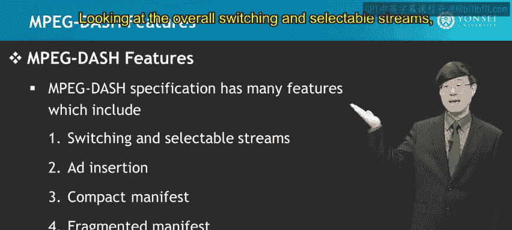
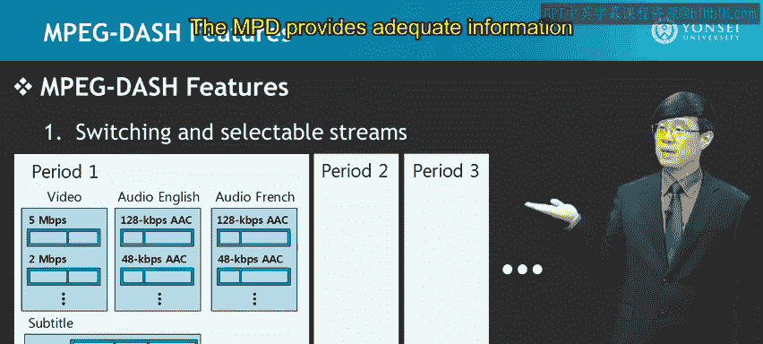
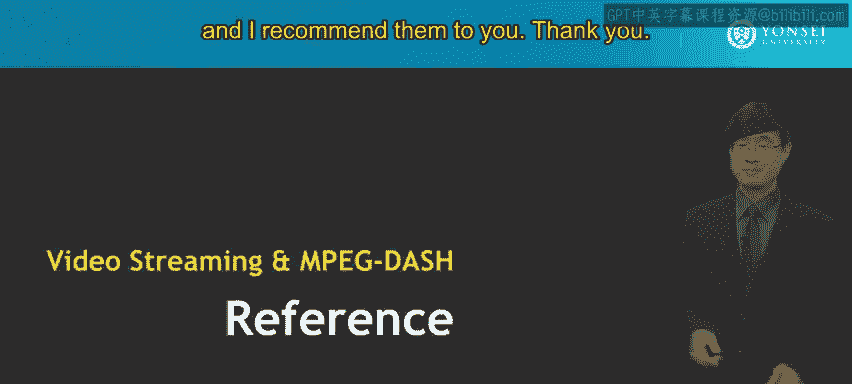

# 150：27_5.3 YouTube的MPEG-DASH（第2部分）📺

在本节课中，我们将深入学习MPEG-DASH媒体呈现描述（MPD）的详细结构与核心功能。我们将解析MPD的层级构成，并探讨其如何支持自适应流媒体中的各种高级特性，如码率切换、广告插入和多语言支持等。

---

## 解析MPD的整体结构 🏗️

上一节我们介绍了MPEG-DASH的基本概念，本节中我们来看看MPD文件的具体内容与结构。

MPD是媒体呈现描述文件。如图所示，一个MPD包含多个**Period**（时段）。每个Period都有其ID、起始时间等信息。如果我们展开其中一个Period，例如Period ID 2，可以看到它的起始时间是60秒。此外，Period内部还包含多个**Adaptation Set**（自适应集）。

那么Adaptation Set里有什么呢？让我们打开Adaptation Set 1。里面包含了多个**Representation**（表示），例如：
*   Representation 1：码率为5 Mbps
*   Representation 2：码率为2 Mbps
*   Representation 3：码率为500 Kbps
*   Representation 4：支持**特技模式**

接下来，我们深入查看Representation 2。它标明了码率为2 Mbps，并且包含了**Segment**（分片）信息。在Segment信息中，列出了分片的时长，以及初始化分片和多个媒体分片（如Media Segment 1, 2, 3, 4）。

综上所述，你现在了解了MPD内部包含什么，以及为什么MPD对于支持像YouTube这样使用MPEG-DASH的客户端至关重要。

---

## MPD的核心层级与概念 🔍

MPD采用层级结构来组织流媒体内容。

1.  **Period**：这是一个节目时间区间，包含了起始时间和持续时长信息。一个MPD可以包含多个Period。
2.  **Adaptation Set**：每个Period内包含多个Adaptation Set。一个Adaptation Set包含同一内容（如视频、音频、字幕）的不同**Representation**。
3.  **Representation**：这是同一多媒体内容的不同编码版本，通常具有不同的码率。码率基于分辨率、声道数等信息决定。Representation也可以包含用于**特技模式**的版本。对于YouTube等服务，支持特技模式是必需的。

特技模式是指用户可以快速前进、后退或跳转到视频特定位置的应用。我们之前学习过一些帧信息，如I帧、P帧和B帧。通常，**I帧**会用于特技模式。因为当你拖动进度条时，视频和音频的参考点会一起移动，此时你通常会看到一张静态图像作为起始画面。I帧包含完整的独立图像信息，因此非常适合用于表示特技模式中的预览画面。在开发此类流媒体服务时，特技模式中的小窗口可以是低分辨率的I帧。

4.  **Segment**：Representation由多个媒体分片信息组成。分片是按时间顺序从媒体流中切分出来的数据块。每个分片都有一个**URI**（统一资源标识符），这对于基于Web的应用至关重要。URI指明了多媒体内容可以从哪个服务地址位置下载。下载使用HTTP GET请求，可能包含字节范围。

5.  **Segment信息**：包含初始化分片和多个媒体分片的信息。

---

## MPEG-DASH的关键特性 ✨

MPEG-DASH规范包含许多强大特性，这些特性被用于自适应视频流技术中。

以下是其主要特性：

*   **切换与可选流**：支持在不同流之间进行选择和切换。
*   **广告插入**：这看似简单，但对于运营服务器和视频流服务的公司而言，广告插入可能是最重要的收入来源。
*   **紧凑型清单与分片清单**：提供不同的清单格式。
*   **可变时长分片**：分片的持续时间可以变化。

### 切换与可选流

如图所示，在Period 1中，你可以看到：
*   视频：5 Mbps, 2 Mbps 及更低码率
*   英语音频：128 Kbps, 48 Kbps
*   法语音频：128 Kbps, 48 Kbps
*   英语和法语字幕

MPD为客户端提供了充分的信息，使其能够在基于时段分段的单元中进行选择和切换。

具体切换选项包括：
*   从不同语言中选择一个音频流。
*   在不同摄像机角度之间选择视频流。
*   从提供的语言中选择字幕。
*   动态切换同一摄像机视频的不同码率。

正是这些多样化的切换和可选项目支持，使得MPEG-DASH如此强大和高效。

### 广告插入

广告可以作为一段独立的Period插入到其他Period之间，或者作为Segment插入到其他Segment之间。这同时支持点播和直播场景。这种灵活性对服务提供商极为有利。再次强调，插入广告可能是负责视频流或服务器的公司最重要的收入来源。

### 紧凑型清单与分片清单

紧凑型清单意味着分片地址URL可以通过模板方案来指示，从而生成紧凑的MPD。MPD也可以被分成多个部分，其中一些元素可以被外部引用，这使得MPD可以分步下载。每种方式都有其优缺点。

### 可变时长分片

如下例所示，分片的持续时间可以变化。在直播流中，下一个分片的时长信息可以随着当前分片的交付，通过事件提供给客户端。特别是在进行直播时，分片时长的这种灵活性非常有益。

---

## 高级功能与未来展望 🚀

MPEG-DASH还包含一系列高级功能，确保其适用于现在和未来的复杂应用场景。

以下是这些高级功能：

*   **多源与CDN支持**：如图所示，内容可以存放在不同的服务器或CDN上。多个基础URL可以被使用，同一内容可以在多个URL上可用，客户端可以从任何提供的URL进行流式传输。CDN选项的反复出现，正是我们将在下一模块中学习CDN的原因。
*   **直播会话的时钟漂移控制**：每个分片可以包含**UTC时间**。UTC时间使客户端能够控制其时钟漂移并重新同步，从而确保通过互联网、广域网和局域网技术进行的视频流过程完美协调。
*   **支持SVC与MVC**：**SVC**（可伸缩视频编码）和**MVC**（多视点视频编码）都很重要。MPD提供了关于这些表示之间解码依赖关系的充分信息，可用于流式传输任何SVC或MVC多层编码的流。
*   **灵活的描述符集**：描述符用于描述内容分级、组件角色、辅助功能特性、摄像机视角、帧封装、音频声道配置等。这为你提供了控制和切换显示内容的能力。
*   **自适应集分组**：可以根据内容作者的指导将自适应集分组为子集，使内容的呈现方式符合原始创作者的意图。
*   **用于报告会话体验的质量指标**：MPEG-DASH标准定义了一组质量指标。客户端使用这些指标进行测量并报告给服务器，从而使服务器能获得关于会话体验质量的反馈。这些信息可用于改进网络管理和控制方式，并据此规划、调度和部署各种其他特性。

这些特性大多以灵活和可扩展的方式提供，并非强制要求。你可以选择想要使用的选项，并决定如何使用它们。这使得MPEG-DASH能够以灵活的方式用于各种未来的应用中。这也是我如此详细讲解的原因——MPEG-DASH不仅是当今的技术，也将是未来的技术。如果你理解了我刚才解释的内容，将来你将能在自己的应用中以各种方式使用它。

---

本节课中，我们一起学习了MPEG-DASH MPD的详细结构，包括Period、Adaptation Set、Representation和Segment的层级关系。我们还深入探讨了其关键特性，如流切换、广告插入、可变分片、CDN支持、时钟同步以及面向未来的可扩展设计。理解这些核心概念，是掌握现代自适应流媒体技术的基础。