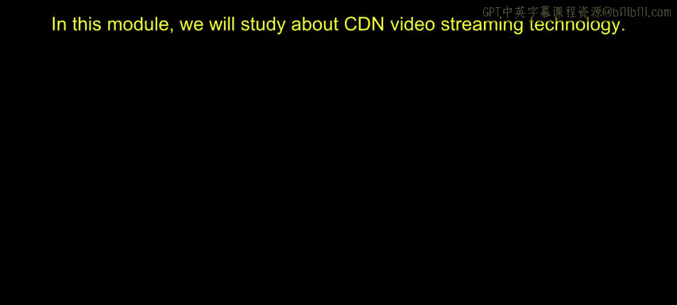

# 151：28_6.1 CDN介绍 🚀

在本节课中，我们将学习关于内容分发网络（CDN）的视频流技术。我们将从CDN的介绍开始，涵盖其动机、结构、工作流程、分层内容交付模型、市场与主要服务提供商，以及CDN中的先进技术。

## 动机：为什么需要CDN？🤔

上一节我们介绍了本课程的主题，本节中我们来看看CDN的动机。

CDN是一个由一组战略部署且地理上分散的缓存服务器构成的网络。所谓地理分散，可以指全球范围或跨大洲的连接。对于内容提供商而言，CDN是为大量用户设备提供服务的最有效解决方案之一，旨在减少内容下载时间和网络流量。

减少内容下载时间至关重要，如果下载速度过慢，用户将不会使用你的服务。此外，减少网络流量也很重要。以YouTube为例，它拥有数百万乃至数十亿用户。如果每个用户的请求都直接连接到主服务器，主服务器将无法承受。因此，CDN技术的作用是预测最需要或最受欢迎的内容，并将其放置在本地服务器中。这样，当用户请求到来时，本地服务器就能直接提供视频流服务。

因此，CDN技术对于视频流至关重要，特别是在强大的、基于互联网的跨洲连接中。所有主流的视频流服务技术都需要CDN的支持，这也是本讲内容如此重要的原因。

移动用户和智能设备访问的网络流量正在迅速增长。移动网络性能高度依赖于多媒体数据和应用程序的内容下载。此外，由于移动设备使用量的大幅增加，一些移动网络运营商曾遭遇服务中断或性能下降的问题。网络在扩容，但速度赶不上用户增长的速度。当用户数量超过网络承载能力时，服务就会降级、停止或变得极其缓慢，甚至无法使用。

如何减轻这种影响？CDN技术是关键。例如，内容提供商可能位于美国，而用户遍布全球各地。如果每个人都连接到美国去下载谷歌或YouTube的内容，那么连接这些内容的国际链路将不堪重负，许多服务都会受到严重影响。使用CDN技术可以同时减少内容下载时间和网络流量，实现双赢。

## CDN与移动网络 📱

上一节我们了解了CDN的总体动机，本节中我们聚焦于CDN在移动网络中的特殊重要性。

与自治系统内的宽带骨干网相比，移动通信网络对降低流量负载和内容交付时间有着更强烈的需求。

移动通信网络服务商需要为用户提供服务，这些用户并非固定连接在千兆以太网上的笔记本或台式机用户。他们是移动的，会移动到不同的小区，需要支持切换；他们会移动到小区边缘，那里信号质量差，需要进行切换。在这些条件下，如何提供服务？此外，还需要通过无线连接提供服务，而无线连接的带宽和吞吐量有限，且容易出错。

在这些情况下，需要以减少网络资源占用的方式，满足用户需求。在提供所有交换和漫游服务的移动通信蜂窝网络中，资源非常有限，支持这些服务非常复杂，网络也非常敏感。因此，CDN技术的支持更为关键。

国际和跨洲骨干网对CDN支持也有迫切需求。它们希望跨洲链路的流量最小化，因为这些链路成本高昂，并且需要优先满足具有关键高优先级服务需求的用户。因此，CDN使一切变得更加高效。

你会看到BGP4（边界网关协议4）被用于自治系统网络之间，该协议在流量使用成本计费上可能有不同的策略。因此，使用CDN将特定内容传送到某个区域，供该区域内所有请求该内容的用户重复使用，可以节省单次传输，实现多次复用，从而节省长途骨干连接上的网络流量。

## CDN的结构 🏗️

上一节我们讨论了CDN的应用场景，本节中我们来剖析CDN的结构。

CDN通常由内容提供商和缓存服务器组成。

内容提供商拥有所有要服务的内容。以YouTube为例，同一部电影可能有不同质量的多个视频版本，音频也可能有高质量和低质量之分。因此，内容提供商需要拥有所有这些内容。

缓存服务器分布在网络中，存储着内容提供商所存内容的选定副本。内容提供商和缓存服务器（更靠近用户）共同工作。

当用户向其最近的缓存服务器请求内容时，如果请求的内容在其缓存中，服务器可以直接交付。否则，缓存服务器会将用户的请求重定向到远程的内容提供商。

以下是缓存命中和未命中两种情况下的工作流程：

**情况一：缓存命中（快速交付）**
1.  用户发送会话请求。
2.  本地缓存服务器检查其缓存中是否有该内容。
3.  服务器发送会话响应，确认拥有该内容。
4.  用户设备进行资源分配（如内存分配），为存储视频数据包创建空间。
5.  用户发送内容请求。
6.  服务器进行内容交付，数据包被保存在用户分配的资源区域。

**情况二：缓存未命中**
1.  用户发送会话请求。
2.  本地缓存服务器检查其缓存，发现没有该内容。
3.  服务器为从内容提供商处下载该内容进行资源分配。
4.  服务器向内容提供商发送内容请求。
5.  内容提供商交付内容，内容被保存在缓存服务器的资源分配区。
6.  缓存服务器向用户发送会话响应。
7.  用户设备进行资源分配。
8.  用户向本地缓存服务器发送内容请求。
9.  本地缓存服务器进行内容交付，数据包被保存在用户分配的资源区域。

## 内容老化与更新策略 🔄

上一节我们介绍了CDN的基本工作流程，本节中我们来看看一个重要的管理策略：内容老化。

内容老化策略的重点是以最有效的方式向用户交付最受欢迎的内容。换句话说，我们希望发送那些会被反复请求、在本地被重复使用的内容。因此，内容老化是指丢弃旧内容，为新近更受欢迎的内容腾出空间。

其决策取决于多个因素，包括缓存服务器的位置、数量以及有限的缓存服务器内存大小。如果内存容量小，则需要更频繁地丢弃旧内容。

以下是内容老化与更新的基本操作：
*   **内容老化**：从缓存服务器中删除过期的内容。
*   **内容更新**：从内容提供商处下载更新的内容。

需要在这两者之间取得良好的平衡：丢弃旧内容，并下载更受欢迎的新内容。

每种内容都有一个内容更新周期，这是一种基于生存时间的操作。例如：
*   在线交易信息：几秒钟。
*   拍卖信息：几秒钟。
*   电影：24小时或更长。

## 总结 📝

本节课中，我们一起学习了内容分发网络（CDN）的基础知识。我们首先探讨了CDN的动机，理解了它在减少内容下载时间和网络流量、特别是在支持海量用户和移动网络方面的重要性。接着，我们剖析了CDN的基本结构，包括内容提供商和分布式缓存服务器的角色，并通过流程图详细说明了缓存命中与未命中时的工作流程。最后，我们介绍了内容老化与更新策略，这是CDN高效运行的关键管理机制，它确保最受欢迎的内容能够被快速访问。CDN是现代互联网内容高效分发的核心技术。