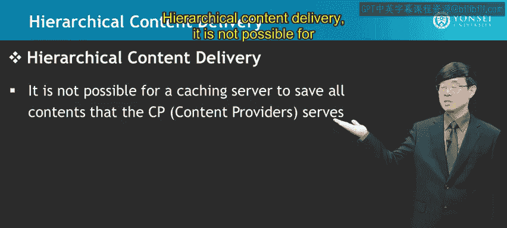
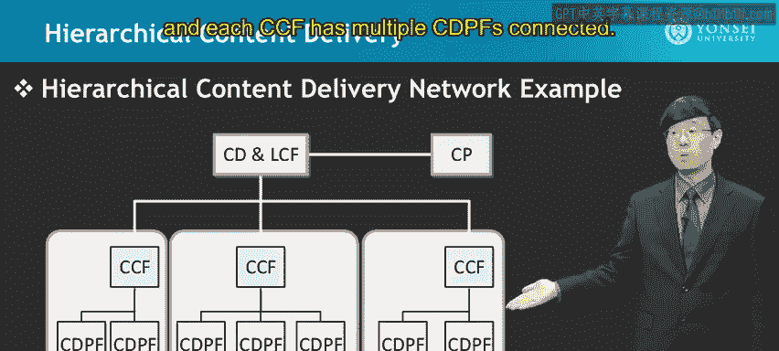
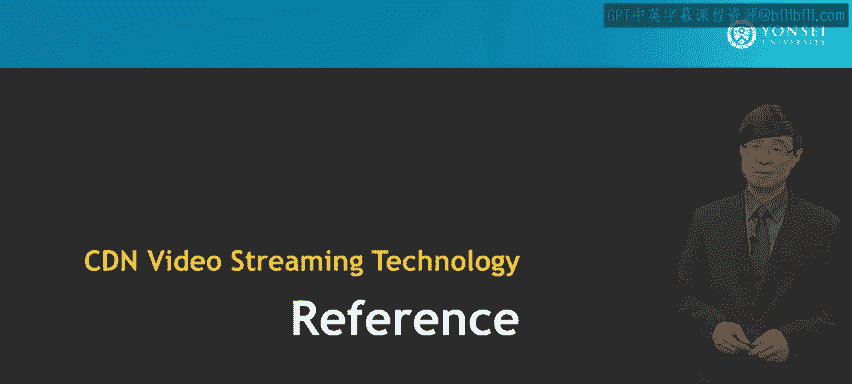

# 延世大学《新兴技术：从智能手机到物联网再到大数据》课程 - P152：29_6.2 CDN分层内容分发 🚀

在本节课中，我们将要学习内容分发网络中的分层内容分发机制。我们将探讨为什么需要分层结构，其核心功能模块如何工作，以及内容在不同场景下的具体分发流程。

## 概述

缓存服务器不可能保存内容提供商提供的所有内容。

从远程内容提供商处检索内容可能导致较长的内容下载时间。因为内容提供商连接着大量用户，同时进行下载。此外，内容提供商很可能距离遥远，缓存服务器与内容提供商之间存在很长的网络路径。因此，当请求内容时，请求需要经过很长的路径，返回的视频数据包也需要经过很长的路径。链路越长，发生错误的频率可能越高，这些错误需要通过TCP过程来恢复。

典型的情况是，每个服务器为支持内容数据包的路由会产生大量流量。

对于每个服务器给定的缓存容量，最大化命中率至关重要。本地缓存服务器的高命中率意味着请求的内容无需从内容提供商处获取。这意味着你需要将最受欢迎、最常被请求的内容，即具有高命中率的内容，预存到最可能被请求区域的本地缓存服务器中。

因此，某些内容在特定区域可能更受欢迎，而其他内容在其他区域更受欢迎。这与命中率密切相关。所以，并非所有本地部署的缓存服务器都会保存相同的信息。它们将根据本地服务器用户请求的服务类型，接收所有不同的请求。

分层CDN以可扩展的方式在互联网中实现了这一目标。这意味着即使用户数量增加，它仍能保持良好的性能。分层协作内容分发技术用于向本地缓存服务器提供内容分发。

接下来，我们将更深入地研究它。以下是分层内容分发中使用的主要功能模块。

## 核心功能模块

我们将从CDN LCCF开始。它控制整个内容分发过程，并拥有CDN的所有内容ID。

*   **CDN LCCF**： 控制整个内容分发过程，并拥有CDN的所有内容ID。
*   **CCF**： 集群控制功能，控制多个CDPF，并保存集群的内容ID。
*   **CDPF**： 内容分发处理功能，存储内容并将其分发给用户。

因此，我们有CDN LCCF、CCF、CDPF和用户。它们以类似下图的结构连接。

在这些集群的底部，可以认为有多个用户，但图中未画出。可以看到C（用户）连接到CDN LCCF，CDN LCCF连接到每个集群的CCF。每个集群有一个CCF。CCF连接到集群内的CDPF，每个CCF连接多个CDPF。

上一节我们介绍了分层CDN的架构和核心模块，本节中我们来看看内容分发的三种具体流程。

## 内容分发流程

### 情况一：请求内容在本地集群

请求的内容位于本地集群内。内容请求消息被发送到CCF。CCF向CDPF发送会话请求消息，以将内容分发给用户，然后CDPF将内容发送给用户。非常简单。

这是最简单的情况，工作流程如下：
1.  用户发起会话请求。
2.  本地集群的CCF接收此请求。
3.  CCF检查请求的内容是否在本地集群内。
4.  进行会话建立，将目标CDPF连接起来。
5.  会话响应发送回用户。
6.  用户现在通过资源分配（内存分配）来准备下载，为视频流数据包腾出存储空间。
7.  发起内容请求（第6步从用户到CCF，第7步在本地集群内从CCF到目标CDPF）。
8.  CDPF将内容发送给用户。

### 情况二：请求内容不在本地集群，但在另一个目标集群

请求的内容不在本地集群，但另一个本地集群（目标集群）拥有该内容。流程是什么？

流程是：内容请求消息从本地集群重定向到CDN LCCF。这个阶段需要使用CDN LCCF，然后CDN LCCF检查请求的内容是否在其他集群。接着，请求的内容可以直接从目标集群发送给用户，或者可以通过本地集群中转，再由本地集群发送给用户。本地集群也可以存储请求的内容并发送给用户。

流程如下，更为复杂，这是因为本地集群没有该内容。
1.  用户向其本地CCF发起会话请求。
2.  CCF检查本地集群内部的内容可用性（在其多个CDPF中检查）。
3.  如果没有找到，则向CDN LCCF发送重定向请求消息。
4.  CDN LCCF拥有其他本地集群的信息，因此开始在其他集群中查找和搜索。
5.  CDN LCCF将分配拥有该内容的集群。
6.  CDN LCCF发送响应告知CCF连接到何处。
7.  CCF通过向目标集群的CCF发送会话请求来建立连接。
8.  在目标集群内进行会话建立，将CCF与该目标集群内适当的CDPF连接起来。
9.  目标集群的CCF发回会话响应，该响应返回到本地集群的CCF。
10. 本地集群的CCF将会话响应发回给用户。
11. 用户随后准备资源分配部分以下载和保存接收到的数据包。
12. 用户直接向目标集群的CCF发送内容请求。
13. 内容请求直接发送到目标集群内的CDPF。
14. 在本示例中，CDPF直接将内容发送给用户。

### 情况三：请求内容不在CDN内

当请求的内容不在CDN内时。内容请求消息从CDN LCCF发送到内容提供商。在这种情况下，需要联系内容提供商，因为该内容不在任何缓存范围内。内容提供商通过本地集群将内容发送给用户。请求的内容可以存储在本地集群中。

机制简述如下：
1.  用户连接到本地集群。
2.  本地集群连接到CDN LCCF。
3.  由于在此范围内未发现该内容，CDN LCCF将向内容提供商发出请求。
4.  内容提供商将信息发送回CDN LCCF。
5.  CDN LCCF将联系本地集群。
6.  经过这些过程交换后，内容提供商将把信息发送到本地集群的CDPF。
7.  信息再发送到本地集群的CCF。
8.  CCF联系用户。
9.  用户分配内存以接收未来的数据包（资源分配机制，参见第15步）。
10. 用户向本地CDPF发起内容请求。
11. 内容在第17步发送给用户。

## 总结

本节课中我们一起学习了CDN分层内容分发。我们了解到单一的缓存服务器无法存储所有内容，因此需要通过分层和协作的方式来提高内容分发的效率和命中率。核心系统由CDN LCCF、CCF和CDPF等功能模块构成，它们协同工作以管理内容。我们详细分析了三种典型的内容请求场景：内容在本地集群、内容在远程集群以及内容需要从原始提供商获取。每种场景都对应着不同的信令交互和内容传输路径，其核心目标都是尽可能快速、高效地将内容送达用户，同时减轻源站压力和网络拥塞。

这些是我使用的参考文献，我推荐给你，谢谢。

