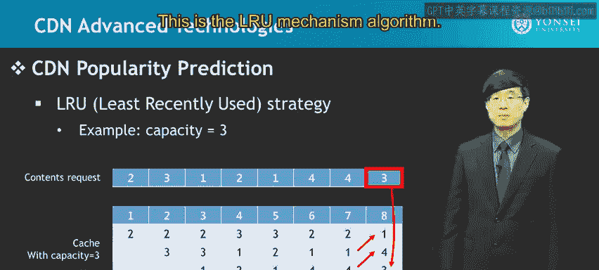

# 延世大学《新兴技术从智能手机到物联网再到大数据》课程 - P154：31_6.4 CDN先进技术（第1部分）📡


在本节课中，我们将学习内容分发网络的一些先进技术。我们将重点关注研发领域中的几个关键主题，包括内容管理、系统优化以及缓存与路由策略。课程将介绍如何基于内容类型进行差异化支持，并探讨用于预测内容流行度和管理缓存的数学模型与算法。

---

## 内容层面的先进技术 🔍

上一节我们了解了CDN的基本概念，本节中我们来看看在内容管理方面有哪些先进技术。这些技术旨在更智能地处理和分发不同类型的内容。

以下是研发中涉及的一些关键内容技术方向：

*   **基于内容类型的差异化支持**：根据数据、多媒体、移动应用等内容类型的不同特性，提供定制化的分发策略。
*   **内容老化控制**：监控内容的“年龄”和流行度，自动淘汰不再受欢迎或过时的内容，将其从CDN中移除。
*   **内容选择与删除**：基于内容类型和访问模式预测，智能决定哪些内容应被缓存或删除。
*   **内容复制检测**：识别并管理CDN网络中的重复内容，以优化存储效率。
*   **动态页面发布**：支持包含动态生成内容的网页的高效分发。
*   **数字版权管理**：在分发过程中保护内容的知识产权。
*   **直播事件管理**：优化大型实时活动（如体育赛事、音乐会直播）的内容分发。

---

## 系统层面的先进技术 ⚙️

了解了内容管理技术后，我们转向支撑CDN运行的系统层面。这些技术关注如何衡量和优化CDN的整体性能与市场价值。

以下是系统层面研发的关键方向：

*   **代理服务器动态部署**：根据实时需求，动态调整缓存服务器的地理位置。
*   **存储与内存大小的动态管理**：根据流量模式，弹性分配存储资源。
*   **内容交付方法优化**：改进将内容从源站或缓存服务器传送到用户的机制。
*   **移动设备特性与位置感知**：针对移动设备的网络条件和地理位置，优化内容交付。
*   **网络延迟控制**：最小化用户请求的响应时间。
*   **安全与信息保障**：基于异常检测、用户身份验证和内容认证等技术，确保分发过程的安全。

---

## 协作缓存与内容路由策略 🤝

系统优化离不开高效的缓存与路由机制。本节我们探讨几种使CDN服务器能够协作，以更高效地定位和提供内容的策略。

以下是几种常见的协作缓存与内容路由方案：

*   **基于查询的方案**：当某个CDN服务器没有请求的内容时，它会向同一集群内的其他服务器广播查询请求。
*   **基于摘要的方案**：每个CDN服务器维护一个内容摘要，其中包含同一集群内其他服务器所缓存内容的信息。
*   **基于目录的方案**：由一个目录服务器集中维护集群内所有CDN服务器的内容信息。
*   **基于哈希的方案**：所有CDN服务器使用相同的哈希函数。内容的分配基于其URL、服务器的唯一ID和哈希函数来计算。
*   **混合哈希方案**：CDN服务器将其部分存储空间用于缓存最流行的内容，其余部分则通过哈希函数与其他服务器共享使用。

---

## 内容流行度预测与缓存算法 📊

要实现智能缓存，必须能够预测内容的流行度。本节介绍用于建模内容流行度的经典分布，以及一个广泛使用的缓存替换算法。

### 齐夫分布

CDN内容流行度预测通常基于**齐夫分布**。该分布通过现实世界内容访问的统计模型验证，能很好地描述内容流行度的偏态分布。

第 `i` 热门内容的流行度 `P_i` 可以用以下公式描述：

**`P_i = ω / i^α`**

其中：
*   `i` 是内容的排名（1为最热门）。
*   `ω` 是一个归一化常数，确保所有流行度之和为1。`ω = 1 / (∑_{k=1}^n (1/k^α))`，`n` 是内容总数。
*   `α` 是齐夫参数，它决定了内容流行度的偏斜程度。`α` 值越大，流行度越集中在头部内容。

这个公式用于预测应该保存哪些内容以及可以删除哪些内容。例如，当 `α=1`，`n=10` 时，排名第一的内容流行度最高，随后内容的流行度急剧下降。

### LRU缓存算法

在众多基于流行度预测的模型中，一个最常用的算法是 **LRU**。

**LRU** 代表“最近最少使用”。该策略基于一个观察：最近被请求过的内容在不久的将来更有可能再次被请求。

其工作原理是：持续监控在特定时间窗口内（例如，当前时刻 `T` 对比 `T-1`）的内容请求。当缓存空间已满且需要存入新内容时，算法会**替换掉最近最少被使用的内容**，即为最近被使用的内容赋予更高的缓存优先级。

以下是一个LRU算法的工作示例，假设缓存容量为3：

```
请求序列：2, 3, 1, 2, 1, 4, 4, 3

步骤  请求  缓存状态（左为最近最少使用，右为最近最多使用）  操作
1     2     [空， 空， 空] -> [空， 空， 2]                插入2
2     3     [空， 空， 2] -> [空， 2， 3]                 插入3，2左移
3     1     [空， 2， 3] -> [2， 3， 1]                  插入1，2和3左移
4     2     [2， 3， 1] -> [3， 1， 2]                   命中2，将其移至最右，其他左移
5     1     [3， 1， 2] -> [3， 2， 1]                   命中1，将其移至最右，其他左移
6     4     [3， 2， 1] -> [2， 1， 4]                   插入4，淘汰最左的3，其他左移
7     4     [2， 1， 4] -> [2， 1， 4]                   命中4，状态不变（已在最右）
8     3     [2， 1， 4] -> [1， 4， 3]                   插入3，淘汰最左的2，其他左移
```

通过这个例子可以看到，LRU算法通过动态调整缓存中内容的位置，确保最可能被再次访问的内容保留在缓存中。

---



本节课中，我们一起学习了CDN的先进技术。我们从**内容管理**和**系统优化**两个层面了解了研发方向，探讨了**协作缓存与路由**的几种策略，并深入学习了用于内容流行度预测的**齐夫分布**模型以及实际管理中常用的**LRU缓存替换算法**。这些技术共同作用，使得现代CDN能够更智能、更高效地分发海量网络内容。